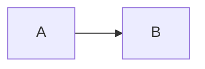

# Writing content

Everything in the app comes from the Markdown files in this folder. Edit them, then rebuild:

```bash
pip install -r scripts/requirements.txt
python3 scripts/build_content.py      # writes data/curriculum.js, mcq.js, scen.js, lab.js
```

The build stops with a list of problems if a question doesn't have exactly one correct answer.
Bump `VERSION` in `sw.js` after changing content so installed copies update.

## Learn modules: `learn/NN-name.md`

```markdown
---
id: docker
title: Docker & containers
level: Beginner            # Beginner | Intermediate | Advanced
icon: 🐳
topic: Docker              # links the module to Quiz topic filters
summary: One line shown on the cover card.
---

## Lesson title

### Card title
Short text, one idea per card. **Bold** the key terms.

> 🔧 **In Memos:** a note tying the idea to the project.



```hcl file=infra/main.tf        ← adds a file header that links to memos-aws-infra
resource "aws_vpc" "main" { … }
```

### Check
? Question text?
- [ ] wrong answer
- [x] right answer
- [ ] wrong answer
> Explanation shown after answering.
```

Every `### Check` card also goes into the Quiz automatically.

## Quiz bank: `quiz/topic.md`

```markdown
---
topic: Linux
source: tech-vault         # default for the file
level: Beginner            # default for the file
---

@ level: Intermediate · source: My guide     ← optional, applies to the next question only
? Question (can include ```code``` or ```mermaid``` below this line)
- [ ] option
- [x] correct option
> explanation
```

## Scenarios: `scenarios/*.md`

```markdown
## Title
@ topic: Security · level: Mid · files: bootstrap/oidc.tf, infra/main.tf
The situation, in a few lines.
? What do you do?
- [ ] option
  > why this is wrong          ← indented feedback appears under that option
- [x] option
  > why this is right
> **Takeaway:** the lesson.
```

## Build Lab: `lab.md`

```markdown
# Stage title
@ icon: 🐳 · time: 30 min
Intro text and an architecture diagram.

## Step title
What and why.
$ docker build -t memos:dev .          ← an interactive practice-terminal command
```output
what the terminal prints
```
? Optional checkpoint question
- [ ] …
- [x] …
```
