# Set up your tools
@ icon: 🧰 · time: 30 min
Every DevOps project starts the same way: the right tools on your machine and a **safe** AWS account. In this lab you'll rebuild the Memos platform from nothing, the same way the real repo was built.

> 🔧 **How the lab works:** each step explains **what** and **why**, then gives you a command to type into the practice terminal. You can tap **Run it for me** on your phone. To do it for real, copy the commands into your own terminal.

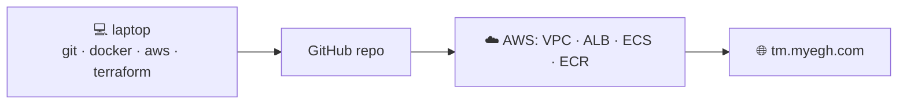

## Install Git and check it
Git tracks every change to your code. On macOS run `brew install git`; on Ubuntu `sudo apt install -y git`.
$ git --version
```output
git version 2.47.1
```
Tell Git who you are, once per machine:
$ git config --global user.name "Enamul Rahman"
```output
(no output means it worked)
```

## Install Docker
Docker builds and runs containers. Install **Docker Desktop** (Mac/Windows) or Docker Engine (Linux), then check:
$ docker run --rm hello-world
```output
Unable to find image 'hello-world:latest' locally
latest: Pulling from library/hello-world
Status: Downloaded newer image for hello-world:latest

Hello from Docker!
This message shows that your installation appears to be working correctly.
```
? What did `docker run --rm hello-world` just do?
- [ ] Built an image from a Dockerfile
- [x] Pulled an image from Docker Hub, ran it as a container, then removed the container (`--rm`)
- [ ] Installed Docker
- [ ] Pushed an image to ECR
> `run` = pull if missing → create → start. `--rm` cleans up the container when it exits.

## Install the AWS CLI and Terraform
The **AWS CLI** talks to AWS's APIs from your terminal. **Terraform** turns `.tf` files into real infrastructure. On macOS: `brew install awscli hashicorp/tap/terraform`.
$ aws --version
```output
aws-cli/2.22.4 Python/3.12.6 Darwin/24.1.0 source/arm64
```
$ terraform -version
```output
Terraform v1.13.5
on darwin_arm64
```
> ⚠️ Match the pipeline's version (Memos pins **1.13.5**), so local and CI behave the same.

## Secure the AWS account
In the AWS console, as root, do these **once**:
1. Turn on **MFA** for the root user.
2. **Billing → Budgets →** create a monthly budget (e.g. $20) with email alerts.
3. Enable **IAM Identity Center** and create an admin user for yourself.
4. Sign out of root and never use it day to day.

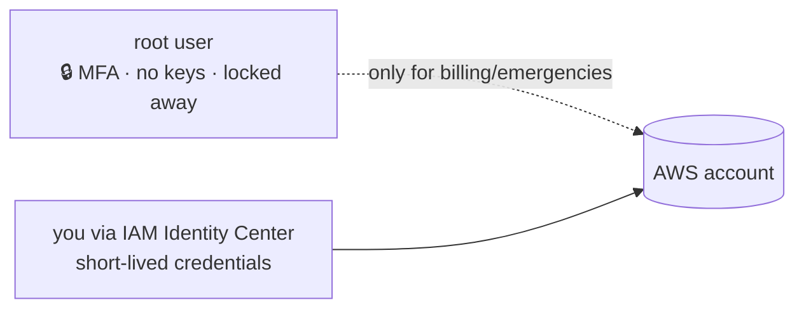
? Why create a separate admin identity instead of using the root user?
- [ ] Root can't use the CLI
- [x] Root has unlimited, unrestrictable power, so if it's compromised you lose the account; day-to-day work should use a separate, revocable identity
- [ ] Identity Center is required for Terraform
- [ ] It's cheaper
> Least privilege starts with you. Keep root locked away behind MFA.

## Log in from the terminal
Use **SSO** so your laptop gets short-lived credentials, not access keys stored in a file.
$ aws configure sso
```output
SSO session name: memos
SSO start URL: https://d-1234567890.awsapps.com/start
SSO region: eu-west-1
Attempting to automatically open the SSO authorization page in your default browser.
Successfully logged into Start URL: https://d-1234567890.awsapps.com/start
CLI default client Region [None]: eu-west-1
Profile name: memos
```
Then check who you are:
$ aws sts get-caller-identity --profile memos
```output
{
    "UserId": "AROA3XFRBF23EXAMPLE:enamul",
    "Account": "123456789012",
    "Arn": "arn:aws:sts::123456789012:assumed-role/AWSReservedSSO_AdministratorAccess_ab12/enamul"
}
```
> 🔧 Run `export AWS_PROFILE=memos` so every later command uses this login.

# Create the repo and get the app
@ icon: 📁 · time: 15 min
The infrastructure lives in its own repository, **memos-aws-infra**, with the Memos source code in an `app/` folder.

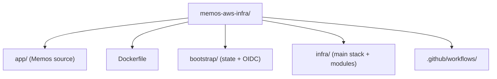

## Create the repository
$ mkdir memos-aws-infra && cd memos-aws-infra && git init
```output
Initialized empty Git repository in /Users/enamul/memos-aws-infra/.git/
```

## Bring in the Memos source
Copy the open-source app into `app/`. A shallow clone is enough, and you remove its `.git` so it becomes plain files in your repo.
$ git clone --depth 1 https://github.com/usememos/memos.git app && rm -rf app/.git
```output
Cloning into 'app'...
remote: Enumerating objects: 1520, done.
Receiving objects: 100% (1520/1520), 3.21 MiB | 9.80 MiB/s, done.
```

## Write a .gitignore (carefully)
Keep build output, secrets and Terraform's local files out of Git.
```gitignore file=.gitignore
.terraform/
*.tfstate
*.tfstate.*
*.tfplan
.env
/memos
```
> 🔧 **The real bug:** an earlier version said `memos` (no slash). That also matched `app/cmd/memos/`, so `main.go` was never committed and CI failed. **`/memos`** only matches at the repo root.

? Why does `/memos` in .gitignore behave differently from `memos`?
- [ ] It doesn't: they're identical
- [x] A leading `/` anchors the pattern to the repo root, so it only ignores a top-level `memos`, not every file or folder named memos
- [ ] `/memos` ignores folders only
- [ ] `/memos` is invalid syntax
> Unanchored patterns match at **any depth**. That's how `cmd/memos/` disappeared.

## First commit and push
Create an empty repo on GitHub called **memos-aws-infra**, then:
$ git add . && git commit -m "Add Memos source" && git push -u origin main
```output
[main (root-commit) 1a2b3c4] Add Memos source
 1203 files changed, 98211 insertions(+)
To github.com:EnamulRahman/memos-aws-infra.git
 * [new branch]      main -> main
```

# Containerise Memos
@ icon: 🐳 · time: 40 min
You'll package Memos into a small, secure image with a **three-stage** Dockerfile, then run it locally.

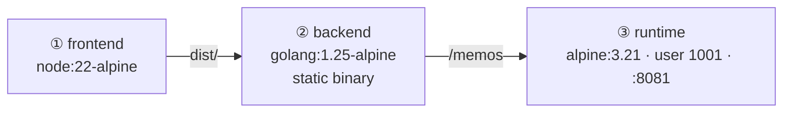

## Stage 1: build the frontend
The React frontend compiles into static files. Copy the **lock files first** so dependency installs are cached between builds.
```dockerfile file=Dockerfile
FROM node:22-alpine AS frontend
WORKDIR /build/web
RUN npm install --global pnpm@10.24.0
COPY app/web/package.json app/web/pnpm-lock.yaml ./
RUN pnpm install --frozen-lockfile
COPY app/web/ ./
RUN pnpm release
```
? Why copy `package.json` and the lock file **before** the rest of the frontend source?
- [ ] npm requires it
- [x] So the slow `pnpm install` layer is cached and only re-runs when dependencies change, not on every code edit
- [ ] To make the image smaller
- [ ] So the files are owned by root
> Order layers from least- to most-frequently changing.

## Stage 2: compile the Go backend
`CGO_ENABLED=0` makes a **static** binary with no C libraries needed. `-ldflags="-s -w"` strips debug info.
```dockerfile file=Dockerfile
FROM golang:1.25-alpine AS backend
WORKDIR /build
RUN apk add --no-cache git ca-certificates
COPY app/go.mod app/go.sum ./
RUN go mod download
COPY app/ ./
COPY --from=frontend /build/server/router/frontend/dist ./server/router/frontend/dist
RUN CGO_ENABLED=0 go build -trimpath -ldflags="-s -w" -tags netgo,osusergo -o /memos ./cmd/memos
```
> 🔧 **Story 3:** the image was `golang:1.23`, but `go.mod` needed newer Go. It's now **1.25**, matching the code. Always match toolchain versions.

## Stage 3: a tiny, non-root runtime
Only the binary, CA certificates and time-zone data. A dedicated user, **1001**, owns the data folder.
```dockerfile file=Dockerfile
FROM alpine:3.21 AS runtime
RUN apk add --no-cache ca-certificates tzdata && \
    addgroup -S -g 1001 appuser && \
    adduser -S -D -u 1001 -G appuser appuser && \
    mkdir -p /var/opt/memos && chown appuser:appuser /var/opt/memos
COPY --from=backend /memos /usr/local/bin/memos
WORKDIR /var/opt/memos
ENV MEMOS_PORT=8081 MEMOS_DATA=/var/opt/memos
USER 1001:1001
EXPOSE 8081
ENTRYPOINT ["memos"]
```

## Build the image
`--platform linux/amd64` matches Fargate's default CPU architecture, even if you're on an ARM Mac.
$ docker build --platform linux/amd64 -t memos:dev .
```output
[+] Building 212.4s (24/24) FINISHED
 => [frontend 5/6] RUN pnpm install --frozen-lockfile           58.1s
 => [backend 7/7] RUN CGO_ENABLED=0 go build -trimpath ...      96.3s
 => [runtime 3/3] COPY --from=backend /memos /usr/local/bin/memos 0.1s
 => naming to docker.io/library/memos:dev
```
$ docker images memos
```output
REPOSITORY   TAG       IMAGE ID       CREATED          SIZE
memos        dev       4f1c9a2b7e3d   10 seconds ago   75.8MB
```
> 🔧 A single-stage build of the same code was **2.79 GB**. That's about 97% smaller.

## Run it and test it
Publish container port 8081 on your laptop and give it a volume so the data survives restarts.
$ docker run -d --name memos -p 8081:8081 -v memos-data:/var/opt/memos memos:dev
```output
9b3e0c1d77f2a8c4e1f6a3b5d9e8c7f0a1b2c3d4e5f6a7b8c9d0e1f2a3b4c5d6
```
$ curl -i http://localhost:8081/healthz
```output
HTTP/1.1 200 OK
Content-Type: text/plain; charset=UTF-8

Service ready.
```
Open **http://localhost:8081** in a browser and you'll see Memos running locally.
? Which user is the Memos process running as inside the container?
- [ ] root
- [x] UID 1001 (appuser)
- [ ] nobody
- [ ] the same user as your laptop
> `USER 1001:1001` in the Dockerfile. If the app were compromised, the attacker wouldn't be root.

## Commit the Dockerfile
$ git add Dockerfile .dockerignore && git commit -m "Add multi-stage Dockerfile" && git push
```output
[main 5d6e7f8] Add multi-stage Dockerfile
 2 files changed, 41 insertions(+)
```

# Bootstrap: state bucket and OIDC
@ icon: 🪣 · time: 30 min
Before the main infrastructure, you need two **long-lived** things: a place to store Terraform state, and a keyless identity for GitHub Actions. They live in their own `bootstrap/` stack.

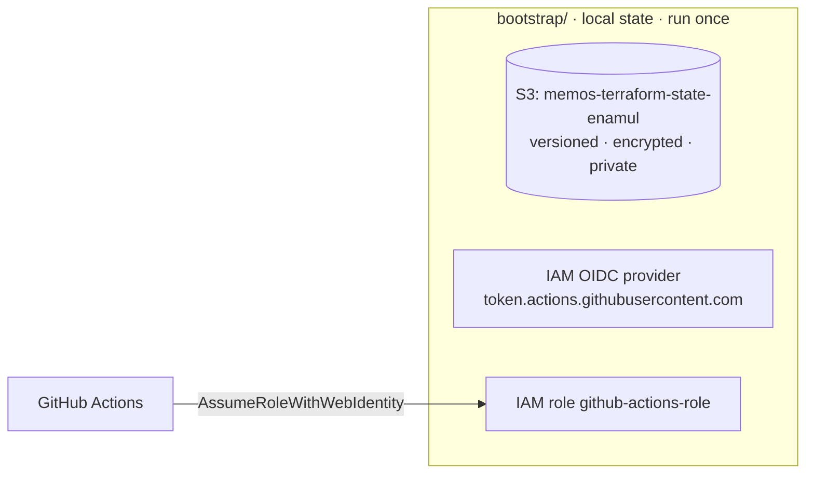

## Provider configuration
```hcl file=bootstrap/provider.tf
terraform {
  required_version = ">= 1.10.0, < 2.0.0"
  required_providers {
    aws = { source = "hashicorp/aws", version = "~> 5.0" }
  }
}

provider "aws" {
  region = "eu-west-1"
  default_tags {
    tags = { Project = "Memos", ManagedBy = "Terraform" }
  }
}
```
> `default_tags` stamps every resource, which makes cost reports and clean-up easy.

## The state bucket
```hcl file=bootstrap/state.tf
resource "aws_s3_bucket" "state" {
  bucket = "memos-terraform-state-enamul"   # globally unique: use your own
  lifecycle { prevent_destroy = true }
}
resource "aws_s3_bucket_versioning" "state" {
  bucket = aws_s3_bucket.state.id
  versioning_configuration { status = "Enabled" }
}
resource "aws_s3_bucket_server_side_encryption_configuration" "state" {
  bucket = aws_s3_bucket.state.id
  rule {
    apply_server_side_encryption_by_default {
      sse_algorithm = "AES256"
    }
  }
}
resource "aws_s3_bucket_public_access_block" "state" {
  bucket                  = aws_s3_bucket.state.id
  block_public_acls       = true
  block_public_policy     = true
  ignore_public_acls      = true
  restrict_public_buckets = true
}
```
Plus a bucket policy that **denies any request not using HTTPS** (`aws:SecureTransport = false`).
? What does `prevent_destroy = true` protect against?
- [ ] Someone deleting objects in the bucket
- [x] Terraform destroying the bucket, even when running `terraform destroy`
- [ ] Public access to the bucket
- [ ] Encryption being turned off
> It's a Terraform safety catch. Versioning protects the **objects** inside.

## The OIDC provider and role
GitHub signs a token for each workflow run. AWS trusts that token **only** for your repo.
```hcl file=bootstrap/oidc.tf
resource "aws_iam_openid_connect_provider" "github" {
  url            = "https://token.actions.githubusercontent.com"
  client_id_list = ["sts.amazonaws.com"]
  thumbprint_list = ["ffffffffffffffffffffffffffffffffffffffff"]
}

resource "aws_iam_role" "github_actions" {
  name = "github-actions-role"
  assume_role_policy = jsonencode({
    Version = "2012-10-17"
    Statement = [{
      Effect    = "Allow"
      Principal = { Federated = aws_iam_openid_connect_provider.github.arn }
      Action    = "sts:AssumeRoleWithWebIdentity"
      Condition = {
        StringEquals = { "token.actions.githubusercontent.com:aud" = "sts.amazonaws.com" }
        StringLike   = { "token.actions.githubusercontent.com:sub" = "repo:EnamulRahman/memos-aws-infra:*" }
      }
    }]
  })
}
```
> ⚠️ The real repo attaches **AdministratorAccess** to this role, which is simple but too broad. In stage 15 you'll tighten it.

## Apply the bootstrap
$ cd bootstrap && terraform init
```output
Initializing provider plugins...
- Installing hashicorp/aws v5.82.2...
Terraform has been successfully initialized!
```
$ terraform apply
```output
Plan: 8 to add, 0 to change, 0 to destroy.

Do you want to perform these actions?
  Enter a value: yes

aws_s3_bucket.state: Creation complete after 2s [id=memos-terraform-state-enamul]
aws_iam_openid_connect_provider.github: Creation complete after 1s
aws_iam_role.github_actions: Creation complete after 1s [id=github-actions-role]

Apply complete! Resources: 8 added, 0 changed, 0 destroyed.
```

## Give GitHub the role ARN
In GitHub: **Settings → Secrets and variables → Actions → New secret** named `AWS_ROLE_ARN`, with the role's ARN as the value.
$ aws iam get-role --role-name github-actions-role --query Role.Arn --output text
```output
arn:aws:iam::123456789012:role/github-actions-role
```
? Is the role ARN a sensitive credential?
- [ ] Yes, it's as dangerous as an access key
- [x] Not really: it's an identifier; only workflows matching the trust policy can assume it. It's stored as a secret mainly for tidiness
- [ ] Yes, anyone with it can log in to AWS
- [ ] It expires after an hour
> The protection is the **trust policy** (`aud` + `sub`), not the secrecy of the ARN.

# Terraform skeleton for the main stack
@ icon: 🏗️ · time: 20 min
Now the main stack in `infra/`. Its state lives in the bucket you just created.

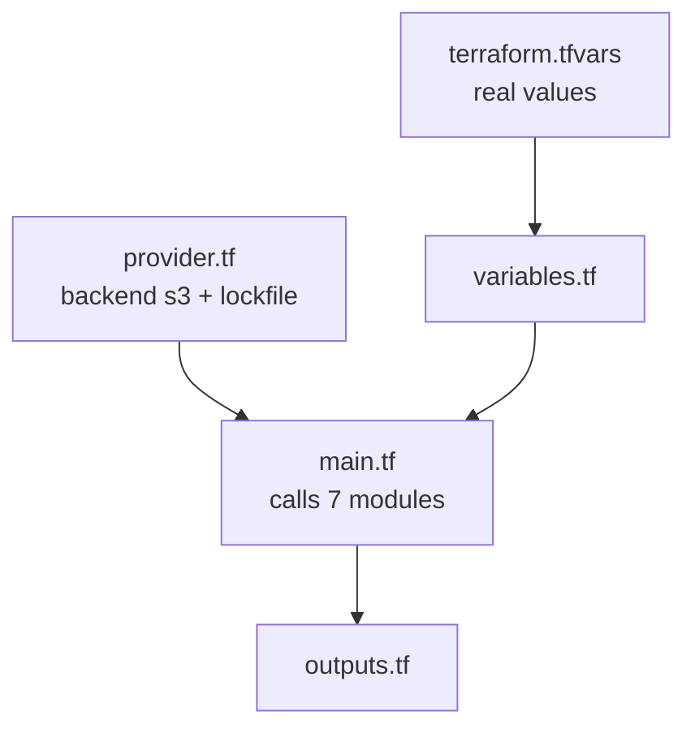

## Backend and provider
```hcl file=infra/provider.tf
terraform {
  required_version = ">= 1.10.0, < 2.0.0"
  required_providers {
    aws = { source = "hashicorp/aws", version = "~> 5.0" }
  }
  backend "s3" {
    bucket       = "memos-terraform-state-enamul"
    key          = "prod/terraform.tfstate"
    region       = "eu-west-1"
    encrypt      = true
    use_lockfile = true      # S3 native locking (Terraform 1.10+)
  }
}

provider "aws" {
  region = var.aws_region
  default_tags { tags = { Project = "Memos", ManagedBy = "Terraform" } }
}
```

## Variables and values
Declare inputs in `variables.tf`, and put the real values in `terraform.tfvars`:
```hcl file=infra/terraform.tfvars
project_name = "memos"
environment  = "prod"
aws_region   = "eu-west-1"
domain_name  = "myegh.com"

vpc_cidr             = "10.0.0.0/16"
public_subnet_cidrs  = ["10.0.1.0/24", "10.0.2.0/24"]
private_subnet_cidrs = ["10.0.3.0/24", "10.0.4.0/24"]
availability_zones   = ["eu-west-1a", "eu-west-1b"]

repository_name = "memos"
```
> `image_url` has a default of `""` and is passed in by the pipeline with each deploy.

## Initialise with the remote backend
$ cd ../infra && terraform init
```output
Initializing the backend...
Successfully configured the backend "s3"! Terraform will automatically
use this backend unless the backend configuration changes.
Initializing modules...
Terraform has been successfully initialized!
```
? Where will this stack's state be stored?
- [ ] In `infra/terraform.tfstate` on your laptop
- [x] In S3 at `memos-terraform-state-enamul/prod/terraform.tfstate`, locked with a `.tflock` object
- [ ] In GitHub
- [ ] In DynamoDB
> Shared by you and CI, versioned, encrypted, and locked during applies.

# Build the network
@ icon: 🏘️ · time: 30 min
A VPC across two AZs, with public subnets for the load balancer and NAT, and private subnets for the app.

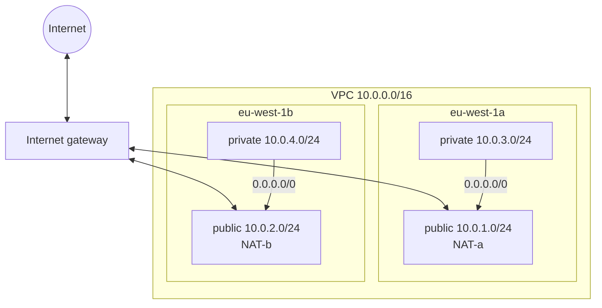

## VPC and subnets
```hcl file=infra/modules/vpc/main.tf
resource "aws_vpc" "main" {
  cidr_block           = var.vpc_cidr
  enable_dns_hostnames = true
  enable_dns_support   = true
}

resource "aws_subnet" "public" {
  count             = length(var.public_subnet_cidrs)
  vpc_id            = aws_vpc.main.id
  cidr_block        = var.public_subnet_cidrs[count.index]
  availability_zone = data.aws_availability_zones.available.names[count.index]
}

resource "aws_subnet" "private" {
  count             = length(var.private_subnet_cidrs)
  vpc_id            = aws_vpc.main.id
  cidr_block        = var.private_subnet_cidrs[count.index]
  availability_zone = data.aws_availability_zones.available.names[count.index]
}
```
> `count` creates one subnet per CIDR in the list, and each lands in a different AZ.

## Internet gateway and NAT gateways
One NAT gateway **per AZ**, each with its own Elastic IP, so one AZ failing doesn't cut off the other's outbound traffic.
```hcl file=infra/modules/vpc/main.tf
resource "aws_internet_gateway" "main" { vpc_id = aws_vpc.main.id }

resource "aws_eip" "nat" {
  count  = length(var.public_subnet_cidrs)
  domain = "vpc"
}

resource "aws_nat_gateway" "main" {
  count         = length(var.public_subnet_cidrs)
  allocation_id = aws_eip.nat[count.index].id
  subnet_id     = aws_subnet.public[count.index].id
  depends_on    = [aws_internet_gateway.main]
}
```

## Route tables
The public route table sends internet traffic to the **IGW**. Each private route table sends it to **its own AZ's NAT**.
```hcl file=infra/modules/vpc/main.tf
resource "aws_route_table" "public" {
  vpc_id = aws_vpc.main.id
  route {
    cidr_block = "0.0.0.0/0"
    gateway_id = aws_internet_gateway.main.id
  }
}

resource "aws_route_table" "private" {
  count  = length(var.private_subnet_cidrs)
  vpc_id = aws_vpc.main.id
  route {
    cidr_block     = "0.0.0.0/0"
    nat_gateway_id = aws_nat_gateway.main[count.index].id
  }
}
```
? What makes `10.0.1.0/24` a **public** subnet?
- [ ] Its CIDR range
- [ ] It's in AZ a
- [x] Its route table sends `0.0.0.0/0` to the internet gateway
- [ ] It has a NAT gateway
> "Public" is defined by the **route**, not a setting.

## Call the module and apply
```hcl file=infra/main.tf
module "vpc" {
  source               = "./modules/vpc"
  project_name         = var.project_name
  environment          = var.environment
  vpc_cidr             = var.vpc_cidr
  public_subnet_cidrs  = var.public_subnet_cidrs
  private_subnet_cidrs = var.private_subnet_cidrs
  availability_zones   = var.availability_zones
}
```
$ terraform apply -target=module.vpc
```output
Plan: 15 to add, 0 to change, 0 to destroy.
module.vpc.aws_vpc.main: Creation complete after 2s [id=vpc-0a1b2c3d4e5f67890]
module.vpc.aws_nat_gateway.main[0]: Still creating... [1m30s elapsed]
module.vpc.aws_nat_gateway.main[1]: Creation complete after 1m44s
Apply complete! Resources: 15 added, 0 changed, 0 destroyed.
```
> ⚠️ `-target` is handy while learning, building one piece at a time. Day to day, run plain `plan`/`apply` so the whole stack stays consistent. NAT gateways now cost money every hour, so `terraform destroy` at the end of a session if you're practising.

# Security groups
@ icon: 🔒 · time: 15 min
Two firewalls: one for the ALB (open to the world on 80/443) and one for the tasks (open **only** to the ALB, on 8081).

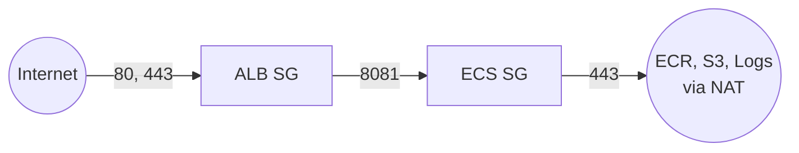

## Two empty groups
```hcl file=infra/modules/security/main.tf
resource "aws_security_group" "alb" {
  name   = "${var.project_name}-${var.environment}-alb-sg"
  vpc_id = var.vpc_id
}
resource "aws_security_group" "ecs" {
  name   = "${var.project_name}-${var.environment}-ecs-sg"
  vpc_id = var.vpc_id
}
```

## Rules as separate resources
Separate rule resources are easier to read and change than inline blocks. Note the **SG-to-SG** references:
```hcl file=infra/modules/security/main.tf
resource "aws_vpc_security_group_ingress_rule" "alb_https" {
  security_group_id = aws_security_group.alb.id
  cidr_ipv4         = "0.0.0.0/0"
  ip_protocol       = "tcp"
  from_port         = 443
  to_port           = 443
}
resource "aws_vpc_security_group_egress_rule" "alb_to_ecs" {
  security_group_id            = aws_security_group.alb.id
  referenced_security_group_id = aws_security_group.ecs.id
  ip_protocol = "tcp"
  from_port   = 8081
  to_port     = 8081
}
resource "aws_vpc_security_group_ingress_rule" "ecs_from_alb" {
  security_group_id            = aws_security_group.ecs.id
  referenced_security_group_id = aws_security_group.alb.id
  ip_protocol = "tcp"
  from_port   = 8081
  to_port     = 8081
}
resource "aws_vpc_security_group_egress_rule" "ecs_https" {
  security_group_id = aws_security_group.ecs.id
  cidr_ipv4         = "0.0.0.0/0"
  ip_protocol       = "tcp"
  from_port         = 443
  to_port           = 443
}
```
There's also a port-80 ingress rule on the ALB, used only for the HTTPS redirect.
? What would break if you deleted the `alb_to_ecs` **egress** rule?
- [ ] Nothing: security groups are stateful
- [x] The ALB couldn't open connections to the tasks on 8081, so health checks fail and users get errors
- [ ] Only HTTPS would break
- [ ] The NAT gateway would stop
> Stateful means **replies** are allowed automatically. The ALB still needs an egress rule to **start** connections to the targets.

# ECR and your first image push
@ icon: 📦 · time: 20 min
Create the private registry, then push the image you built in stage 3.

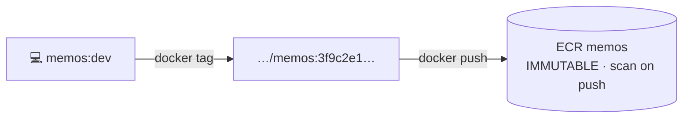

## The repository
```hcl file=infra/modules/ecr/main.tf
resource "aws_ecr_repository" "this" {
  name                 = var.repository_name
  image_tag_mutability = "IMMUTABLE"
  force_delete         = true
  image_scanning_configuration { scan_on_push = true }
}
```
$ terraform apply -target=module.ecr
```output
module.ecr.aws_ecr_repository.this: Creation complete after 1s [id=memos]
Apply complete! Resources: 1 added, 0 changed, 0 destroyed.
```

## Log Docker in to ECR
$ aws ecr get-login-password | docker login --username AWS --password-stdin 123456789012.dkr.ecr.eu-west-1.amazonaws.com
```output
Login Succeeded
```

## Tag with the commit SHA and push
$ docker tag memos:dev 123456789012.dkr.ecr.eu-west-1.amazonaws.com/memos:$(git rev-parse HEAD)
```output
(no output means it worked)
```
$ docker push 123456789012.dkr.ecr.eu-west-1.amazonaws.com/memos:$(git rev-parse HEAD)
```output
The push refers to repository [123456789012.dkr.ecr.eu-west-1.amazonaws.com/memos]
5f70bf18a086: Pushed
3f9c2e1d…: digest: sha256:9a8b7c… size: 1157
```
? You run the same `docker push` again. What happens?
- [ ] It overwrites the old image
- [x] ECR rejects it: the tag already exists and tags are immutable
- [ ] It creates `memos:sha-2`
- [ ] It deletes the old image first
> That's the "re-run" problem `build.yml` solves by checking ECR first and reusing the image.

# DNS and the certificate
@ icon: 🔐 · time: 20 min
Look up your Route 53 hosted zone, then request an ACM certificate that Terraform validates automatically.

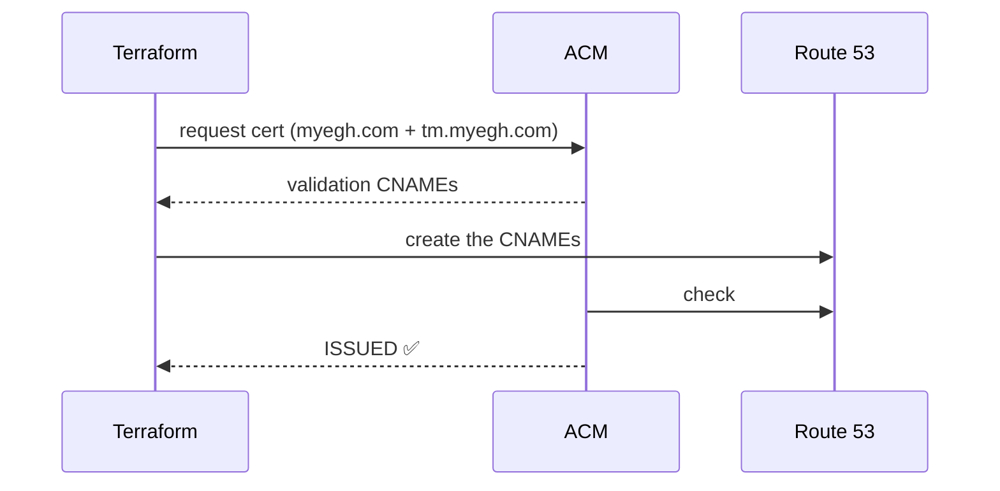

## Find the hosted zone
The domain is already registered and its hosted zone exists, so Terraform just **looks it up** with a data source:
```hcl file=infra/main.tf
data "aws_route53_zone" "main" {
  name         = var.domain_name
  private_zone = false
}
```
$ aws route53 list-hosted-zones-by-name --dns-name myegh.com --query "HostedZones[0].Id"
```output
"/hostedzone/Z0123456789ABCDEFGHIJ"
```

## Request and validate the certificate
```hcl file=infra/modules/acm/main.tf
resource "aws_acm_certificate" "this" {
  domain_name               = var.domain_name
  subject_alternative_names = ["tm.${var.domain_name}"]
  validation_method         = "DNS"
  lifecycle { create_before_destroy = true }
}

resource "aws_route53_record" "validation" {
  for_each = {
    for o in aws_acm_certificate.this.domain_validation_options : o.domain_name => {
      name = o.resource_record_name, type = o.resource_record_type, record = o.resource_record_value
    }
  }
  zone_id = var.zone_id
  name    = each.value.name
  type    = each.value.type
  records = [each.value.record]
  ttl     = 60
}

resource "aws_acm_certificate_validation" "this" {
  certificate_arn         = aws_acm_certificate.this.arn
  validation_record_fqdns = [for r in aws_route53_record.validation : r.fqdn]
}
```
$ terraform apply -target=module.acm
```output
module.acm.aws_acm_certificate.this: Creation complete after 9s
module.acm.aws_route53_record.validation["myegh.com"]: Creation complete after 35s
module.acm.aws_route53_record.validation["tm.myegh.com"]: Creation complete after 35s
module.acm.aws_acm_certificate_validation.this: Still creating... [1m0s elapsed]
module.acm.aws_acm_certificate_validation.this: Creation complete after 1m12s
```
? Why `for_each` here rather than `count`?
- [ ] count doesn't work with Route 53
- [x] The validation options are keyed by domain name, so for_each gives stable keys that don't shift if a domain is added or removed
- [ ] for_each is required by ACM
- [ ] count would create duplicate certificates
> Stable keys mean stable resources.

# The load balancer
@ icon: ⚖️ · time: 25 min
The public front door: port 80 redirects, port 443 terminates TLS and forwards to the tasks on 8081.

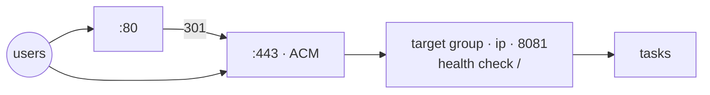

## ALB and target group
```hcl file=infra/modules/alb/main.tf
resource "aws_lb" "this" {
  name                       = "${var.project_name}-alb"
  internal                   = false
  load_balancer_type         = "application"
  drop_invalid_header_fields = true
  security_groups            = [var.security_group]
  subnets                    = var.public_subnets
}

resource "aws_lb_target_group" "this" {
  name        = "${var.project_name}-tg"
  port        = 8081
  protocol    = "HTTP"
  vpc_id      = var.vpc_id
  target_type = "ip"            # Fargate tasks register by IP
  health_check {
    path                = "/"
    matcher             = "200-399"
    interval            = 30
    healthy_threshold   = 2
    unhealthy_threshold = 2
  }
}
```

## Listeners: redirect and forward
```hcl file=infra/modules/alb/main.tf
resource "aws_lb_listener" "http" {
  load_balancer_arn = aws_lb.this.arn
  port              = 80
  protocol          = "HTTP"
  default_action {
    type = "redirect"
    redirect {
      port        = "443"
      protocol    = "HTTPS"
      status_code = "HTTP_301"
    }
  }
}

resource "aws_lb_listener" "https" {
  load_balancer_arn = aws_lb.this.arn
  port              = 443
  protocol          = "HTTPS"
  ssl_policy        = "ELBSecurityPolicy-TLS13-1-2-2021-06"
  certificate_arn   = var.certificate_arn
  default_action {
    type             = "forward"
    target_group_arn = aws_lb_target_group.this.arn
  }
}
```
$ terraform apply -target=module.alb
```output
module.alb.aws_lb.this: Still creating... [2m0s elapsed]
module.alb.aws_lb.this: Creation complete after 2m31s
Apply complete! Resources: 4 added, 0 changed, 0 destroyed.
```
? Why does the target group use `target_type = "ip"` for Fargate?
- [ ] The ALB only supports IP targets
- [x] Fargate has no EC2 instance to register; each task gets its own network interface and private IP (awsvpc mode), so targets are task IPs
- [ ] IP targets are cheaper
- [ ] It's needed for HTTPS
> ALBs support instance, IP and Lambda targets. Fargate tasks are reached by their own IPs.

# IAM roles for ECS
@ icon: 🎭 · time: 10 min
Two roles with two different jobs.

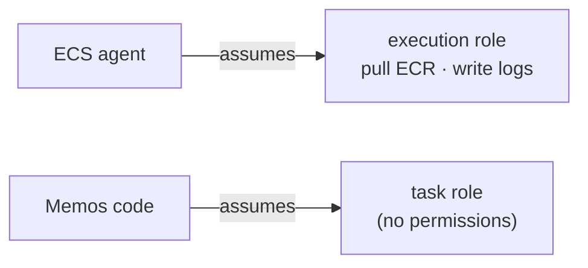

## Trust ECS, then attach permissions
```hcl file=infra/modules/iam/main.tf
data "aws_iam_policy_document" "ecs_assume_role_policy" {
  statement {
    actions = ["sts:AssumeRole"]
    principals {
      type        = "Service"
      identifiers = ["ecs-tasks.amazonaws.com"]
    }
  }
}

resource "aws_iam_role" "execution_role" {
  name               = "${var.project_name}-ecs-execution-role"
  assume_role_policy = data.aws_iam_policy_document.ecs_assume_role_policy.json
}
resource "aws_iam_role_policy_attachment" "execution_policy" {
  role       = aws_iam_role.execution_role.name
  policy_arn = "arn:aws:iam::aws:policy/service-role/AmazonECSTaskExecutionRolePolicy"
}

resource "aws_iam_role" "task_role" {
  name               = "${var.project_name}-ecs-task-role"
  assume_role_policy = data.aws_iam_policy_document.ecs_assume_role_policy.json
}
```
? Memos never calls AWS APIs itself. Which role can therefore have **no** permissions attached?
- [ ] The execution role
- [x] The task role
- [ ] Both
- [ ] Neither
> The execution role still needs ECR pull and CloudWatch Logs permissions so ECS can start the task.

# Run Memos on ECS and go live
@ icon: 🚀 · time: 30 min
The final piece: a cluster, a task definition, a service wired to the ALB, and a DNS record. After this, **tm.myegh.com** is live.

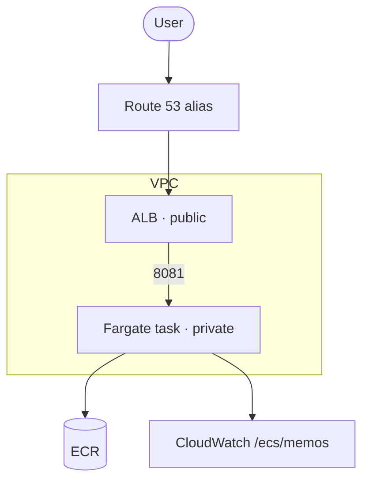

## Cluster and log group
```hcl file=infra/modules/ecs/main.tf
resource "aws_ecs_cluster" "this" {
  name = "${var.project_name}-cluster"
  setting {                       # cost trade-off
    name  = "containerInsights"
    value = "disabled"
  }
}

resource "aws_cloudwatch_log_group" "this" {
  name              = "/ecs/${var.project_name}"
  retention_in_days = 7
}
```

## The task definition
```hcl file=infra/modules/ecs/main.tf
resource "aws_ecs_task_definition" "this" {
  family                   = "${var.project_name}-task"
  requires_compatibilities = ["FARGATE"]
  network_mode             = "awsvpc"
  cpu                      = var.cpu          # 256 = 0.25 vCPU
  memory                   = var.memory       # 512 MB
  execution_role_arn       = var.execution_role_arn
  task_role_arn            = var.task_role_arn
  container_definitions = jsonencode([{
    name         = "memos"
    image        = var.image_url
    essential    = true
    portMappings = [{ containerPort = var.container_port, hostPort = var.container_port, protocol = "tcp" }]
    logConfiguration = {
      logDriver = "awslogs"
      options = {
        "awslogs-group"         = aws_cloudwatch_log_group.this.name
        "awslogs-region"        = "eu-west-1"
        "awslogs-stream-prefix" = "ecs"
      }
    }
  }])
}
```

## The service
```hcl file=infra/modules/ecs/main.tf
resource "aws_ecs_service" "this" {
  name            = "${var.project_name}-service"
  cluster         = aws_ecs_cluster.this.id
  task_definition = aws_ecs_task_definition.this.arn
  desired_count   = var.desired_count     # 1
  launch_type     = "FARGATE"
  network_configuration {
    subnets          = var.private_subnet_ids
    security_groups  = [var.ecs_security_group_id]
    assign_public_ip = false
  }
  load_balancer {
    target_group_arn = var.target_group_arn
    container_name   = "memos"
    container_port   = var.container_port
  }
}
```

## Point the domain at the ALB
```hcl file=infra/main.tf
resource "aws_route53_record" "app" {
  zone_id = data.aws_route53_zone.main.zone_id
  name    = "tm.${var.domain_name}"
  type    = "A"
  alias {
    name                   = module.alb.dns_name
    zone_id                = module.alb.alb_zone_id
    evaluate_target_health = true
  }
}
```

## Apply everything
Now run a full plan and apply with the image you pushed:
$ terraform apply -var="image_url=123456789012.dkr.ecr.eu-west-1.amazonaws.com/memos:$(git rev-parse HEAD)"
```output
Plan: 9 to add, 0 to change, 0 to destroy.
module.ecs.aws_ecs_cluster.this: Creation complete after 11s
module.ecs.aws_ecs_task_definition.this: Creation complete after 1s [id=memos-task]
module.ecs.aws_ecs_service.this: Creation complete after 2s
aws_route53_record.app: Creation complete after 41s [id=Z0123…_tm.myegh.com_A]

Outputs:
app_url = "https://tm.myegh.com"
```

## Watch the service become healthy
$ aws ecs describe-services --cluster memos-cluster --services memos-service --query "services[0].events[0:3].message"
```output
[
    "(service memos-service) has reached a steady state.",
    "(service memos-service) registered 1 targets in (target-group memos-tg)",
    "(service memos-service) has started 1 tasks: (task 7d1e…)."
]
```
$ curl -s -o /dev/null -w "%{http_code}\n" https://tm.myegh.com/healthz
```output
200
```
🎉 **Memos is live on AWS.**
? A user visits `http://tm.myegh.com`. Put the journey in order.
- [ ] ECS → ALB → Route 53 → browser
- [x] Route 53 alias → ALB :80 → 301 to https → ALB :443 (TLS with ACM) → target group → task on 8081
- [ ] NAT gateway → ECS → ALB
- [ ] ACM → Route 53 → ECS
> Be able to say this in one breath. It's the most common "explain your project" question.

# Automate it with GitHub Actions
@ icon: 🔁 · time: 45 min
Everything so far was by hand. Now a push to `main` will build, scan, push and deploy automatically, with no stored AWS keys.

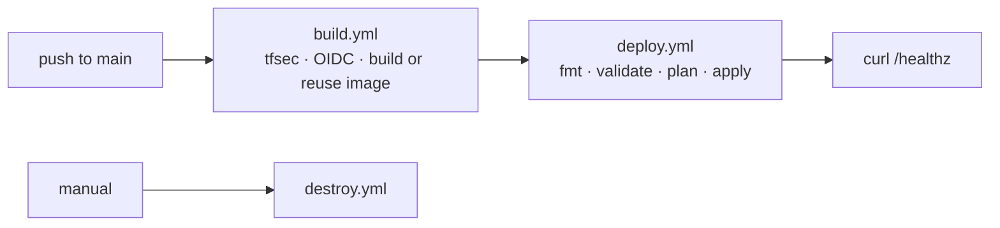

## build.yml: triggers and permissions
```yaml file=.github/workflows/build.yml
name: Build and Push
on:
  push:
    branches: [main]
    paths: ['app/**', 'Dockerfile', '.dockerignore']
  workflow_dispatch:
env:
  AWS_REGION: eu-west-1
  ECR_REPOSITORY: memos
jobs:
  build:
    runs-on: ubuntu-latest
    permissions:
      id-token: write     # allow OIDC
      contents: read
```

## build.yml: log in with OIDC
```yaml file=.github/workflows/build.yml
    steps:
      - uses: actions/checkout@v4
      - name: Scan Terraform security
        uses: aquasecurity/tfsec-action@v1.0.3
        with: { working_directory: infra }
      - name: Configure AWS credentials
        uses: aws-actions/configure-aws-credentials@v4
        with:
          role-to-assume: ${{ secrets.AWS_ROLE_ARN }}
          aws-region: ${{ env.AWS_REGION }}
      - id: login-ecr
        uses: aws-actions/amazon-ecr-login@v2
```

## build.yml: build or reuse the image
Idempotent: if the SHA's image already exists, reuse it. Only `ImageNotFoundException` triggers a build, and any other error fails loudly.
```yaml file=.github/workflows/build.yml
      - name: Build or reuse image
        env:
          ECR_REGISTRY: ${{ steps.login-ecr.outputs.registry }}
          IMAGE_TAG: ${{ github.sha }}
        run: |
          IMAGE="$ECR_REGISTRY/$ECR_REPOSITORY:$IMAGE_TAG"
          ERROR_FILE=$(mktemp)
          if aws ecr describe-images --repository-name "$ECR_REPOSITORY" \
               --image-ids "imageTag=$IMAGE_TAG" > /dev/null 2>"$ERROR_FILE"; then
            echo "Image already exists; reusing $IMAGE"
          elif grep -q ImageNotFoundException "$ERROR_FILE"; then
            docker build -t "$IMAGE" .
            docker push "$IMAGE"
          else
            cat "$ERROR_FILE" >&2; exit 1
          fi
```

## deploy.yml: run after a successful build
```yaml file=.github/workflows/deploy.yml
name: Deploy
on:
  workflow_run:
    workflows: ["Build and Push"]
    types: [completed]
    branches: [main]
  workflow_dispatch:
    inputs:
      image_tag:
        description: "Full commit SHA of an existing ECR image"
        required: true
jobs:
  deploy:
    if: ${{ github.event_name == 'workflow_dispatch' || github.event.workflow_run.conclusion == 'success' }}
```
The deploy job checks the SHA is 40 characters and exists in ECR, then runs `terraform fmt -check`, `init`, `validate`, `plan -out=tfplan` and `apply tfplan` with `image_url` set.

## deploy.yml: verify it worked
```yaml file=.github/workflows/deploy.yml
  health-check:
    needs: deploy
    runs-on: ubuntu-latest
    steps:
      - run: sleep 60
      - run: |
          code=$(curl -s -o /dev/null -w "%{http_code}" --max-time 30 https://tm.myegh.com/healthz)
          if [ "$code" = "200" ]; then echo "✅ Health check passed"; else echo "❌ got $code"; exit 1; fi
```

## Push and watch it run
Make a small change in `app/` and push:
$ git commit -am "Tweak app title" && git push
```output
[main 3f9c2e1] Tweak app title
To github.com:EnamulRahman/memos-aws-infra.git
   5d6e7f8..3f9c2e1  main -> main
```
In GitHub → **Actions**: *Build and Push* ✅ → *Deploy* ✅ → *Post Deploy Health Check* ✅.

## Practise a rollback
A bad version went out? **Actions → Deploy → Run workflow**, with `image_tag` set to the previous good SHA:
$ gh workflow run deploy.yml -f image_tag=5d6e7f8a9b0c1d2e3f4a5b6c7d8e9f0a1b2c3d4e
```output
✓ Created workflow_dispatch event for deploy.yml at main
```
? Why can you trust that this rollback deploys exactly the old code?
- [ ] Terraform keeps old versions of the app
- [x] ECR tags are immutable, so that SHA tag can only ever point at the image built from that commit
- [ ] GitHub caches old builds
- [ ] ECS remembers old task definitions
> Immutable, SHA-tagged artefacts are what make rollbacks boring, and boring is good.

# Break it and fix it
@ icon: 🧯 · time: 30 min
The best way to learn troubleshooting is to cause real failures on purpose, then fix them. Try these on a practice environment, never on something real users depend on.

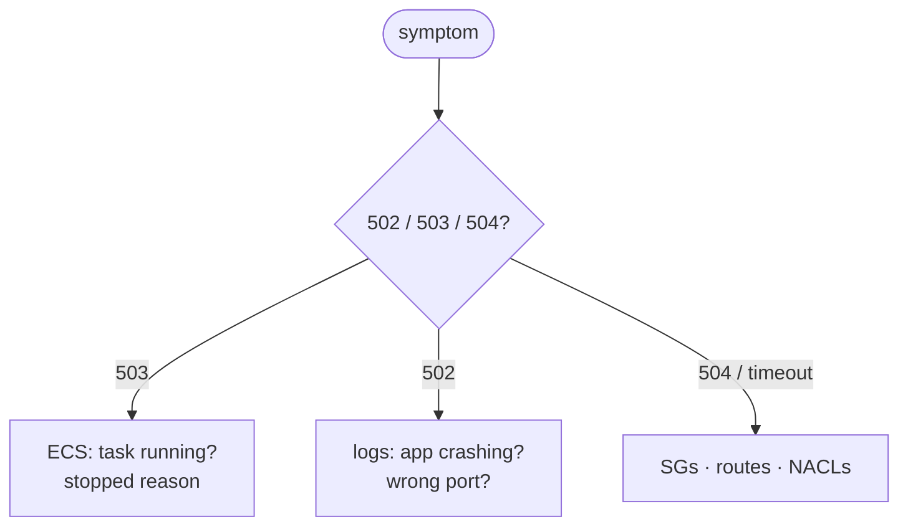

## Drill 1: port drift
Change `MEMOS_PORT` to `5230` in the Dockerfile (Memos' default) but leave everything else on 8081. Deploy.
$ aws elbv2 describe-target-health --target-group-arn arn:aws:elasticloadbalancing:eu-west-1:123456789012:targetgroup/memos-tg/abc123 --query "TargetHealthDescriptions[0].TargetHealth"
```output
{
    "State": "unhealthy",
    "Reason": "Target.FailedHealthChecks",
    "Description": "Health checks failed"
}
```
? What's the fix that stops this ever happening again?
- [ ] Open port 5230 in the security groups as well
- [x] Define the port once (a variable used by the image env, task definition, target group and SG rules) so they can't drift apart
- [ ] Turn off health checks
- [ ] Use port 80 everywhere
> This was a real Memos bug: 5230 vs 8081. One source of truth for each value.

## Drill 2: read the logs
When the task is crashing, the answer is usually in the logs:
$ aws logs tail /ecs/memos --since 15m --follow
```output
2026-11-03T16:07:34 ecs/memos/7d1e… Memos 0.25.x started successfully!
2026-11-03T16:07:34 ecs/memos/7d1e… Data directory: /var/opt/memos
2026-11-03T16:07:34 ecs/memos/7d1e… Server running on port 8081
```

## Drill 3: why did the task stop?
$ aws ecs describe-tasks --cluster memos-cluster --tasks 7d1e0c4b --query "tasks[0].[stoppedReason,containers[0].exitCode]"
```output
[
    "Essential container in task exited",
    137
]
```
? Exit code 137 on this task most likely means…
- [ ] the image wasn't found
- [x] the container was killed with SIGKILL, almost always for going over its 512 MB memory limit
- [ ] a normal shutdown
- [ ] a health check timeout
> 137 = 128 + 9. Raise the memory (a valid Fargate pair) and find out why usage grows.

## Drill 4: drift
Add an SSH rule to the ECS security group in the console, then:
$ terraform plan -refresh-only
```output
Note: Objects have changed outside of Terraform
  # module.security.aws_security_group.ecs has changed
Terraform detected the following changes made outside of Terraform since the last apply.
```
Remove the hand-made rule, and talk about **why** changes go through code.

# Level up: production improvements
@ icon: 🌟 · time: 60 min
The platform works. These upgrades turn it into something you'd defend in a senior interview. Each one matches a known limitation.

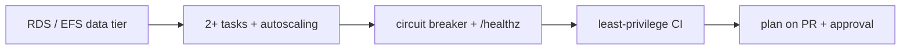

## Automatic rollback and a better health check
```hcl file=infra/modules/ecs/main.tf
resource "aws_ecs_service" "this" {
  # …
  health_check_grace_period_seconds = 60
  deployment_circuit_breaker {
    enable   = true
    rollback = true
  }
}
```
```hcl file=infra/modules/alb/main.tf
health_check {
  path    = "/healthz"     # the real liveness endpoint
  matcher = "200"
}
```
? What does the circuit breaker add on top of the pipeline's `/healthz` check?
- [ ] Faster image builds
- [x] ECS itself stops a failing rollout and returns to the last working deployment, with no human or pipeline needed
- [ ] HTTPS
- [ ] Auto scaling
> The pipeline **detects** a bad deploy. The circuit breaker **recovers** from it.

## Lock down the CI role
Only `main` may assume the role, and with fewer permissions:
```hcl file=bootstrap/oidc.tf
StringLike = {
  "token.actions.githubusercontent.com:sub" = "repo:EnamulRahman/memos-aws-infra:ref:refs/heads/main"
}
```
Then replace `AdministratorAccess` with a policy listing the ECR, ECS, ELB, EC2, IAM (scoped), ACM, Route 53, Logs and state-bucket actions Terraform actually uses. Pin third-party actions to commit SHAs while you're there.

## Move the data out of the container
Memos supports Postgres. Add RDS in the private subnets and pass the DSN as a secret:
```hcl file=infra/modules/ecs/main.tf
container_definitions = jsonencode([{
  name  = "memos"
  image = var.image_url
  environment = [{ name = "MEMOS_DRIVER", value = "postgres" }]
  secrets     = [{ name = "MEMOS_DSN", valueFrom = var.dsn_secret_arn }]
  # …
}])
```
Give the **execution role** `secretsmanager:GetSecretValue` on that secret, allow 5432 from the ECS SG to an RDS SG, and then `desired_count = 2`.
? After moving to RDS, why is it now safe to run two tasks?
- [ ] Fargate gives each task more memory
- [x] The tasks are stateless: both read and write the same database instead of their own local SQLite files
- [ ] The ALB can now route to two targets
- [ ] RDS makes tasks start faster
> Stateless app tier plus a shared, durable data tier: that's the pattern behind almost every scalable web app.

## Plan on every pull request
```yaml file=.github/workflows/plan.yml
on:
  pull_request:
    paths: ['infra/**']
jobs:
  plan:
    runs-on: ubuntu-latest
    permissions: { id-token: write, contents: read, pull-requests: write }
    steps:
      - uses: actions/checkout@v4
      - uses: aws-actions/configure-aws-credentials@v4
        with: { role-to-assume: "${{ secrets.AWS_PLAN_ROLE_ARN }}", aws-region: eu-west-1 }
      - uses: hashicorp/setup-terraform@v3
      - run: terraform init && terraform plan -no-color | tee plan.txt
        working-directory: infra
```
Post `plan.txt` as a PR comment, and require a reviewer on a protected `production` environment before `apply`. Reviewers see **exactly** what will change.
