# The brief and the board
@ icon: 📋 · time: 30 min
This track walks you through the **[CoderCo EKS assignment](https://github.com/CoderCo-Learning/eks-assignment-v1)**. The app is the **2048 game**: a static website (HTML, CSS, JavaScript) with no backend. Your job is to run it on **Amazon EKS** the way a platform team would.

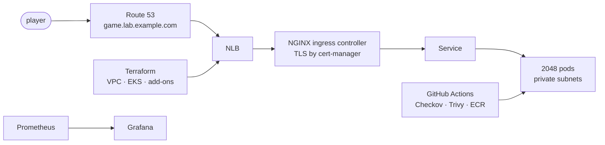

> ⚠️ **Cost:** EKS isn't free. The control plane is about $0.10/hour, plus two t3.large nodes, a NAT gateway and a load balancer. That's roughly **$8–10 a day** while it runs. Set an **AWS Budget** alert first, and run the clean-up stage at the end of **every** session.

## Read the marking criteria
| Criterion | Points | Stage |
|---|---|---|
| Board / tickets | 10 | 1 |
| Terraform for AWS infra (VPC + EKS, modules, IAM, SGs) | 15 | 4–5 |
| NGINX Ingress Controller | 10 | 7 |
| Monitoring: Prometheus + Grafana dashboard | 15 | 9 |
| Pipeline 1: Terraform | 10 | 10 |
| Pipeline 2: Trivy, Checkov, build → ECR, deploy | **30** | 11 |
| Bonus: Argo CD | 15 | 13 |
| Bonus: architecture diagram | 10 | 14 |
| Bonus: Helm | 10 | 12 |
| Bonus: cert-manager | 10 | 8 |
| Bonus: ExternalDNS | 10 | 8 |
| **Total** | **150** | |

? Which single area is worth the most points?
- [ ] The NGINX Ingress Controller
- [ ] Monitoring
- [x] Pipeline 2: security scans, build and push to ECR, deploy to EKS
- [ ] The board
> 30 points. The two pipelines together are worth 40, so plan your time around them.

## Fork and clone the repo
Fork **CoderCo-Learning/eks-assignment-v1** to your own GitHub account (call it `eks-assignment`), then clone it:
$ git clone https://github.com/your-username/eks-assignment.git && cd eks-assignment
```output
Cloning into 'eks-assignment'...
Receiving objects: 100% (42/42), 210.11 KiB | 4.12 MiB/s, done.
```
Run the game locally to see what you're deploying:
$ python3 -m http.server 3000
```output
Serving HTTP on 0.0.0.0 port 3000 (http://0.0.0.0:3000/) ...
```
Open **http://localhost:3000** and play a round.

## Set up the board
Create a Trello or Jira board with columns **To do → In progress → Review → Done**. Each ticket should be small enough to finish in one session, with a clear "done when":

| # | Ticket | Done when |
|---|---|---|
| 1 | Dockerfile | the game is served on 8080 as non-root |
| 2 | Bootstrap: S3 state + OIDC role | bootstrap apply succeeds |
| 3 | VPC module | 3 public + 3 private subnets, NAT, load balancer tags |
| 4 | EKS module + node group + access entries | `kubectl get nodes` shows 2 Ready |
| 5 | ECR repository | immutable tags, scan on push |
| 6 | App manifests | the game is reachable via port-forward |
| 7 | Delegate `lab` subdomain to Route 53 | `dig NS` shows AWS servers |
| 8 | NGINX Ingress Controller | NLB created, IngressClass `nginx` |
| 9 | cert-manager + ExternalDNS | HTTPS padlock, record created automatically |
| 10 | Monitoring | dashboards show nodes, pods, CPU and memory |
| 11 | Pipeline 1 | the PR shows a plan; merge applies |
| 12 | Pipeline 2 | push deploys; a bad image fails the run |
| 13 | Helm chart, Argo CD, diagram, README, clean-up script | each committed and working |

> 🔧 Move tickets as you go and link commits to them (e.g. `#7 delegate lab subdomain`). Marks are for tracking **progress**, not just having a board.

# Warm up on a local cluster
@ icon: 🧪 · time: 30 min
Before paying for EKS, practise the same commands on a **free** cluster on your laptop with **kind** (Kubernetes in Docker).

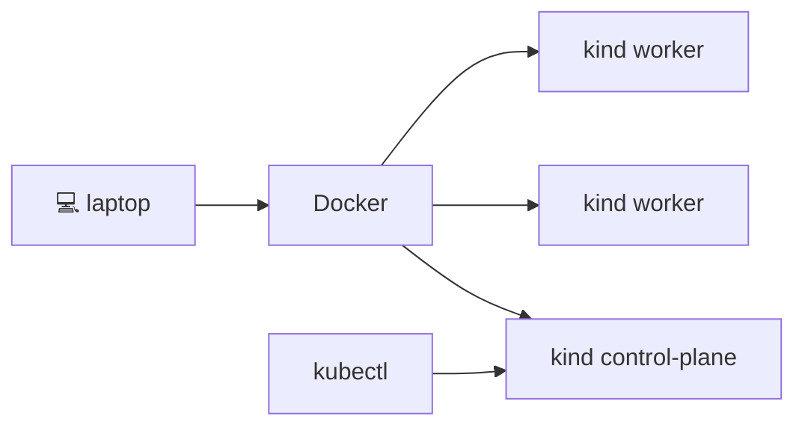

## Install the tools
On macOS: `brew install kind kubectl helm`. (Windows: `choco install kind kubernetes-cli kubernetes-helm`.)
$ kind version && kubectl version --client && helm version --short
```output
kind v0.29.0 go1.24.2 darwin/arm64
Client Version: v1.34.1
v3.18.4+gd80839c
```

## Create a three-node cluster
```yaml file=kind-config.yaml
kind: Cluster
apiVersion: kind.x-k8s.io/v1alpha4
nodes:
  - role: control-plane
  - role: worker
  - role: worker
```
$ kind create cluster --config kind-config.yaml --name k8s-demo
```output
Creating cluster "k8s-demo" ...
 ✓ Ensuring node image (kindest/node:v1.34.0) 🖼
 ✓ Preparing nodes 📦 📦 📦
 ✓ Starting control-plane 🕹️
 ✓ Joining worker nodes 🚜
Set kubectl context to "kind-k8s-demo"
```
$ kubectl get nodes
```output
NAME                     STATUS   ROLES           AGE   VERSION
k8s-demo-control-plane   Ready    control-plane   62s   v1.34.0
k8s-demo-worker          Ready    <none>          41s   v1.34.0
k8s-demo-worker2         Ready    <none>          41s   v1.34.0
```

## Deploy, expose and self-heal
$ kubectl create deployment web --image=nginx:1.27 --replicas=3
```output
deployment.apps/web created
```
$ kubectl expose deployment web --port=80
```output
service/web exposed
```
Now delete one pod and watch the Deployment replace it:
$ kubectl delete pod -l app=web --wait=false && kubectl get pods -l app=web
```output
pod "web-6d4cf56db6-2xkqp" deleted
pod "web-6d4cf56db6-9fz7m" deleted
pod "web-6d4cf56db6-qwl4c" deleted
NAME                   READY   STATUS              RESTARTS   AGE
web-6d4cf56db6-7hj2k   0/1     ContainerCreating   0          1s
web-6d4cf56db6-lm8vn   0/1     ContainerCreating   0          1s
web-6d4cf56db6-x4c9d   0/1     ContainerCreating   0          1s
```
? Why did three new pods appear straight away?
- [ ] kubectl re-created them
- [x] The Deployment's ReplicaSet wants 3 replicas and keeps making reality match
- [ ] kind restarts deleted containers
- [ ] The Service recreated them
> Self-healing through desired state. To really remove them, delete the **Deployment**.

## Reach it and tidy up
$ kubectl port-forward svc/web 8080:80
```output
Forwarding from 127.0.0.1:8080 -> 80
Handling connection for 8080
```
Visit http://localhost:8080, press Ctrl+C, then delete the practice cluster:
$ kind delete cluster --name k8s-demo
```output
Deleting cluster "k8s-demo" ...
Deleted nodes: ["k8s-demo-control-plane" "k8s-demo-worker" "k8s-demo-worker2"]
```

# Containerise 2048
@ icon: 🐳 · time: 30 min
2048 has no backend, so production needs only a **web server for static files**. Use the **unprivileged nginx** image: it already runs as a non-root user and listens on **8080** (non-root processes can't bind ports below 1024).

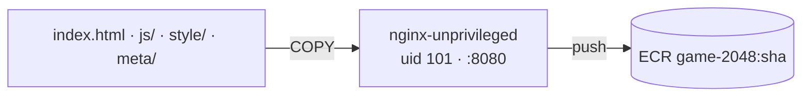

## The Dockerfile
```dockerfile file=Dockerfile
# Pin an exact version (or digest) from Docker Hub in real use
FROM nginxinc/nginx-unprivileged:stable-alpine
COPY --chown=101:101 index.html favicon.ico /usr/share/nginx/html/
COPY --chown=101:101 js/    /usr/share/nginx/html/js/
COPY --chown=101:101 style/ /usr/share/nginx/html/style/
COPY --chown=101:101 meta/  /usr/share/nginx/html/meta/
EXPOSE 8080
# no CMD needed: the base image starts nginx
```
```gitignore file=.dockerignore
.git
.github
terraform/
k8s/
charts/
*.md
Rakefile
```
`--chown=101:101` gives the files to the nginx user. Copying only the site's folders keeps the build tooling and docs out of the image.

## Build for the right CPU
EKS t3 nodes are **x86**. On an Apple Silicon Mac, `--platform linux/amd64` stops "exec format error" later.
$ docker build --platform linux/amd64 -t game-2048:dev .
```output
[+] Building 6.3s (10/10) FINISHED
 => [1/5] FROM docker.io/nginxinc/nginx-unprivileged:stable-alpine
 => [2/5] COPY --chown=101:101 index.html favicon.ico /usr/share/nginx/html/
 => naming to docker.io/library/game-2048:dev
```

## Run it and prove it's not root
$ docker run -d -p 8080:8080 --name game game-2048:dev && curl -sI http://localhost:8080 | head -1
```output
a1b2c3d4e5f6…
HTTP/1.1 200 OK
```
$ docker exec game id
```output
uid=101(nginx) gid=101(nginx) groups=101(nginx)
```
? Which port must the Kubernetes Service's `targetPort` and the probes use for this image?
- [ ] 80
- [ ] 3000
- [x] 8080
- [ ] 443
> The container listens on 8080. Port 3000 was only the local Python server.

# Bootstrap: state and keyless CI
@ icon: 🪣 · time: 30 min
As in the ECS track, two **long-lived** things come first, in their own small stack: an **S3 bucket** for Terraform state, and an **OIDC role** so GitHub Actions can reach AWS without stored keys.

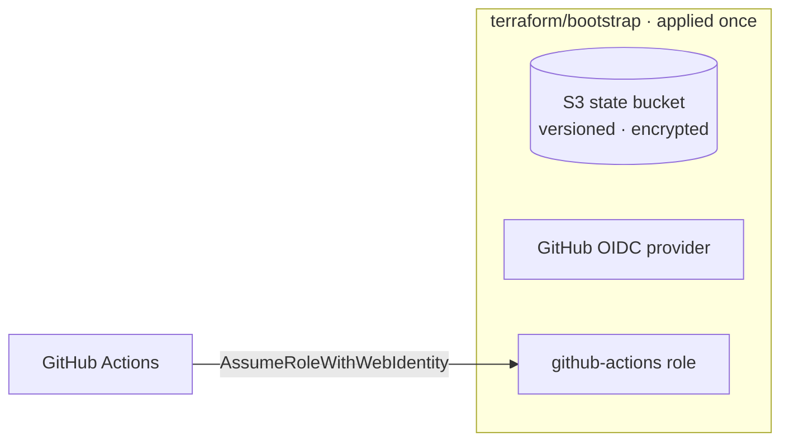

## State bucket
```hcl file=terraform/bootstrap/state.tf
resource "aws_s3_bucket" "state" {
  bucket = "eks-lab-tfstate-example"     # globally unique: use your own
  lifecycle { prevent_destroy = true }
}
resource "aws_s3_bucket_versioning" "state" {
  bucket = aws_s3_bucket.state.id
  versioning_configuration { status = "Enabled" }
}
resource "aws_s3_bucket_public_access_block" "state" {
  bucket                  = aws_s3_bucket.state.id
  block_public_acls       = true
  block_public_policy     = true
  ignore_public_acls      = true
  restrict_public_buckets = true
}
```
Add default encryption, and a bucket policy that denies non-HTTPS access.

## OIDC role, tied to your repo's main branch
```hcl file=terraform/bootstrap/oidc.tf
resource "aws_iam_openid_connect_provider" "github" {
  url            = "https://token.actions.githubusercontent.com"
  client_id_list = ["sts.amazonaws.com"]
}

resource "aws_iam_role" "github_actions" {
  name = "eks-lab-github-actions"
  assume_role_policy = jsonencode({
    Version = "2012-10-17"
    Statement = [{
      Effect    = "Allow"
      Principal = { Federated = aws_iam_openid_connect_provider.github.arn }
      Action    = "sts:AssumeRoleWithWebIdentity"
      Condition = {
        StringEquals = { "token.actions.githubusercontent.com:aud" = "sts.amazonaws.com" }
        StringLike   = { "token.actions.githubusercontent.com:sub" = [
          "repo:your-username/eks-assignment:ref:refs/heads/main",
          "repo:your-username/eks-assignment:pull_request"
        ] }
      }
    }]
  })
}
```
> ⚠️ Attaching broad permissions (even admin) is common for a first version. Note it in your README as something you'd scope down.

## Apply it once
$ cd terraform/bootstrap && terraform init && terraform apply
```output
Plan: 6 to add, 0 to change, 0 to destroy.
aws_s3_bucket.state: Creation complete after 2s [id=eks-lab-tfstate-example]
aws_iam_role.github_actions: Creation complete after 1s [id=eks-lab-github-actions]
Apply complete! Resources: 6 added, 0 changed, 0 destroyed.
```
Store the role's ARN as the GitHub secret `AWS_ROLE_ARN`.
? Why does the trust policy list `:pull_request` as well as `refs/heads/main`?
- [ ] So pull requests can apply changes to production
- [x] So Pipeline 1 can run `terraform plan` on pull requests; applies only happen from main
- [ ] It's required by AWS
- [ ] To allow forks to deploy
> In production you'd give PRs a separate **read-only** plan role.

# Terraform: VPC, EKS and ECR modules
@ icon: 🏗️ · time: 90 min
The criteria want **reusable modules**, with IAM and security groups configured properly. You'll wrap well-tested community modules in your own modules, then call them from an environment folder.

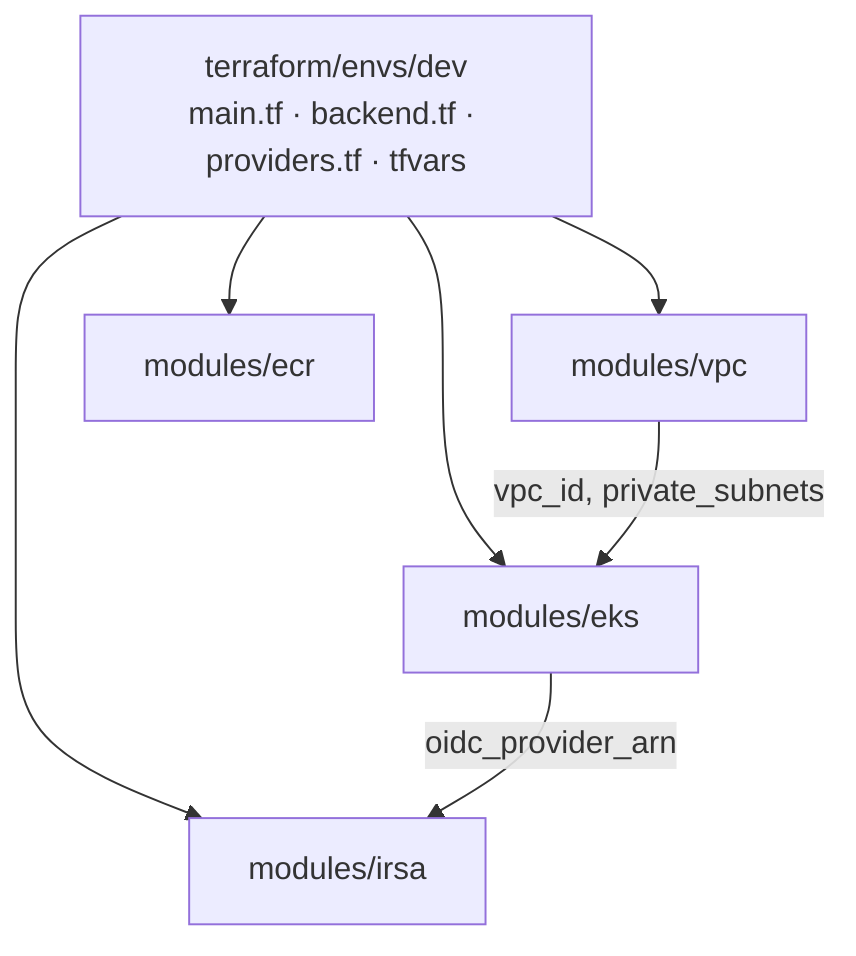

## Lay out the folders
```output
terraform/
├── bootstrap/          # done: state bucket + OIDC role
├── modules/
│   ├── vpc/            # wraps terraform-aws-modules/vpc
│   ├── eks/            # wraps terraform-aws-modules/eks + access entries
│   ├── ecr/            # the image repository
│   ├── irsa/           # one IAM role per add-on
│   └── addons/         # helm_release: ingress, cert-manager, ExternalDNS, monitoring, Argo CD
└── envs/
    └── dev/            # calls the modules with dev values
```
> 🔧 Many teams split **addons** into a second stack applied after the cluster exists, because the Helm and Kubernetes providers need a live cluster to connect to.

## The VPC module
```hcl file=terraform/modules/vpc/main.tf
module "vpc" {
  source  = "terraform-aws-modules/vpc/aws"
  version = "~> 6.0"

  name            = var.name
  cidr            = var.cidr
  azs             = var.azs
  private_subnets = var.private_subnets
  public_subnets  = var.public_subnets

  enable_nat_gateway   = true
  single_nat_gateway   = var.single_nat_gateway   # true for a lab: cheaper, but a single point of failure
  enable_dns_hostnames = true

  # tell AWS where to put load balancers created from Kubernetes
  public_subnet_tags  = { "kubernetes.io/role/elb" = 1 }
  private_subnet_tags = { "kubernetes.io/role/internal-elb" = 1 }
}

output "vpc_id"          { value = module.vpc.vpc_id }
output "private_subnets" { value = module.vpc.private_subnets }
```

## The EKS module
```hcl file=terraform/modules/eks/main.tf
module "eks" {
  source  = "terraform-aws-modules/eks/aws"
  version = "~> 21.0"

  name               = var.name
  kubernetes_version = var.kubernetes_version   # a version in standard support
  vpc_id             = var.vpc_id
  subnet_ids         = var.private_subnet_ids

  endpoint_public_access                   = true   # lab only
  enable_cluster_creator_admin_permissions = true
  enable_irsa                              = true

  eks_managed_node_groups = {
    default = {
      instance_types = ["t3.large"]
      min_size       = 1
      max_size       = 3
      desired_size   = 2
    }
  }

  access_entries = {
    github_actions = {
      principal_arn = var.github_actions_role_arn
      policy_associations = {
        admin = {
          policy_arn   = "arn:aws:eks::aws:cluster-access-policy/AmazonEKSClusterAdminPolicy"
          access_scope = { type = "cluster" }
        }
      }
    }
  }
}
```
> ⚠️ Without the `github_actions` access entry, Pipeline 2 fails later with "You must be logged in to the server".

## ECR and the environment
```hcl file=terraform/modules/ecr/main.tf
resource "aws_ecr_repository" "this" {
  name                 = var.name                 # game-2048
  image_tag_mutability = "IMMUTABLE"
  image_scanning_configuration { scan_on_push = true }
}
```
```hcl file=terraform/envs/dev/main.tf
module "vpc" {
  source          = "../../modules/vpc"
  name            = "eks-lab"
  cidr            = "10.0.0.0/16"
  azs             = ["eu-west-2a", "eu-west-2b", "eu-west-2c"]
  private_subnets = ["10.0.1.0/24", "10.0.2.0/24", "10.0.3.0/24"]
  public_subnets  = ["10.0.4.0/24", "10.0.5.0/24", "10.0.6.0/24"]
  single_nat_gateway = true
}

module "eks" {
  source                 = "../../modules/eks"
  name                   = "eks-lab"
  kubernetes_version     = var.kubernetes_version
  vpc_id                 = module.vpc.vpc_id
  private_subnet_ids     = module.vpc.private_subnets
  github_actions_role_arn = var.github_actions_role_arn
}

module "ecr" {
  source = "../../modules/ecr"
  name   = "game-2048"
}
```
`backend.tf` points at the bootstrap bucket with `use_lockfile = true`, exactly like the ECS track.

## Apply and connect kubectl
$ cd terraform/envs/dev && terraform init && terraform apply
```output
Plan: 63 to add, 0 to change, 0 to destroy.
module.eks.module.eks.aws_eks_cluster.this[0]: Still creating... [9m30s elapsed]
module.eks.module.eks.aws_eks_cluster.this[0]: Creation complete after 9m48s [id=eks-lab]
module.eks.module.eks.module.eks_managed_node_group["default"].aws_eks_node_group.this[0]: Creation complete after 1m52s
Apply complete! Resources: 63 added, 0 changed, 0 destroyed.
```
$ aws eks update-kubeconfig --region eu-west-2 --name eks-lab
```output
Added new context arn:aws:eks:eu-west-2:123456789012:cluster/eks-lab to /Users/you/.kube/config
```
$ kubectl get nodes
```output
NAME                                       STATUS   ROLES    AGE   VERSION
ip-10-0-1-87.eu-west-2.compute.internal    Ready    <none>   3m    v1.34.0-eks-…
ip-10-0-2-141.eu-west-2.compute.internal   Ready    <none>   3m    v1.34.0-eks-…
```
? The nodes' names start with `ip-10-0-1-…` and `ip-10-0-2-…`. What does that tell you?
- [ ] They're in public subnets
- [x] They're in the private subnets (10.0.1.0/24 and 10.0.2.0/24), spread across AZs
- [ ] They have public IPs
- [ ] They're Fargate nodes
> Nodes in private subnets, load balancers in public: the same pattern as the ECS track.

# Deploy the game with manifests
@ icon: 🚢 · time: 45 min
Push an image to ECR, then deploy with plain Kubernetes YAML: a namespace, a Deployment and a ClusterIP Service.

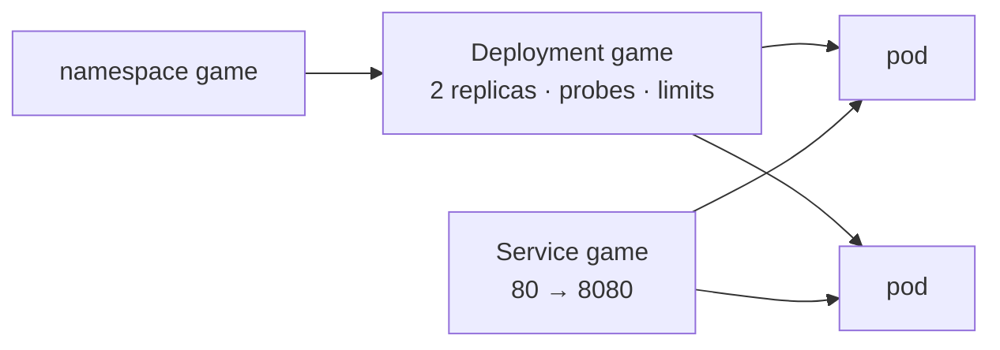

## Push the first image
$ aws ecr get-login-password --region eu-west-2 | docker login --username AWS --password-stdin 123456789012.dkr.ecr.eu-west-2.amazonaws.com
```output
Login Succeeded
```
$ docker tag game-2048:dev 123456789012.dkr.ecr.eu-west-2.amazonaws.com/game-2048:$(git rev-parse HEAD) && docker push 123456789012.dkr.ecr.eu-west-2.amazonaws.com/game-2048:$(git rev-parse HEAD)
```output
The push refers to repository [123456789012.dkr.ecr.eu-west-2.amazonaws.com/game-2048]
3f9c2e1…: digest: sha256:4b8e… size: 1989
```

## The Deployment, hardened
```yaml file=k8s/deployment.yaml
apiVersion: apps/v1
kind: Deployment
metadata:
  name: game
  namespace: game
spec:
  replicas: 2
  selector:
    matchLabels: { app: game }
  template:
    metadata:
      labels: { app: game }
    spec:
      containers:
        - name: game
          image: IMAGE_PLACEHOLDER          # the pipeline swaps in …/game-2048:<sha>
          ports:
            - containerPort: 8080
          resources:
            requests: { cpu: 50m, memory: 64Mi }
            limits: { memory: 128Mi }
          readinessProbe:
            httpGet: { path: /, port: 8080 }
            initialDelaySeconds: 3
            periodSeconds: 5
          livenessProbe:
            httpGet: { path: /, port: 8080 }
            initialDelaySeconds: 10
            periodSeconds: 10
          securityContext:
            runAsNonRoot: true
            allowPrivilegeEscalation: false
            readOnlyRootFilesystem: true
            capabilities: { drop: ["ALL"] }
          volumeMounts:
            - { name: tmp, mountPath: /tmp }   # nginx needs a writable /tmp
      volumes:
        - { name: tmp, emptyDir: {} }
```

## Namespace and Service
```yaml file=k8s/namespace.yaml
apiVersion: v1
kind: Namespace
metadata:
  name: game
```
```yaml file=k8s/service.yaml
apiVersion: v1
kind: Service
metadata:
  name: game
  namespace: game
spec:
  selector: { app: game }
  ports:
    - port: 80
      targetPort: 8080
```

## Apply and watch the rollout
Swap the placeholder for your image locally (the pipeline will do this later), then apply:
$ kubectl apply -f k8s/namespace.yaml && kubectl apply -f k8s/
```output
namespace/game created
deployment.apps/game created
service/game created
```
$ kubectl rollout status deployment/game -n game
```output
Waiting for deployment "game" rollout to finish: 0 of 2 updated replicas are available...
Waiting for deployment "game" rollout to finish: 1 of 2 updated replicas are available...
deployment "game" successfully rolled out
```
$ kubectl port-forward -n game svc/game 8080:80
```output
Forwarding from 127.0.0.1:8080 -> 8080
```
? Why is the container given an `emptyDir` mounted at `/tmp`?
- [ ] To store the game's high scores permanently
- [x] `readOnlyRootFilesystem: true` makes the image read-only, but nginx needs to write temp files, so a scratch `emptyDir` gives it somewhere writable
- [ ] To share files with the Service
- [ ] emptyDir is required by EKS
> Hardening (read-only root) plus a small writable scratch space is a common pattern.

# DNS and the NGINX Ingress Controller
@ icon: 🌐 · time: 60 min
Now let the internet in through **one** load balancer and an **NGINX ingress controller**.

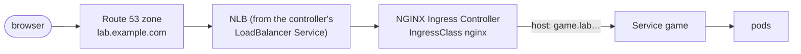

## Delegate a subdomain to Route 53
Keep the domain at its registrar and hand **`lab.example.com`** to AWS:
1. Route 53 → **Create hosted zone** `lab.example.com` (public). Note its 4 NS servers.
2. At the registrar, add 4 **NS** records named `lab`, one per AWS server.
$ dig NS lab.example.com +short
```output
ns-1234.awsdns-26.org.
ns-567.awsdns-06.net.
ns-89.awsdns-11.com.
ns-1890.awsdns-44.co.uk.
```

## Choose the controller
The community **ingress-nginx** project has been **retired**: it no longer gets releases or security fixes. Install **F5's maintained NGINX Ingress Controller** instead. It's still an NGINX Ingress Controller, so it meets the criterion, and explaining **why** you chose it in your README shows you keep up to date.

| | Community ingress-nginx | F5 NGINX Ingress Controller |
|---|---|---|
| Status | retired | maintained |
| Annotations | `nginx.ingress.kubernetes.io/…` | `nginx.org/…` |

## Install it with Terraform
```hcl file=terraform/modules/addons/ingress.tf
resource "helm_release" "nginx_ingress" {
  name             = "nginx-ingress"
  repository       = "oci://ghcr.io/nginx/charts"
  chart            = "nginx-ingress"
  # version        = "…"   ← pin the chart version you tested
  namespace        = "nginx-ingress"
  create_namespace = true

  values = [yamlencode({
    controller = {
      ingressClass = { name = "nginx", setAsDefaultIngress = true }
      service = {
        type = "LoadBalancer"
        annotations = { "service.beta.kubernetes.io/aws-load-balancer-type" = "nlb" }
      }
    }
  })]
}
```
$ kubectl get svc -n nginx-ingress
```output
NAME                       TYPE           EXTERNAL-IP                                                 PORT(S)
nginx-ingress-controller   LoadBalancer   a1b2c3…elb.eu-west-2.amazonaws.com                         80:31080/TCP,443:31443/TCP
```
$ kubectl get ingressclass
```output
NAME    CONTROLLER                     AGE
nginx   nginx.org/ingress-controller   4m
```

## An Ingress for the game
```yaml file=k8s/ingress.yaml
apiVersion: networking.k8s.io/v1
kind: Ingress
metadata:
  name: game
  namespace: game
spec:
  ingressClassName: nginx
  rules:
    - host: game.lab.example.com
      http:
        paths:
          - path: /
            pathType: Prefix
            backend:
              service:
                name: game
                port: { number: 80 }
```
Before DNS exists, test by sending the Host header straight to the NLB:
$ curl -sI -H "Host: game.lab.example.com" http://a1b2c3…elb.eu-west-2.amazonaws.com | head -1
```output
HTTP/1.1 200 OK
```
? The controller's Service shows `EXTERNAL-IP <pending>` for a long time. What do you check?
- [ ] The Grafana password
- [x] `kubectl describe svc -n nginx-ingress` events, and that the public subnets carry `kubernetes.io/role/elb = 1`
- [ ] The ECR repository
- [ ] The Ingress hostname
> AWS needs those tags to choose subnets for the load balancer.

# HTTPS and DNS on autopilot (bonus)
@ icon: 🔐 · time: 60 min
**cert-manager** gets free Let's Encrypt certificates and renews them. **ExternalDNS** creates Route 53 records from your Ingresses. Both need AWS permissions, through **IRSA**.

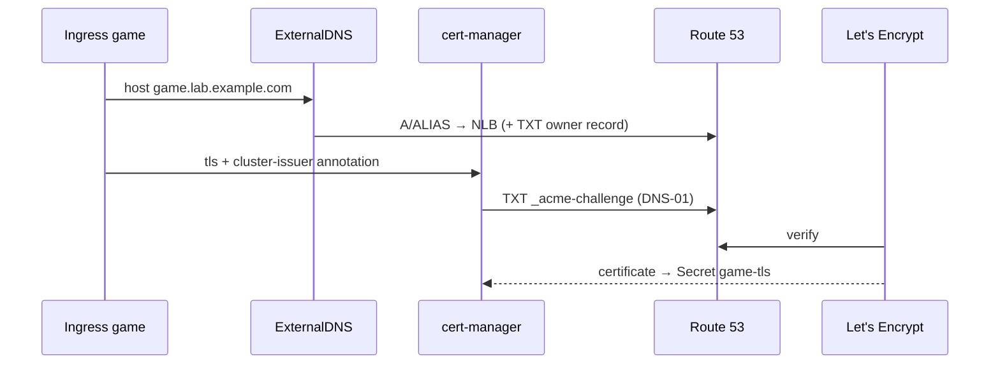

## IAM roles for the two add-ons
One IRSA role each, limited to **one hosted zone** and **one service account**:
```hcl file=terraform/modules/irsa/main.tf
module "cert_manager_irsa" {
  source  = "terraform-aws-modules/iam/aws//modules/iam-role-for-service-accounts-eks"
  version = "~> 5.0"   # newer major versions renamed this submodule: check its docs

  role_name                     = "eks-lab-cert-manager"
  attach_cert_manager_policy    = true
  cert_manager_hosted_zone_arns = [var.hosted_zone_arn]
  oidc_providers = {
    main = {
      provider_arn               = var.oidc_provider_arn
      namespace_service_accounts = ["cert-manager:cert-manager"]
    }
  }
}

module "external_dns_irsa" {
  source  = "terraform-aws-modules/iam/aws//modules/iam-role-for-service-accounts-eks"
  version = "~> 5.0"

  role_name                     = "eks-lab-external-dns"
  attach_external_dns_policy    = true
  external_dns_hosted_zone_arns = [var.hosted_zone_arn]
  oidc_providers = {
    main = {
      provider_arn               = var.oidc_provider_arn
      namespace_service_accounts = ["external-dns:external-dns"]
    }
  }
}
```

## Install cert-manager and ExternalDNS
```hcl file=terraform/modules/addons/dns-tls.tf
resource "helm_release" "cert_manager" {
  name             = "cert-manager"
  repository       = "https://charts.jetstack.io"
  chart            = "cert-manager"
  namespace        = "cert-manager"
  create_namespace = true
  set = [
    { name = "crds.enabled", value = "true" },
    { name = "serviceAccount.annotations.eks\\.amazonaws\\.com/role-arn", value = var.cert_manager_role_arn },
  ]
}

resource "helm_release" "external_dns" {
  name             = "external-dns"
  repository       = "https://kubernetes-sigs.github.io/external-dns/"
  chart            = "external-dns"
  namespace        = "external-dns"
  create_namespace = true
  values = [yamlencode({
    provider      = { name = "aws" }
    domainFilters = ["lab.example.com"]
    policy        = "sync"
    txtOwnerId    = "eks-lab"
    serviceAccount = { annotations = { "eks.amazonaws.com/role-arn" = var.external_dns_role_arn } }
  })]
}
```

## A ClusterIssuer (staging first)
```yaml file=k8s/cluster-issuer.yaml
apiVersion: cert-manager.io/v1
kind: ClusterIssuer
metadata:
  name: letsencrypt
spec:
  acme:
    server: https://acme-staging-v02.api.letsencrypt.org/directory
    email: you@example.com
    privateKeySecretRef: { name: letsencrypt }
    solvers:
      - dns01:
          route53: { region: eu-west-2 }
        selector:
          dnsZones: [lab.example.com]
```
> ⚠️ Use **staging** until the whole flow works (production has rate limits), then change `server` to `https://acme-v02.api.letsencrypt.org/directory`.

## Turn on HTTPS for the game
Add the annotation and a `tls` block to `k8s/ingress.yaml`:
```yaml file=k8s/ingress.yaml
metadata:
  annotations:
    cert-manager.io/cluster-issuer: letsencrypt
spec:
  tls:
    - hosts: [game.lab.example.com]
      secretName: game-tls
```
$ kubectl get certificate -n game
```output
NAME       READY   SECRET     AGE
game-tls   True    game-tls   2m
```
$ dig +short game.lab.example.com
```output
a1b2c3…elb.eu-west-2.amazonaws.com.
18.170.42.11
35.177.8.200
```
Open **https://game.lab.example.com**. The padlock and DNS record arrived with no manual steps.
? A certificate stays `READY False`. Where do you start?
- [ ] Restart the nodes
- [x] `kubectl describe certificate`, then follow its CertificateRequest → Order → Challenge, and check the cert-manager logs (often the IRSA role can't write the TXT record)
- [ ] Delete the Route 53 zone
- [ ] Switch the Service to NodePort
> cert-manager leaves a trail of objects. Follow them until you find the error.

# Monitoring with Prometheus and Grafana
@ icon: 📈 · time: 60 min
Worth **15 points**: Prometheus and Grafana, with a dashboard showing CPU, memory, pods, nodes and namespaces.

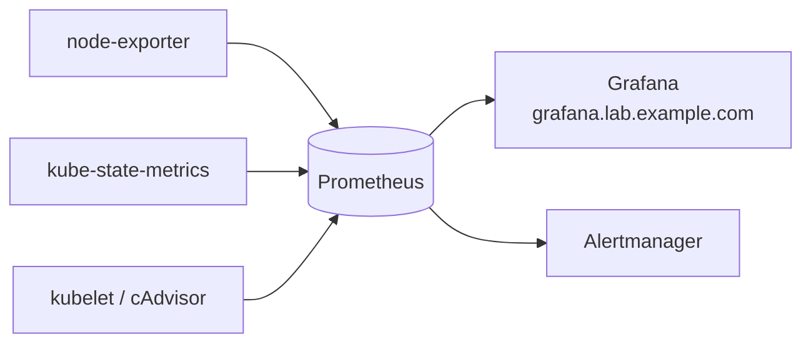

## Install kube-prometheus-stack
```hcl file=terraform/modules/addons/monitoring.tf
resource "helm_release" "monitoring" {
  name             = "monitoring"
  repository       = "https://prometheus-community.github.io/helm-charts"
  chart            = "kube-prometheus-stack"
  # version        = "…"   ← pin what you tested
  namespace        = "monitoring"
  create_namespace = true
  values           = [file("${path.module}/values/monitoring.yaml")]
}
```
```yaml file=terraform/modules/addons/values/monitoring.yaml
grafana:
  ingress:
    enabled: true
    ingressClassName: nginx
    annotations:
      cert-manager.io/cluster-issuer: letsencrypt
    hosts: [grafana.lab.example.com]
    tls:
      - hosts: [grafana.lab.example.com]
        secretName: grafana-tls
prometheus:
  prometheusSpec:
    retention: 7d
```

## Log in to Grafana
$ kubectl get pods -n monitoring
```output
NAME                                                     READY   STATUS    AGE
alertmanager-monitoring-kube-prometheus-alertmanager-0   2/2     Running   3m
monitoring-grafana-6d8f9c7b5-x2k4p                       3/3     Running   3m
monitoring-kube-state-metrics-7b9f6d4c8-q8r2t            1/1     Running   3m
monitoring-prometheus-node-exporter-4lq9v                1/1     Running   3m
prometheus-monitoring-kube-prometheus-prometheus-0       2/2     Running   3m
```
$ kubectl get secret -n monitoring monitoring-grafana -o jsonpath="{.data.admin-password}" | base64 -d
```output
pr0m-0p3r4t0r
```
Log in as `admin` at https://grafana.lab.example.com, then change the password (or set `grafana.adminPassword` from a secret).

## Build your own dashboard
The built-in **Kubernetes / Compute Resources / Cluster** and **Node Exporter / Nodes** dashboards cover the basics. For extra marks, build one with four panels:

| Panel | PromQL |
|---|---|
| Running pods per namespace | `sum by (namespace) (kube_pod_status_phase{phase="Running"})` |
| Node count | `count(kube_node_info)` |
| CPU by namespace | `sum by (namespace) (rate(container_cpu_usage_seconds_total{container!=""}[5m]))` |
| Memory by namespace | `sum by (namespace) (container_memory_working_set_bytes{container!=""})` |

Export it (Dashboard → Share → Export → JSON) into `monitoring/dashboards/` in your repo.
? Why do the requests and limits you set on the game make these graphs more useful?
- [ ] Prometheus can't scrape pods without them
- [x] You can compare actual usage against what each pod reserved and is allowed, which shows over- or under-sizing
- [ ] Grafana requires limits to start
- [ ] They change the colours
> Usage on its own is just a number. Against requests and limits, it becomes a decision.

# Pipeline 1: Terraform
@ icon: 🔁 · time: 45 min
Automate the infrastructure: **plan on every pull request**, **apply on merge**, with state management and error handling.

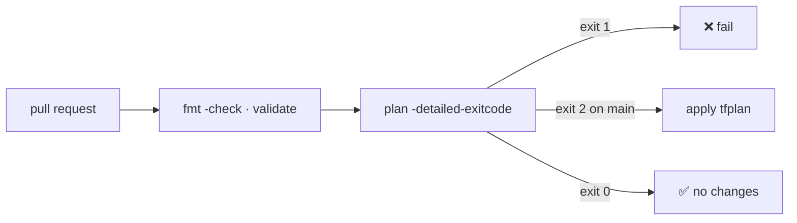

## The workflow
```yaml file=.github/workflows/terraform.yml
name: Terraform
on:
  pull_request:
    paths: ['terraform/**']
  push:
    branches: [main]
    paths: ['terraform/**']
  workflow_dispatch:

concurrency:
  group: terraform-dev
  cancel-in-progress: false      # never kill an apply half-way

permissions:
  id-token: write
  contents: read
  pull-requests: write

jobs:
  terraform:
    runs-on: ubuntu-latest
    environment: dev             # add required reviewers here for an approval gate
    defaults:
      run:
        working-directory: terraform/envs/dev
    steps:
      - uses: actions/checkout@v4
      - uses: aws-actions/configure-aws-credentials@v4
        with:
          role-to-assume: ${{ secrets.AWS_ROLE_ARN }}
          aws-region: eu-west-2
      - uses: hashicorp/setup-terraform@v3
      - run: terraform fmt -check -recursive
      - run: terraform init -input=false
      - run: terraform validate
      - id: plan
        run: terraform plan -input=false -out=tfplan -detailed-exitcode
        continue-on-error: true
      - if: steps.plan.outputs.exitcode == '1'
        run: exit 1
      - if: github.ref == 'refs/heads/main' && steps.plan.outputs.exitcode == '2'
        run: terraform apply -input=false tfplan
```
> 🔧 Pin third-party actions to full commit SHAs in real use, and check for newer major versions.

## What "state management and error handling" mean
- **State:** remote in S3, versioned, `use_lockfile = true`, created by bootstrap, plus a **concurrency group** so two runs can't fight over the lock.
- **Errors:** `fmt -check` and `validate` fail fast. `-detailed-exitcode` separates **error (1)** from **changes (2)** and **no changes (0)**. `-input=false` never hangs. Only the **saved plan** is applied, and only on **main**.
? Why `continue-on-error: true` on the plan step?
- [ ] To ignore Terraform errors
- [x] Exit code 2 means "there are changes", which isn't a failure; the next step fails the job explicitly when the code is 1
- [ ] To speed up the run
- [ ] It's required by setup-terraform
> The workflow decides what each exit code means, rather than treating every non-zero code as a failure.

# Pipeline 2: scan, build, push and deploy
@ icon: 🛡️ · time: 60 min
The biggest section (**30 points**): **Checkov** scans the code, **Trivy** scans the image **before** it's pushed, the image goes to **ECR** tagged with the commit SHA, and the manifests deploy to EKS with **automatic rollback**.

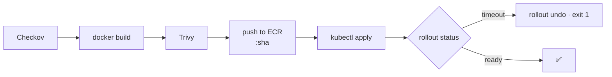

## Scan, then build
```yaml file=.github/workflows/app.yml
name: App
on:
  push:
    branches: [main]
    paths: ['index.html', 'js/**', 'style/**', 'meta/**', 'k8s/**', 'Dockerfile']
  workflow_dispatch:
permissions:
  id-token: write
  contents: read
env:
  AWS_REGION: eu-west-2
  ECR_REPOSITORY: game-2048
  IMAGE_TAG: ${{ github.sha }}
jobs:
  scan-build-deploy:
    runs-on: ubuntu-latest
    steps:
      - uses: actions/checkout@v4
      - name: Checkov (Kubernetes YAML + Dockerfile)
        uses: bridgecrewio/checkov-action@v12
        with:
          directory: .
          framework: kubernetes,dockerfile
          soft_fail: false
      - name: Build
        run: docker build -t "$ECR_REPOSITORY:$IMAGE_TAG" .
```

## Trivy, then push
```yaml file=.github/workflows/app.yml
      - name: Trivy (fail on fixable HIGH/CRITICAL)
        uses: aquasecurity/trivy-action@0.28.0     # pin to a full commit SHA in real use
        with:
          image-ref: ${{ env.ECR_REPOSITORY }}:${{ env.IMAGE_TAG }}
          severity: CRITICAL,HIGH
          ignore-unfixed: true
          exit-code: '1'
      - uses: aws-actions/configure-aws-credentials@v4
        with:
          role-to-assume: ${{ secrets.AWS_ROLE_ARN }}
          aws-region: ${{ env.AWS_REGION }}
      - id: ecr
        uses: aws-actions/amazon-ecr-login@v2
      - name: Push
        run: |
          IMAGE="${{ steps.ecr.outputs.registry }}/$ECR_REPOSITORY:$IMAGE_TAG"
          docker tag "$ECR_REPOSITORY:$IMAGE_TAG" "$IMAGE"
          docker push "$IMAGE"
          echo "IMAGE=$IMAGE" >> "$GITHUB_ENV"
```

## Deploy with automatic rollback
```yaml file=.github/workflows/app.yml
      - name: Deploy
        run: |
          set -euo pipefail
          aws eks update-kubeconfig --region "$AWS_REGION" --name eks-lab
          sed -i "s#IMAGE_PLACEHOLDER#${IMAGE}#" k8s/deployment.yaml
          kubectl apply -f k8s/namespace.yaml
          kubectl apply -f k8s/
          if ! kubectl rollout status deployment/game -n game --timeout=120s; then
            echo "Rollout failed: rolling back"
            kubectl rollout undo deployment/game -n game
            exit 1
          fi
```
Why this order: Checkov is cheap and catches design flaws early. A vulnerable image **never reaches ECR**. OIDC means no stored keys. SHA tags make rollbacks exact. `rollout status` + `undo` turns a bad release into a red run, with the old version still serving.

## Fix what the scanners find
Typical Checkov findings on Kubernetes YAML: no **requests/limits**, no **probes**, running as **root**, an image tag of **`latest`**, no **securityContext**. The hardened Deployment from stage 6 already fixes most of them.

To accept a finding deliberately, add a reasoned skip:
```yaml
metadata:
  annotations:
    checkov.io/skip1: CKV_K8S_43=Image is pinned by commit SHA tag, not digest
```
Trivy findings are usually fixed by a **newer base image**: pin a newer version and rebuild.

## Prove the error handling works
Break the readiness probe on purpose (e.g. path `/nope`), push it, and watch the run:
$ gh run watch
```output
✓ Checkov (Kubernetes YAML + Dockerfile)
✓ Build
✓ Trivy (fail on fixable HIGH/CRITICAL)
✓ Push
X Deploy
  Waiting for deployment "game" rollout to finish: 1 out of 2 new replicas have been updated...
  error: timed out waiting for the condition
  Rollout failed: rolling back
  deployment.apps/game rolled back
```
? During that failed rollout, were players affected?
- [ ] Yes: all pods were replaced with the broken version
- [x] No: the new pods never became ready, so the Service kept sending traffic to the old pods, and the pipeline rolled back
- [ ] Yes: the namespace was deleted
- [ ] Only for 120 seconds
> Readiness probes gate the rollout. That's why they matter so much.

# Helm chart for the app (bonus)
@ icon: ⎈ · time: 45 min
Turn the three manifests into a **Helm chart**, so each release only changes a value: the image tag.

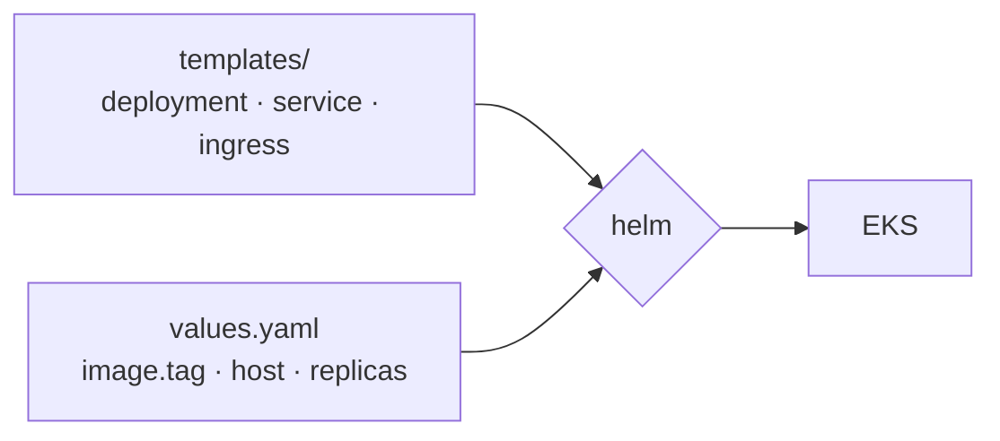

## Create and trim the chart
$ helm create charts/game-2048
```output
Creating charts/game-2048
```
Delete the generated templates you don't need, and move your three manifests into `templates/`, replacing fixed values with `{{ .Values… }}`.
```yaml file=charts/game-2048/values.yaml
replicaCount: 2
image:
  repository: 123456789012.dkr.ecr.eu-west-2.amazonaws.com/game-2048
  tag: ""                       # set by the pipeline
ingress:
  host: game.lab.example.com
  clusterIssuer: letsencrypt
```
```yaml file=charts/game-2048/templates/deployment.yaml
spec:
  replicas: {{ .Values.replicaCount }}
  template:
    spec:
      containers:
        - name: game
          image: "{{ .Values.image.repository }}:{{ required "image.tag is required" .Values.image.tag }}"
```

## Lint, render and install
$ helm lint charts/game-2048 --set image.tag=test
```output
==> Linting charts/game-2048
1 chart(s) linted, 0 chart(s) failed
```
$ helm upgrade --install game charts/game-2048 -n game --create-namespace --set image.tag=3f9c2e1
```output
Release "game" does not exist. Installing it now.
NAME: game
NAMESPACE: game
STATUS: deployed
REVISION: 1
```
In Pipeline 2, replace the `sed` + `kubectl apply` lines with `helm upgrade --install … --set image.tag=$IMAGE_TAG --wait --atomic`. `--atomic` rolls back automatically if the release doesn't become healthy.

? What does `--atomic` add to `helm upgrade --install`?
- [ ] It makes the upgrade faster
- [x] If the release fails (e.g. pods never become ready within `--wait`), Helm rolls it back automatically
- [ ] It deletes the namespace on failure
- [ ] It skips the hooks
> The Helm equivalent of `rollout status` + `rollout undo`.

# GitOps with Argo CD (bonus)
@ icon: 🐙 · time: 60 min
With **Argo CD**, the pipeline stops deploying. It **commits the new image tag to Git**, and Argo CD (inside the cluster) syncs the cluster to match.

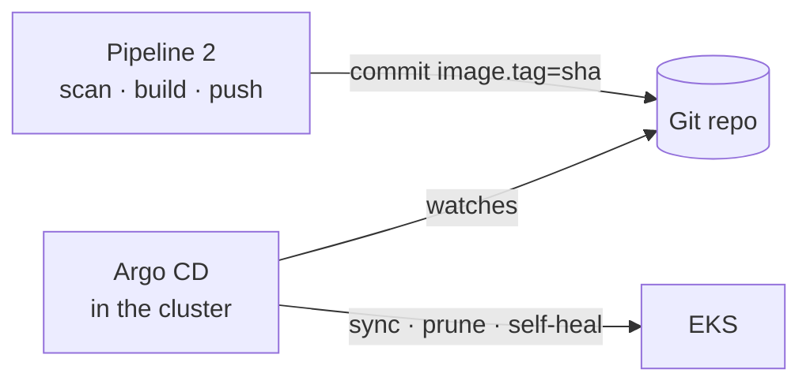

## Install Argo CD
```hcl file=terraform/modules/addons/argocd.tf
resource "helm_release" "argocd" {
  name             = "argo-cd"
  repository       = "https://argoproj.github.io/argo-helm"
  chart            = "argo-cd"
  namespace        = "argocd"
  create_namespace = true
  values = [yamlencode({
    configs = { params = { "server.insecure" = true } }   # TLS ends at the ingress
    server = {
      ingress = {
        enabled          = true
        ingressClassName = "nginx"
        hostname         = "argocd.lab.example.com"
        annotations      = { "cert-manager.io/cluster-issuer" = "letsencrypt" }
        tls              = true
      }
    }
  })]
}
```
$ kubectl -n argocd get secret argocd-initial-admin-secret -o jsonpath="{.data.password}" | base64 -d
```output
xK3pR9vT2mQw7LbN
```

## Point Argo CD at the chart
```yaml file=argocd/game.yaml
apiVersion: argoproj.io/v1alpha1
kind: Application
metadata:
  name: game
  namespace: argocd
spec:
  project: default
  source:
    repoURL: https://github.com/your-username/eks-assignment
    targetRevision: main
    path: charts/game-2048
    helm:
      valueFiles: [values.yaml]
  destination:
    server: https://kubernetes.default.svc
    namespace: game
  syncPolicy:
    automated: { prune: true, selfHeal: true }
    syncOptions: [CreateNamespace=true]
```
$ kubectl apply -f argocd/game.yaml
```output
application.argoproj.io/game created
```

## Change Pipeline 2's last step
Instead of deploying, the pipeline commits the new tag:
```yaml file=.github/workflows/app.yml
      - name: Bump image tag for Argo CD
        run: |
          yq -i ".image.tag = \"$IMAGE_TAG\"" charts/game-2048/values.yaml
          git config user.name "github-actions"
          git config user.email "github-actions@users.noreply.github.com"
          git commit -am "deploy: game-2048 $IMAGE_TAG [skip ci]"
          git push
```
The job now needs `contents: write`, and **no** cluster access at all.
? What's the security benefit of the GitOps version?
- [ ] Argo CD encrypts the images
- [x] The pipeline no longer needs credentials for the cluster; only Argo CD, inside the cluster, applies changes
- [ ] GitHub can't be hacked
- [ ] It removes the need for Trivy
> Fewer powerful credentials outside the cluster means a smaller blast radius.

# Architecture diagram and README (bonus)
@ icon: 📐 · time: 45 min
Worth 10 bonus points, and it's what reviewers read first. Draw it in **draw.io** or **Excalidraw** with AWS icons, and show **two views**.

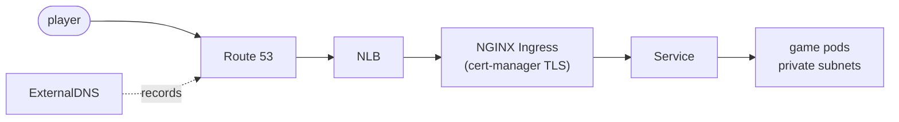

## View 2: the deployment flow
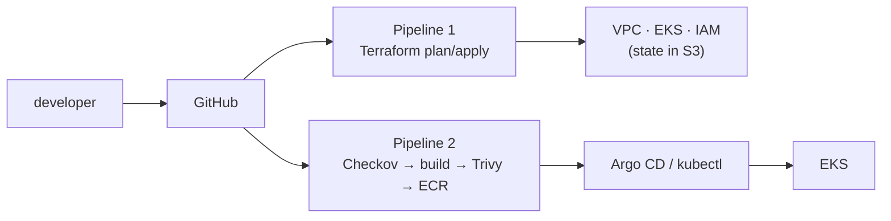

## The README checklist
- what it is, and a screenshot of the live game
- **both diagrams**
- tools and **why** (e.g. "F5 NGINX Ingress Controller, because community ingress-nginx is retired")
- how to deploy, and how to **destroy**
- **costs**, and how you kept them down
- what you'd improve (least-privilege CI role, private API endpoint, NAT per AZ, Pod Identity, Gateway API)
- clear, ticket-linked commit messages from day one

# Clean up (do this, or pay for it)
@ icon: 🧹 · time: 20 min
Kubernetes created some AWS resources itself: the **NLB**, the **DNS records** and any **EBS volumes**. Terraform doesn't know about them. Destroy the cluster first and they become **orphans** that keep billing and can block the VPC from being deleted. Tidy up **inside out**.

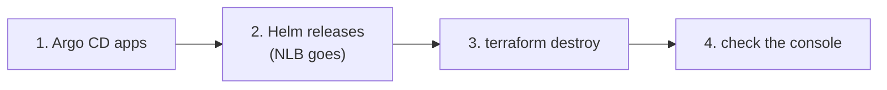

## Remove the apps and add-ons
$ kubectl delete application game -n argocd
```output
application.argoproj.io "game" deleted
```
$ helm uninstall argo-cd -n argocd && helm uninstall monitoring -n monitoring && helm uninstall external-dns -n external-dns && helm uninstall cert-manager -n cert-manager && helm uninstall nginx-ingress -n nginx-ingress
```output
release "argo-cd" uninstalled
release "monitoring" uninstalled
release "external-dns" uninstalled
release "cert-manager" uninstalled
release "nginx-ingress" uninstalled
```
> If the add-ons are managed by Terraform, destroy the **addons** stack first instead of using `helm uninstall`.

## Destroy the infrastructure
$ cd terraform/envs/dev && terraform destroy
```output
Plan: 0 to add, 0 to change, 63 to destroy.
module.eks.module.eks.aws_eks_cluster.this[0]: Destruction complete after 6m12s
module.vpc.module.vpc.aws_vpc.this[0]: Destruction complete after 1s
Destroy complete! Resources: 63 destroyed.
```
$ aws elbv2 describe-load-balancers --region eu-west-2 --query "LoadBalancers[].LoadBalancerName"
```output
[]
```
Also check Route 53 records and EC2 → Volumes. Keep the bootstrap stack (state bucket and OIDC) for next time.
? Why delete the Helm releases **before** `terraform destroy`?
- [ ] Helm releases cost more than the cluster
- [x] Removing the controller's LoadBalancer Service deletes the NLB that Kubernetes created; otherwise it's orphaned and blocks the VPC deletion
- [ ] Terraform can't delete namespaces
- [ ] Helm locks the state file
> Inside-out clean-up: what Kubernetes created, Kubernetes should delete.
