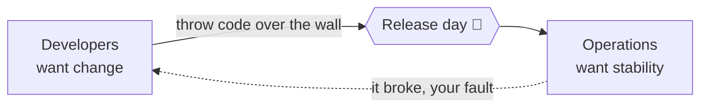
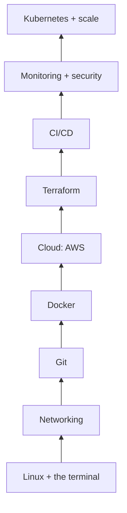
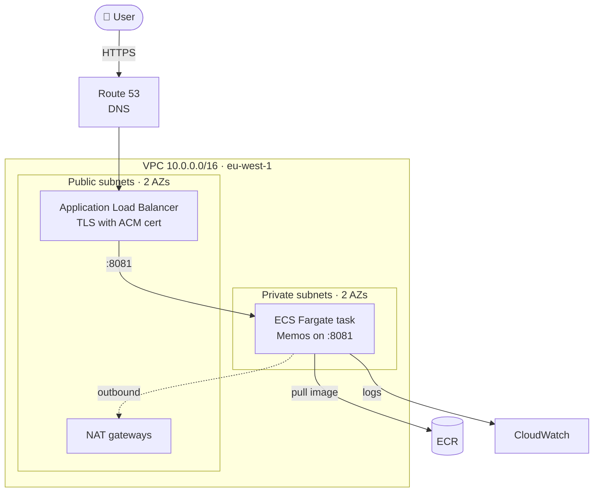
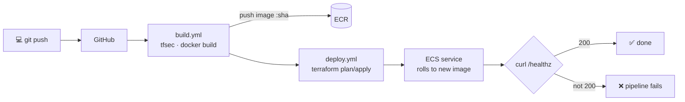

## What DevOps is

### The problem DevOps solves
Software used to be built by one team (**Dev**) and run by another (**Ops**). Developers wanted to ship changes fast. Operations wanted nothing to break. Code was "thrown over the wall", releases were rare and scary, and when something failed each side blamed the other.



### So what is DevOps?
**DevOps** is a way of working where the people who build software and the people who run it share responsibility for the whole life of a service: plan, code, build, test, release, run and learn.

It is **culture plus automation**. Tools such as Docker, Terraform and GitHub Actions matter, but only because they let small changes reach users **quickly and safely**, again and again.

### The DevOps loop
Work flows round a never-ending loop. Each lap should be small, so each release is low-risk and you learn quickly from real users.

```mermaid caption="Plan → code → build → test → release → deploy → operate → monitor → back to plan"
flowchart LR
  P[Plan] --> C[Code] --> B[Build] --> T[Test]
  T --> R[Release] --> D[Deploy] --> O[Operate] --> M[Monitor]
  M --> P
```

### CALMS: the five ideas behind DevOps
- **C**ulture: shared ownership, and no blame when things go wrong.
- **A**utomation: anything you do twice by hand, script it.
- **L**ean: small batches, little waiting, little waste.
- **M**easurement: decide with data (deploy frequency, failure rate, recovery time).
- **S**haring: knowledge, tools and on-call duty are shared, not hoarded.

### Measuring DevOps: the four DORA metrics
Google's DORA research found four numbers that separate strong teams from weak ones:

| Metric | Question it answers |
|---|---|
| Deployment frequency | How often do we ship? |
| Lead time for changes | How long from commit to production? |
| Change failure rate | What % of releases cause a problem? |
| Time to restore | How fast do we recover? |

Elite teams deploy often **and** fail rarely. Speed and stability go together.

### Check
? What is the main goal of DevOps?
- [ ] To replace operations engineers with developers
- [x] To get small changes to users quickly and safely, with shared ownership
- [ ] To use as many tools as possible
- [ ] To release software less often so it is more stable
> DevOps is culture and automation that make **frequent, low-risk** releases possible. Releasing *less* often usually makes each release *riskier*.

## What a DevOps engineer does

### A day in the job
A DevOps or platform engineer builds the **road** that code travels on, so developers can ship without tickets and waiting:

- writes **infrastructure as code** (Terraform) for networks, servers and databases
- builds **CI/CD pipelines** that test and deploy automatically
- packages apps in **containers**
- sets up **monitoring, logging and alerts**
- keeps things **secure**, **reliable** and **affordable**
- helps fix **incidents** and makes sure they don't repeat

### The skills stack
You learn these roughly from the bottom up. This app follows the same order.



> 🔧 **Tip:** you don't need to master one layer before starting the next. You do need the basics of each, because every layer leans on the ones below.

### Check
? Which of these is NOT usually part of a DevOps engineer's job?
- [ ] Writing Terraform for cloud infrastructure
- [ ] Building CI/CD pipelines
- [x] Designing the company logo
- [ ] Setting up monitoring and alerts
> Branding is design work. Infrastructure as code, pipelines and monitoring are core DevOps tasks.

## The project you'll build

### Meet Memos
**Memos** is an open-source note-taking web app (Go backend, React frontend). In this course you take its code and run it on AWS the way a real company would, live at **tm.myegh.com**.

By the end you'll understand every box in this picture, and be able to build it from an empty AWS account. The **Build Lab** tab walks you through it step by step.

### The finished architecture


### How code gets there
Nobody clicks around the AWS console. A push to GitHub starts a pipeline that builds, scans and deploys, and logs in to AWS **without any stored keys** (OIDC).



### Check
? In the Memos architecture, where does the app container actually run?
- [ ] In a public subnet with a public IP
- [x] On ECS Fargate in private subnets, reached only through the load balancer
- [ ] Directly on the Application Load Balancer
- [ ] In the ECR image registry
> The task sits in **private subnets** with no public IP. Users reach it only through the ALB in the public subnets. ECR just stores the image.

## How to use this app

### The four ways to learn here
- **📚 Learn:** short cards, one idea each. Swipe up. The quick checks keep you honest.
- **🛠️ Lab:** build the whole Memos platform step by step, typing real commands into a practice terminal.
- **🧠 Quiz:** multiple choice from tech-vault and your guides, with explanations. Missed questions come back.
- **🎯 Scenarios:** interview-style "what would you do?" problems with feedback on every option.

### A plan that works
1. **Little and often:** 15–20 minutes a day beats 3 hours on Sunday.
2. Do a Learn module, then its **Lab** stage, then **Quiz** on that topic.
3. Say scenario answers **out loud**, as in an interview.
4. Revisit **❌ Missed** questions every few days. Spaced repetition is how things stick.

> 🔧 **Levels:** modules are tagged **Beginner → Intermediate → Advanced**. Work through them in order the first time.
