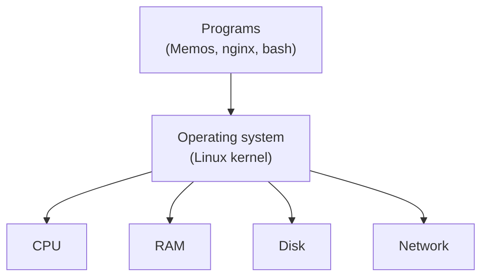
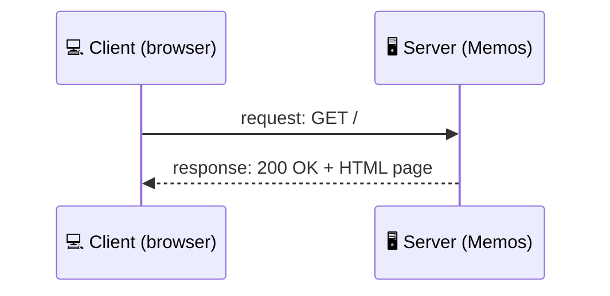
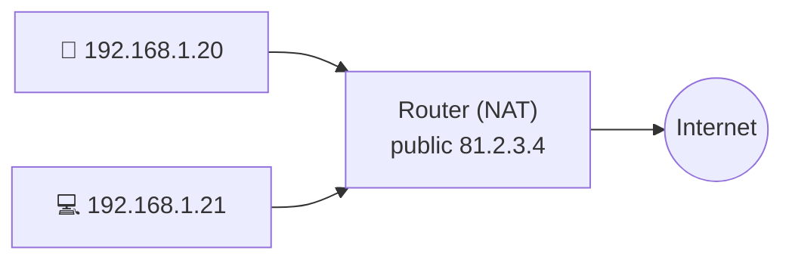
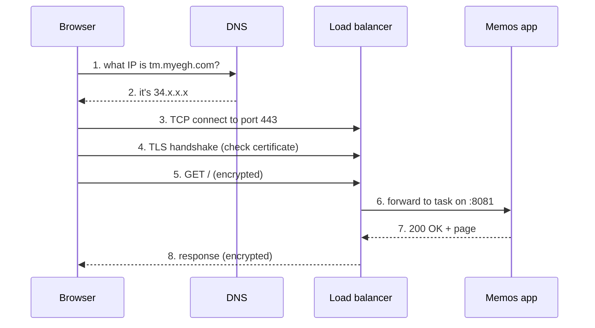
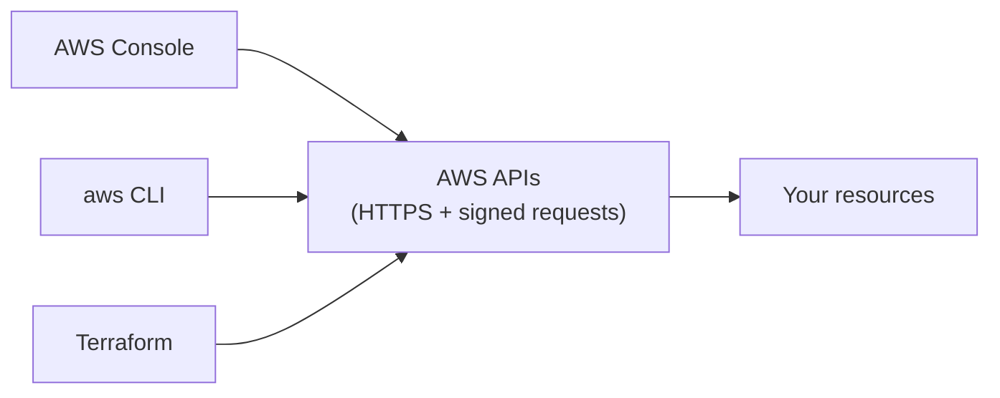

## Computers and servers

### What's inside a computer
Every computer, from a laptop to a cloud server, has the same four parts:

- **CPU:** does the calculations. Measured in cores (and, in AWS, vCPUs).
- **RAM (memory):** fast, temporary workspace. It's wiped when power goes off.
- **Storage (disk):** slower, but keeps data permanently.
- **Network card:** sends and receives data.

The **operating system** (Linux, Windows, macOS) shares those parts between running programs.



### A server is just a computer that serves
A **server** is a computer that waits for requests and answers them. A **client** is whatever asks: your browser, your phone app, or another server.

There's nothing magic about server hardware. In the cloud, a "server" is usually a **virtual machine** or a **container** running on someone else's hardware.



> 🔧 **In Memos:** the "server" is a single container running the `memos` binary on AWS Fargate, with 0.25 vCPU and 512 MB of RAM.

### Check
? Which part of a computer loses its contents when the power goes off?
- [ ] The disk
- [x] RAM
- [ ] The network card
- [ ] An SSD
> RAM is **volatile**: it's fast but temporary. Disks (HDD or SSD) keep data without power.

## Addresses: IP and ports

### IP addresses: the street address
Every device on a network has an **IP address** so data can find it.

- **IPv4** looks like `203.0.113.10`: four numbers from 0 to 255, about 4.3 billion addresses in total.
- **IPv6** looks like `2001:db8::1` and has vastly more addresses.

**Public** IPs can be reached from the internet. **Private** IPs only work inside a private network and come from three reserved ranges:

| Private range | Typical use |
|---|---|
| `10.0.0.0/8` | big networks, AWS VPCs (Memos uses `10.0.0.0/16`) |
| `172.16.0.0/12` | Docker's default networks |
| `192.168.0.0/16` | home Wi-Fi routers |

### NAT: many private devices, one public IP
Your home has one public IP, but lots of devices. Your router does **NAT** (Network Address Translation): it swaps private source addresses for its public one on the way out, and remembers which reply belongs to whom.



> 🔧 **In Memos:** a **NAT gateway** does the same job in AWS. Private ECS tasks can reach out (to pull images, for example), but nobody on the internet can start a connection in to them.

### Ports: the flat number
An IP address gets data to the right **machine**. A **port** (0–65535) gets it to the right **program** on that machine.

| Port | Used by |
|---|---|
| 22 | SSH (remote login) |
| 53 | DNS |
| 80 | HTTP |
| 443 | HTTPS |
| 5432 / 3306 | PostgreSQL / MySQL |
| 8081 | Memos in this project (Memos' own default is 5230) |

An address plus a port, such as `10.0.3.25:8081`, is called a **socket**.

### Check
? A request reaches the right server but the wrong program answers. What was most likely wrong?
- [ ] The IP address
- [x] The port number
- [ ] The MAC address
- [ ] The DNS TTL
> The IP picks the **machine**. The **port** picks the program on it. If the port is wrong, the right server is reached but the wrong program, or no program, answers.

## Opening a website, step by step

### What happens when you type a URL
Typing `https://tm.myegh.com` sets off a chain of steps, and each one is a topic in this course:



### Reading a URL
```output
https://tm.myegh.com:443/api/v1/memos?limit=10
└─┬─┘   └─────┬────┘ └┬┘ └─────┬─────┘ └──┬───┘
scheme     host     port    path      query
```
- **Scheme:** how to talk (`https` means HTTP over TLS).
- **Host:** which server, turned into an IP by DNS.
- **Port:** optional. Defaults to 443 for https and 80 for http.
- **Path:** which resource on the server.
- **Query:** extra parameters.

### HTTP: request and response
HTTP is plain text with a fixed shape. The client sends a **method** and a **path**. The server replies with a **status code**, **headers** and a **body**.

```output
GET /healthz HTTP/1.1          ← request line
Host: tm.myegh.com              ← headers

HTTP/1.1 200 OK                 ← status line
Content-Type: text/plain
Service ready.                  ← body
```

Common methods: **GET** (read), **POST** (create), **PUT/PATCH** (update), **DELETE** (remove).

### Status codes by their first digit
| Range | Meaning | Examples |
|---|---|---|
| 2xx | Success | 200 OK, 201 Created |
| 3xx | Go elsewhere | 301 Moved Permanently (Memos' HTTP→HTTPS redirect) |
| 4xx | **Client** made a mistake | 400 Bad Request, 401 Unauthorised, 403 Forbidden, 404 Not Found |
| 5xx | **Server** failed | 500 Internal Error, 502 Bad Gateway, 503 Unavailable, 504 Timeout |

> 🔧 **Tip:** 4xx means look at the request. 5xx means look at the server, and the load balancer's targets.

### Check
? A user gets **403 Forbidden**. What does that tell you?
- [ ] The server crashed
- [ ] The page doesn't exist
- [x] The server understood the request but refuses to allow it
- [ ] The DNS lookup failed
> 403 is a **4xx client** error: the request reached the server, which decided you aren't allowed. A crash would be 5xx, a missing page 404, and a DNS failure never reaches the server at all.

? What does the ALB in Memos send back when someone visits `http://tm.myegh.com`?
- [ ] 200 OK with the page
- [x] 301 redirect to the https:// address
- [ ] 404 Not Found
- [ ] 502 Bad Gateway
> The HTTP listener on port 80 has a single redirect rule: send **301** to port 443 over HTTPS.

## Clients, servers and APIs

### What an API is
An **API** (Application Programming Interface) is a set of requests a program agrees to answer. Web APIs usually speak HTTP and send **JSON**.

```output
GET /api/v1/memos      →  [{"id": 1, "content": "buy milk"}]
POST /api/v1/memos     →  201 Created
```

Every AWS action, such as "create a VPC" or "push an image", is an **API call**. The console, the CLI and Terraform are all just different ways of making those calls.



### Check
? Terraform, the AWS CLI and the AWS web console all create resources by…
- [ ] editing the same config file
- [x] calling the same AWS APIs
- [ ] logging in to the servers over SSH
- [ ] running CloudFormation behind the scenes
> They are all clients of the **AWS APIs**. That's why anything you can click in the console can also be automated in code.
