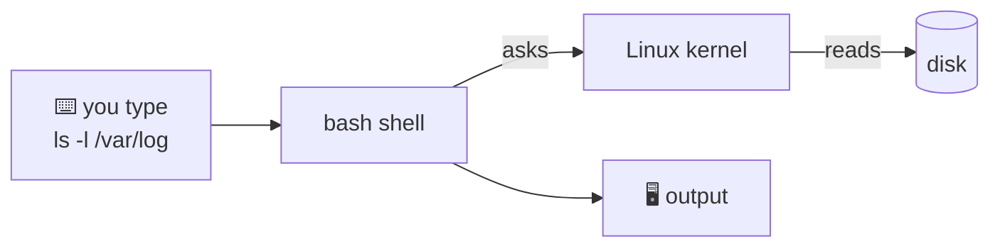
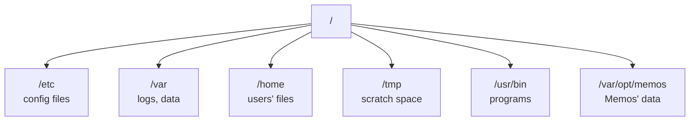
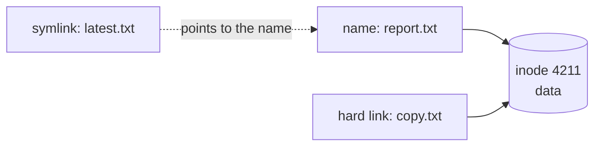
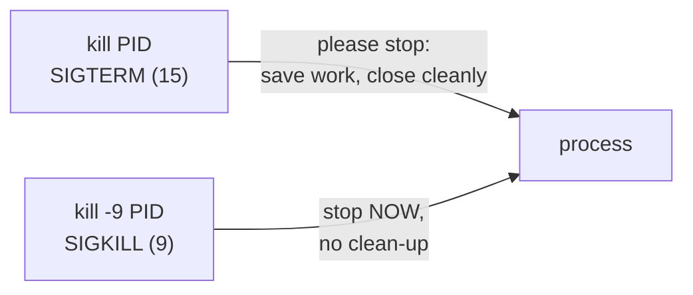

## Linux and the terminal

### Why Linux?
Most servers, almost all containers and nearly every cloud workload run **Linux**. It's free, open source, stable and scriptable.

- The **kernel** is the core: it manages CPU, memory, disks, the network and processes.
- A **distribution** (Ubuntu, Debian, Amazon Linux, Alpine) is the kernel plus tools and a package manager.

> 🔧 **In Memos:** the container runs on **Alpine Linux 3.21**, a tiny distribution (about 5 MB) that's popular for containers.

### The shell
The **terminal** is the window. The **shell** (usually `bash`) is the program inside it that reads your commands, runs them and prints the results.



A command has a **name**, **options** (also called flags) and **arguments**:
```output
ls   -l -a    /var/log
│    └─┬─┘    └───┬───┘
cmd  options    argument
```

### Moving around
| Command | Does |
|---|---|
| `pwd` | print where you are |
| `ls -la` | list files, including hidden ones, with details |
| `cd /var/log` | change directory (`cd ..` up, `cd ~` home) |
| `mkdir -p a/b` | make folders, creating parents too |
| `cp`, `mv`, `rm -r` | copy, move or rename, delete (there's no recycle bin!) |
| `cat`, `less`, `head`, `tail -f` | read files, and follow a growing log |

> ⚠️ `rm -rf` deletes instantly and permanently. Check the path twice.

### Check
? Which command shows the last lines of a log file and keeps printing new lines as they arrive?
- [ ] `cat app.log`
- [ ] `head -f app.log`
- [x] `tail -f app.log`
- [ ] `less app.log`
> `tail -f` **follows** the file. It's the go-to for watching logs live.

## The file system

### One tree, starting at /
Linux has no `C:` drive. Everything hangs off a single root, `/`, and even other disks are **mounted** somewhere in the tree.



| Folder | Holds |
|---|---|
| `/etc` | system configuration |
| `/var/log` | logs |
| `/home/<user>` | a user's files (`/root` for root) |
| `/tmp` | temporary files, often cleared on reboot |
| `/usr/bin`, `/usr/local/bin` | installed programs (`memos` lives in `/usr/local/bin`) |

### Absolute vs relative paths
- **Absolute** paths start at `/`: `/var/opt/memos/memos_prod.db`
- **Relative** paths start where you are: `logs/app.log`
- `.` means "here", `..` means "one level up" and `~` means your home folder.

### Everything is a file
In Linux, nearly everything looks like a file: devices (`/dev/sda`), process information (`/proc`), even network sockets. That's why simple tools such as `cat`, `grep` and `>` work almost everywhere.

### Inodes: a file's ID card
Each file has an **inode** that stores its metadata: type, permissions, owner, size, timestamps and where its data blocks are on disk. The **file name is not in the inode**. Names live in directories, which map names to inode numbers.

- `ls -i` shows inode numbers.
- `df -i` shows inode usage. A disk can be "full" because it has **run out of inodes**, even with space left (for example, millions of tiny files).

### Links: hard vs soft

- A **hard link** is a second name for the same inode. The data survives until every name is deleted.
- A **symbolic (soft) link** is a pointer to a path. It breaks if the target is moved or deleted.

### Check
? A server says "No space left on device", but `df -h` shows 40% free. What should you check next?
- [ ] RAM usage with `free -h`
- [x] Inode usage with `df -i`
- [ ] The CPU load with `top`
- [ ] Open ports with `ss -tlnp`
> Every file needs an inode. Millions of tiny files can use them all up while disk space remains, and `df -i` shows it.

## Users and permissions

### Users, groups and root
Every file and process belongs to a **user**. Users can be in **groups**. **root** (user ID 0) can do anything, which is why you avoid using it day to day and use `sudo` for single commands.

```output
$ id
uid=1001(appuser) gid=1001(appuser) groups=1001(appuser)
```

> 🔧 **In Memos:** the Dockerfile creates `appuser` with UID **1001** and runs the app as `USER 1001:1001`, never as root. If the app is hacked, the attacker isn't root inside the container.

### Reading rwx
```output
-rwxr-x---  1 appuser appuser  2.1K  run.sh
│└┬┘└┬┘└┬┘
│ │  │  └── others: ---  (nothing)
│ │  └───── group:  r-x  (read, run)
│ └──────── owner:  rwx  (read, write, run)
└────────── type: - file, d directory, l link
```
On a **directory**, `r` means you can list it, `w` means you can create or delete files in it, and `x` means you can enter it (`cd`).

### Numbers: chmod 755
Each permission has a value: **r = 4, w = 2, x = 1**. Add them up for each of owner, group and others.

| Number | Meaning | Typical use |
|---|---|---|
| `755` | rwx r-x r-x | scripts, programs, folders |
| `644` | rw- r-- r-- | normal files |
| `600` | rw- --- --- | private keys (SSH refuses keys that are more open than this) |

```output
chmod 755 deploy.sh     # set permissions
chown appuser:appuser /var/opt/memos   # change owner
```

### Check
? What does `chmod 640 secrets.env` give?
- [ ] Owner read/write/execute, group read, others nothing
- [x] Owner read/write, group read, others nothing
- [ ] Everyone can read
- [ ] Owner read only
> 6 = 4+2 (rw), 4 = r, 0 = nothing. So: owner **rw-**, group **r--**, others **---**.

? You can `ls` a folder but `cd` into it fails with "Permission denied". Which permission is missing?
- [ ] r
- [ ] w
- [x] x
- [ ] s
> On directories, **x** means "enter or traverse". With `r` but no `x` you can see the names but can't go in.

## Processes and services

### What a process is
A **process** is a running program. Each has a **PID** (process ID) and a parent. The first process, **PID 1**, starts everything else. On most systems that's **systemd**. In a container it's your app.

```output
ps aux | head          # all processes
top / htop             # live CPU and memory
pgrep memos            # find a PID by name
```

### Signals: asking vs forcing

Always try **SIGTERM** first. Use `-9` only if it won't stop, because SIGKILL can leave half-written files behind.

> 🔧 **Exit codes to know:** `0` success · `1` general error · `127` command not found · `137` = 128+9, killed by SIGKILL, usually **out of memory** · `143` = 128+15, stopped by SIGTERM.

### Zombies and orphans
- A **zombie** has finished, but its parent hasn't collected its exit status yet. It uses no CPU or memory, only a PID entry. The fix is the parent.
- An **orphan** is a process whose parent died. It gets adopted by PID 1.

### Services with systemd
Long-running background programs (**daemons**) such as web servers are managed by **systemd**:

| Command | Does |
|---|---|
| `systemctl status nginx` | is it running? recent logs |
| `systemctl start / stop / restart nginx` | control it **now** |
| `systemctl enable nginx` | start it **at boot** |
| `journalctl -u nginx -f` | follow that service's logs |

> ⚠️ `start` and `enable` are different: started means running now, enabled means it starts after a reboot. You often need both.

### Check
? A container stops with **exit code 137**. What is the most likely cause?
- [ ] The command wasn't found
- [ ] It finished successfully
- [x] It was killed with SIGKILL, often for using too much memory
- [ ] It was stopped politely with SIGTERM
> 137 = 128 + 9 (SIGKILL). On ECS or Kubernetes that's usually the **out-of-memory** killer. Memos' task has only 512 MB.

## Software, disks and logs

### Package managers
Install software from trusted repositories, not by downloading random files:

| Distro | Command |
|---|---|
| Ubuntu / Debian | `apt update && apt install -y curl` |
| Amazon Linux / RHEL | `dnf install -y curl` |
| Alpine (containers) | `apk add --no-cache curl` |

> 🔧 **In Memos:** the runtime image runs `apk add --no-cache ca-certificates tzdata`. That's the bare minimum for HTTPS calls and correct time zones.

### Disk and memory checks
| Question | Command |
|---|---|
| Disk full? | `df -h` (and `df -i` for inodes) |
| What's using space? | `du -sh /var/log/*` |
| Memory? | `free -h` |
| Load? | `uptime` (load averages over 1, 5 and 15 minutes) |

### Logs
- systemd services: `journalctl -u <service>`
- Classic files: `/var/log/syslog` or `/var/log/messages`
- Containers: they write to **stdout/stderr**, which you read with `docker logs`, or in **CloudWatch Logs** on ECS.

> ⚠️ If a deleted log file is still held open by a process, its space isn't freed until that process restarts or reopens it. `lsof | grep deleted` finds these.

### Check
? Which command installs a package in an Alpine-based container without keeping the package index (so the image stays small)?
- [ ] `apt install curl`
- [ ] `yum install curl`
- [x] `apk add --no-cache curl`
- [ ] `brew install curl`
> Alpine uses **apk**. `--no-cache` skips storing the index, which keeps image layers small.
