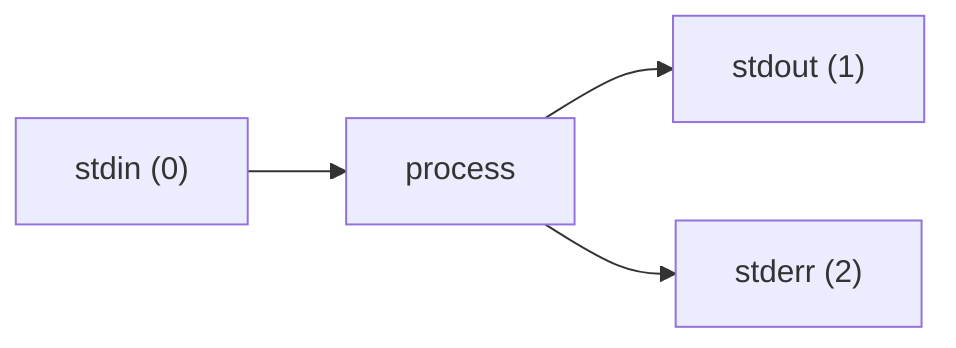
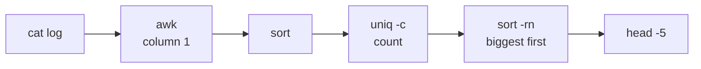

## Your first script

### Why script?
Automation is a core DevOps idea: anything you do twice by hand should become a script. Scripts are repeatable, reviewable and fast. GitHub Actions steps are mostly small bash scripts.

```bash file=hello.sh
#!/bin/bash
# The first line (the "shebang") says which program runs the script
echo "Hello from $(hostname) at $(date)"
```
```output
$ chmod +x hello.sh     # make it executable
$ ./hello.sh
Hello from ip-10-0-3-25 at Tue Nov  3 16:07:34 UTC 2026
```

### Variables and quoting
```bash
name="memos"            # no spaces around =
echo "$name"            # use it with $  → memos
echo "${name}-prod"     # braces mark where the name ends → memos-prod
today=$(date +%F)       # command substitution: save a command's output
```

| Quotes | Behaviour |
|---|---|
| `"double"` | variables **are** expanded: `"$name"` → memos |
| `'single'` | literal text: `'$name'` → $name |

> ⚠️ Always quote variables (`"$file"`). Without quotes, a filename containing spaces splits into several arguments.

### Check
? What does this print? `name=memos; echo '$name is ${name}'`
- [ ] memos is memos
- [x] $name is ${name}
- [ ] memos is ${name}
- [ ] an error
> **Single quotes** stop all expansion, so the text is printed exactly as typed.

## Pipes and redirection

### Streams: stdin, stdout and stderr
Every process has three streams: **0 stdin** (input), **1 stdout** (normal output) and **2 stderr** (errors).



| Syntax | Meaning |
|---|---|
| `cmd > file` | stdout to a file (overwrite) |
| `cmd >> file` | append |
| `cmd 2> err.log` | stderr to a file |
| `cmd > all.log 2>&1` | both streams to one file |
| `cmd > /dev/null` | throw the output away |

### Pipes: chain small tools
`|` sends one command's stdout into the next command's stdin. Small tools that each do one thing combine into powerful one-liners:

```output
# Top 5 IPs hitting a web server
cat access.log | awk '{print $1}' | sort | uniq -c | sort -rn | head -5
```


### grep, awk, sed in one line each
- `grep -i error app.log`: lines that match, ignoring case (`-r` recursive, `-v` invert)
- `awk '{print $2}'`: print column 2
- `sed 's/old/new/g' file`: find and replace

### Check
? Which command sends both normal output and errors into `run.log`?
- [ ] `./run.sh 2> run.log`
- [x] `./run.sh > run.log 2>&1`
- [ ] `./run.sh | run.log`
- [ ] `./run.sh >> 2 run.log`
> `> run.log` sends stdout to the file, then `2>&1` sends stderr to wherever stdout is going. Order matters.

## Logic: exit codes, if and loops

### Exit codes drive everything
Every command returns a number when it finishes: **0 = success**, anything else = failure. `$?` holds the last one. CI pipelines fail a step whenever a command returns non-zero.

```output
$ curl -sf https://memos.example.com/healthz; echo $?
0
$ ls /nope; echo $?
ls: /nope: No such file or directory
2
```

`cmd1 && cmd2` runs cmd2 only if cmd1 **succeeded**. `cmd1 || cmd2` runs cmd2 only if cmd1 **failed**.

### if, for, while
```bash file=check.sh
#!/bin/bash
code=$(curl -s -o /dev/null -w "%{http_code}" https://memos.example.com/healthz)

if [ "$code" = "200" ]; then
  echo "✅ healthy"
else
  echo "❌ got $code"; exit 1
fi

for env in dev staging prod; do
  echo "checking $env"
done

count=0
while [ $count -lt 3 ]; do count=$((count + 1)); done
```

> 🔧 **In Memos:** the post-deploy health check in `deploy.yml` is almost exactly this `if` block. `exit 1` is what turns the pipeline red.

### Functions and arguments
```bash
deploy() {
  local env="$1"        # first argument
  echo "deploying to $env"
}
deploy prod
```
Script arguments are `$1`, `$2`, …. `$#` is how many there are, and `$@` is all of them.

### Check
? In `make build && make deploy`, when does `make deploy` run?
- [x] Only if `make build` exits with code 0
- [ ] Only if `make build` fails
- [ ] Always, after `make build`
- [ ] At the same time as `make build`
> `&&` means "and then, if that worked". `||` means "otherwise".

## Writing scripts safely

### The safety line: set -euo pipefail
Bash keeps going after errors by default, which is dangerous in automation. Put this at the top of every script:

```bash
#!/bin/bash
set -euo pipefail
```
| Flag | Effect |
|---|---|
| `-e` | stop at the first command that fails |
| `-u` | using an unset variable is an error (catches typos such as `$ENVIROMENT`) |
| `-o pipefail` | a pipeline fails if **any** part fails, not just the last |

### Idempotent scripts
An **idempotent** script gives the same result however many times you run it. That's vital for automation, which gets retried.

```bash
mkdir -p /var/opt/memos          # fine if it already exists
grep -q "^appuser:" /etc/passwd || adduser appuser   # only if missing
```

> 🔧 **In Memos:** `build.yml` checks whether an image tag already exists in ECR before building, so re-running the pipeline is safe. That's idempotency.

### Scheduling with cron
`crontab -e` runs commands on a schedule:
```output
# ┌ minute ┌ hour ┌ day of month ┌ month ┌ day of week
  0        2      *              *       *     /usr/local/bin/backup.sh
#  → every day at 02:00
```

### Check
? Why add `set -o pipefail` to a script?
- [ ] To make pipes run faster
- [x] So a failure anywhere in a pipeline makes the whole pipeline fail
- [ ] To stop the script printing errors
- [ ] So variables don't need quotes
> Without it, `failing_cmd | grep x` reports grep's exit code and hides the failure.
