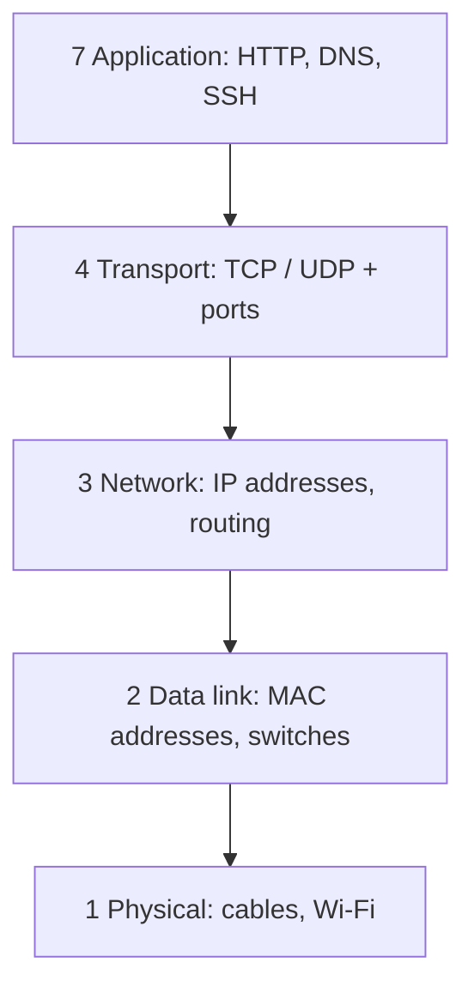
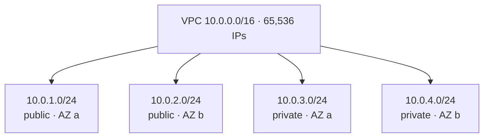
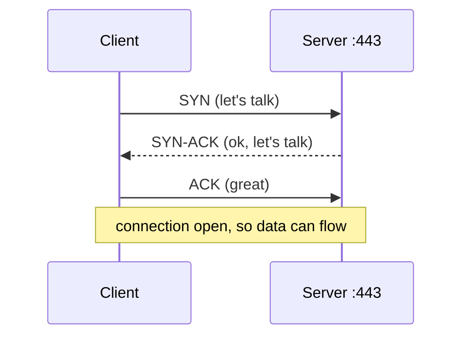
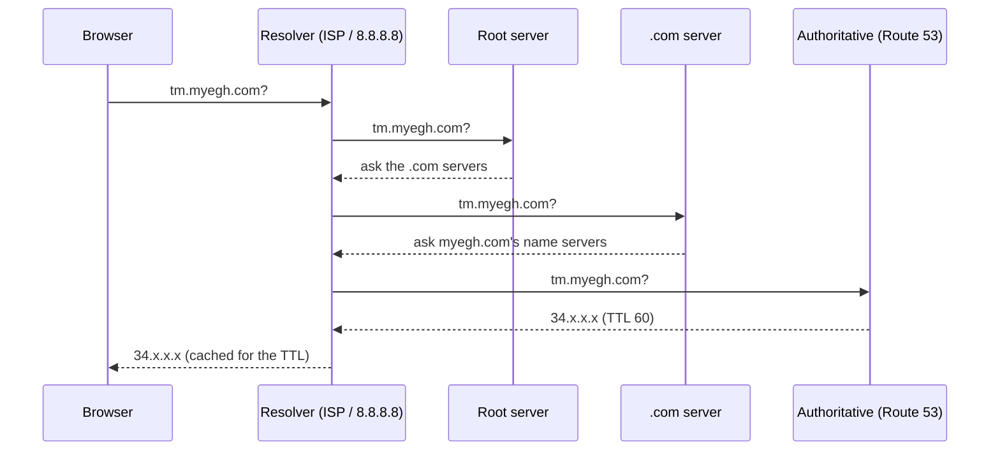
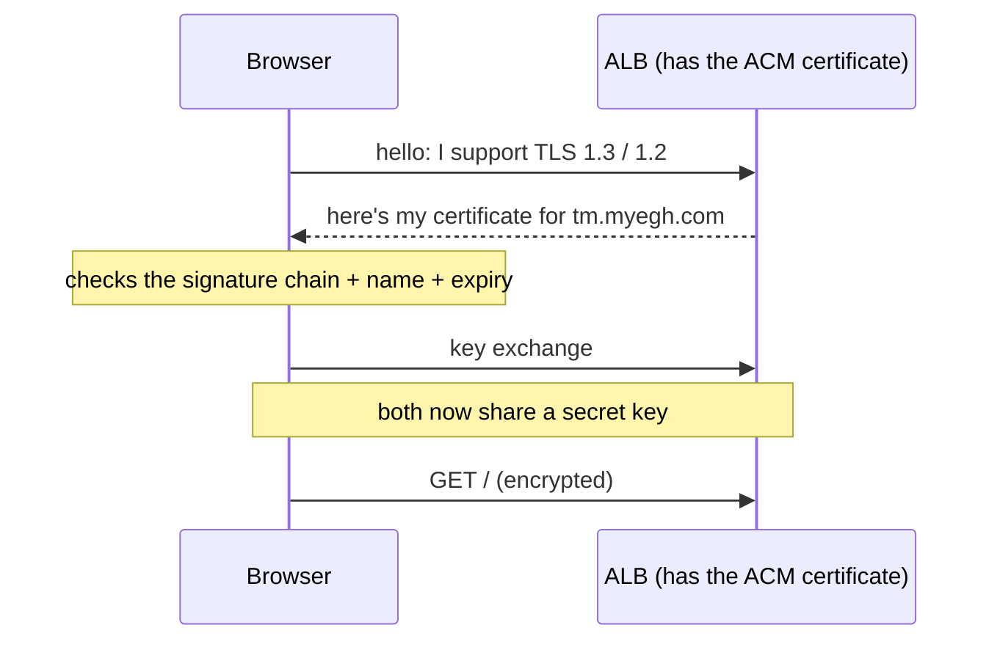
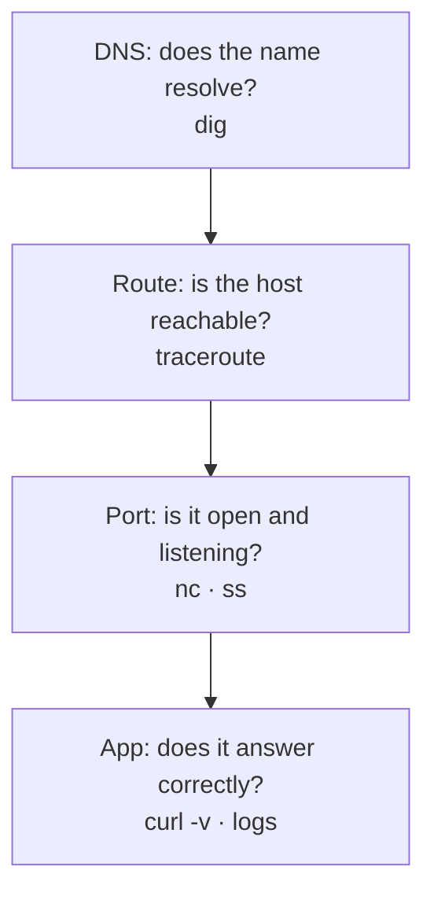

## The layers model

### Why layers?
Networking is split into **layers**, each doing one job and handing off to the next. When something breaks, you work out **which layer** is failing.

The full **OSI model** has 7 layers. Layers 5 (session) and 6 (presentation) are mostly folded into the application layer in practice. The simpler **TCP/IP model** uses 4.

### Layers in AWS terms
| Layer | AWS example |
|---|---|
| 7 | **ALB** routes by path or hostname, WAF |
| 4 | **NLB**, security group port rules |
| 3 | route tables, subnets, IP addresses |

> 🔧 **Interview tip:** "the ALB is layer 7, the NLB is layer 4" comes up often.

### Check
? An Application Load Balancer can route `/api/*` to one service and `/` to another. At which layer is it working?
- [ ] Layer 2
- [ ] Layer 3
- [ ] Layer 4
- [x] Layer 7
> Paths and hostnames are **HTTP** details, which is layer 7. A layer-4 balancer only sees IPs and ports.

## IP ranges and subnetting

### CIDR notation
`10.0.0.0/16` describes a **range**. The number after `/` says how many leading bits are fixed (the network part). The rest are free for hosts.

| CIDR | Fixed bits | Addresses |
|---|---|---|
| `/16` | 16 | 65,536 |
| `/24` | 24 | 256 |
| `/28` | 28 | 16 |
| `/32` | 32 | 1 (a single IP) |

Rule of thumb: **each +1 halves the size**. Addresses = 2^(32 − prefix).

### Splitting a VPC into subnets

> 🔧 **In Memos:** exactly this split. Four /24s give room to grow, and every range sits inside the VPC's /16 without overlapping.

### AWS keeps 5 addresses per subnet
In every AWS subnet, 5 IPs are reserved: the network address, `.1` (the VPC router), `.2` (DNS), `.3` (reserved for future use) and the last address (broadcast). So a `/24` has **256 − 5 = 251** usable addresses.

### Check
? How many usable IP addresses does a `/24` subnet have in AWS?
- [ ] 256
- [ ] 254
- [x] 251
- [ ] 250
> 256 total minus **5 reserved by AWS**. (On an ordinary network you'd lose 2, giving 254.)

? Which CIDR block contains **more** addresses?
- [x] `10.0.0.0/20`
- [ ] `10.0.0.0/24`
- [ ] `10.0.0.0/26`
- [ ] `10.0.0.0/28`
> A **smaller** prefix means **more** addresses: /20 = 4,096, /24 = 256, /26 = 64, /28 = 16.

## TCP, UDP and connections

### TCP vs UDP
| | TCP | UDP |
|---|---|---|
| Connection | handshake first | just sends |
| Reliable? | yes: ordered, retransmits lost data | no guarantees |
| Speed | a bit slower | faster, lighter |
| Used by | HTTP(S), SSH, databases | DNS lookups, video, games, VoIP |

### The three-way handshake

### Refused vs timed out
These two errors point to **different** problems:

- **Connection refused:** the machine was reached, but **nothing is listening** on that port. Is the app down, or listening on the wrong port?
- **Timeout:** packets were **dropped on the way**: a firewall, security group, NACL or route table, or the host is down.

> 🔧 **Interview tip:** this one difference narrows most "can't connect" problems in seconds.

### Check
? `curl http://10.0.3.25:8081` hangs and then times out. What's the most likely cause?
- [ ] The app crashed
- [ ] Nothing is listening on port 8081
- [x] A firewall, security group or route is dropping the traffic
- [ ] The DNS name is wrong
> A **timeout** means the packets never got a reply. "Nothing listening" would give **connection refused** straight away.

## DNS: names to addresses

### How a DNS lookup works

The answer is **cached** for its **TTL** (time to live, in seconds), which is why DNS changes don't apply instantly everywhere.

### Record types
| Type | Points a name to | Example |
|---|---|---|
| **A** | an IPv4 address | `tm.myegh.com → 34.x.x.x` |
| **AAAA** | an IPv6 address | |
| **CNAME** | another name | `www → myegh.com` (not allowed at the zone apex) |
| **MX** | mail servers | |
| **TXT** | text: verification, SPF | |
| **NS** | the zone's name servers | |
| **Alias** (Route 53 only) | an AWS resource, **even at the apex** | `tm.myegh.com → the ALB` |

### Check
? Why does Memos use a Route 53 **alias A record** for the load balancer instead of an ordinary A record?
- [x] An ALB's IP addresses change, and an alias follows the ALB automatically
- [ ] A records can't point to AWS
- [ ] Alias records are faster to type
- [ ] It's required for HTTPS
> ALBs don't have fixed IPs. An **alias** record targets the ALB itself and always returns its current addresses. It's also free and works at the zone apex.

## HTTPS and TLS

### What TLS gives you
**TLS** (the S in HTTPS) provides:
- **Encryption:** nobody on the way can read the traffic.
- **Integrity:** nobody can change it unnoticed.
- **Authentication:** the **certificate** proves the server really is `tm.myegh.com`.

A certificate is signed by a **Certificate Authority (CA)** that browsers trust. In AWS, **ACM** issues certificates for free and renews them automatically.

### The handshake, simplified

### TLS termination
**Terminating** TLS means decrypting at a chosen point. In Memos, TLS ends **at the ALB**. Traffic from the ALB to the task is plain HTTP on 8081, but it stays **inside the private VPC**, and the security group only allows the ALB.

> 🔧 **In Memos:** the HTTPS listener uses `ELBSecurityPolicy-TLS13-1-2-2021-06`, which allows TLS 1.3 and 1.2 only.

### Check
? Where is TLS terminated in the Memos architecture?
- [ ] Inside the Memos container
- [x] At the Application Load Balancer
- [ ] At Route 53
- [ ] At the NAT gateway
> The ALB holds the ACM certificate and decrypts. Behind it, traffic travels inside the VPC to port 8081.

## Debugging tools

### The network toolbox
| Question | Tool |
|---|---|
| Is the host reachable? | `ping host` (often blocked, so not conclusive) |
| What does DNS say? | `dig tm.myegh.com` / `nslookup` |
| Does the port answer? | `nc -zv host 443` · `curl -v https://host` |
| Where does the path break? | `traceroute` / `mtr` |
| What's listening here? | `ss -tlnp` (or `netstat -tlnp`) |
| What's in the packets? | `tcpdump -i eth0 port 443` |

### A debugging order that works

Work **bottom-up** and change **one thing at a time**.

### Check
? Which command shows which programs are listening on which TCP ports on this machine?
- [ ] `ping localhost`
- [ ] `dig localhost`
- [x] `ss -tlnp`
- [ ] `traceroute localhost`
> `ss -tlnp` = **t**cp, **l**istening, **n**umeric, with the **p**rocess. It's the quick way to spot "listening on 5230, not 8081".
