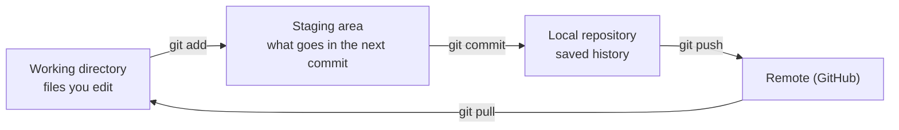
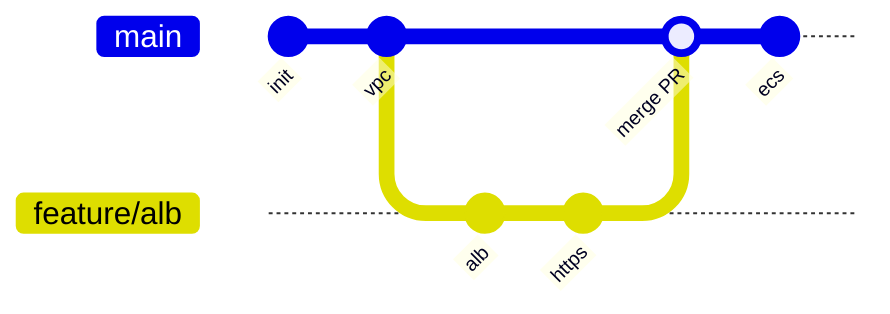
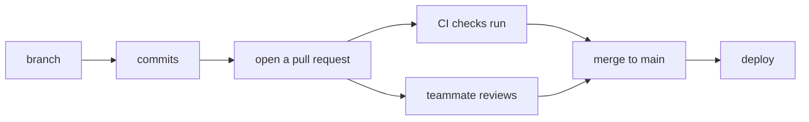
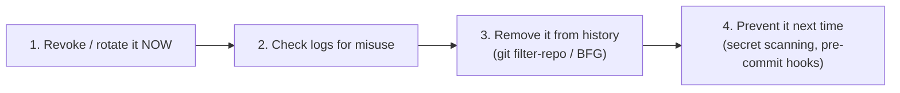

## How Git thinks

### Version control in one sentence
**Git** records **snapshots** of your project over time, so you can see what changed, who changed it and why, and go back. It's **distributed**: every clone holds the full history.

**GitHub** hosts Git repositories online and adds pull requests, reviews, issues and **Actions** (CI/CD).

### The three areas


### Your first loop
```output
git clone https://github.com/your-username/memos-aws-infra.git
cd memos-aws-infra
# …edit files…
git status                 # what changed?
git diff                   # exactly how?
git add infra/main.tf      # stage it
git commit -m "Add VPC module"
git push                   # share it
git log --oneline          # history
```

### Check
? You edited a file and ran `git commit`, but the change isn't in the commit. What did you forget?
- [ ] `git push`
- [x] `git add` (staging the file)
- [ ] `git pull`
- [ ] `git init`
> Commits only include what's **staged**. Run `git add <file>` first, or `git commit -a` for files Git already tracks.

## Branches and pull requests

### Branches are cheap pointers
A **branch** is a movable label pointing at a commit. You work on a branch so `main` stays stable.



```output
git switch -c feature/alb     # create and move to a new branch
git push -u origin feature/alb
```

### The pull-request flow

Protect `main` with **branch protection**: require pull requests, passing checks and an approving review. Nobody pushes straight to production.

### Merge vs rebase
- **Merge** joins histories with a merge commit. It keeps the true history.
- **Rebase** replays your commits on top of the latest `main`, giving a straight line.

> ⚠️ **Golden rule:** only rebase **your own** unshared branches. Rebasing shared history rewrites commits other people have.

### Merge conflicts
A **conflict** happens when two branches change the same lines. Git marks the file:
```output
<<<<<<< HEAD
desired_count = 1
=======
desired_count = 2
>>>>>>> feature/ha
```
Edit it to the correct result, delete the markers, then `git add` the file and `git commit`.

### Check
? When is `git rebase` a bad idea?
- [ ] On your local feature branch before opening a PR
- [x] On a branch other people have already pulled
- [ ] To update your branch with the latest main
- [ ] To tidy up commits before review
> Rebasing **rewrites** commits. If others built on the old ones, their history no longer matches yours.

## Fixing mistakes

### Undo, safely
| Situation | Command |
|---|---|
| Throw away unstaged edits to a file | `git restore file` |
| Unstage a file | `git restore --staged file` |
| Fix the last commit (not pushed yet) | `git commit --amend` |
| Undo a commit that's **already pushed** | `git revert <sha>`, which adds a new commit undoing it |
| Move the branch back (local only) | `git reset --hard <sha>` ⚠️ deletes work |
| Park work-in-progress | `git stash` / `git stash pop` |

> ⚠️ On shared branches, **revert, don't reset**. Reset rewrites history.

### fetch vs pull
- `git fetch` downloads new commits but **doesn't change** your files.
- `git pull` = fetch **+** merge (or rebase) into your branch.

### .gitignore
`.gitignore` lists files Git should never track: `.terraform/`, `*.tfstate`, `.env`, build outputs.

> 🔧 **A classic bug:** the pattern `memos` (meant for the built binary) also matches the folder `cmd/memos/`, so `main.go` is never committed and the build fails in CI. The fix is `/memos`. A leading `/` anchors the pattern to the repo root.

### Check
? A bad commit was pushed to `main` an hour ago and teammates have pulled it. What's the safe way to undo it?
- [ ] `git reset --hard HEAD~1` then `git push --force`
- [x] `git revert <sha>` then push
- [ ] Delete the repository and re-create it
- [ ] `git stash`
> `revert` creates a **new** commit that reverses the bad one. History stays intact for everyone.

## Secrets and Git

### Never commit secrets
Git keeps **everything forever**. Deleting a secret in a later commit doesn't remove it from history, and bots scan public repos for keys within minutes.

If a secret is committed:


> 🔧 **In Memos:** the pipeline uses **OIDC**, so there are **no AWS keys to leak**. The only GitHub secret is a role ARN, which is not a credential.

### Check
? An AWS access key was pushed to a public repo. What's the **first** thing to do?
- [ ] Delete the file and push again
- [ ] Make the repo private
- [x] Deactivate and rotate the key in AWS immediately
- [ ] Rewrite the Git history
> Assume it's already stolen. **Revoke it first**, then clean up history. Deleting the file leaves the key in history.
