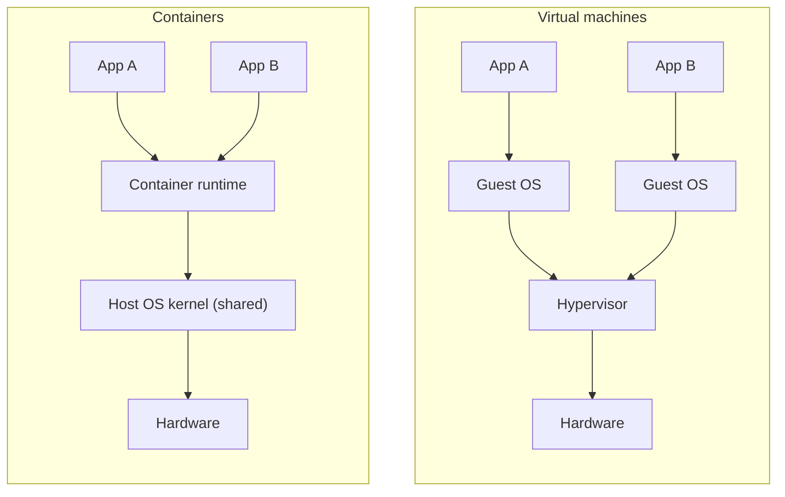
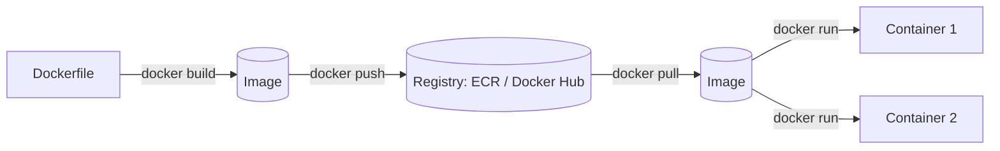
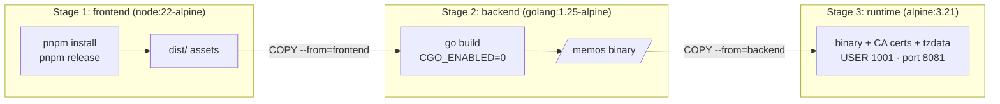
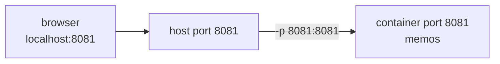

## Why containers

### "Works on my machine"
Apps depend on a runtime version, libraries, OS packages and config. Differences between laptops and servers cause bugs. A **container** packages the app **with everything it needs**, so it runs the same everywhere.

### Containers vs virtual machines

| | VM | Container |
|---|---|---|
| Includes | a whole OS | app + libraries only |
| Starts in | minutes | seconds |
| Size | GBs | MBs |
| Isolation | strong (own kernel) | process-level (**shared kernel**) |

### What a container really is
A container is just a **Linux process** with two kernel features:
- **Namespaces** give it its own view of processes, network, hostname and files.
- **cgroups** limit its CPU and memory.

That's why it starts as fast as a process, and why it's **killed if it goes over its memory limit** (exit 137).

### Check
? What do containers share that virtual machines don't?
- [ ] The application code
- [x] The host operating system's kernel
- [ ] Their IP addresses
- [ ] Their file system
> Containers share the host **kernel**. VMs each boot their own OS on a hypervisor. That's why containers are lighter but isolate a little less strongly.

## Images and Dockerfiles

### Image vs container
- An **image** is a read-only template: the app and its file system, built from a Dockerfile.
- A **container** is a **running instance** of an image. One image can run as many containers.

Like a **class** and its **objects**, or a **recipe** and the **meals** made from it.



### Layers and caching
Each Dockerfile instruction creates a **layer**. Layers are cached: if nothing changed, Docker reuses the layer. So put things that change **rarely** first and things that change **often** last.

```dockerfile
# ✅ good: dependencies cached until package.json changes
COPY package.json pnpm-lock.yaml ./
RUN pnpm install --frozen-lockfile
COPY . .            # source changes only rebuild from here
```

### The core instructions
| Instruction | Does |
|---|---|
| `FROM` | base image to start from |
| `WORKDIR` | set the working folder |
| `COPY` | copy files in (prefer it to `ADD`, which can also unpack and download) |
| `RUN` | run a command **at build time** |
| `ENV` | set environment variables |
| `EXPOSE` | document the port (it doesn't publish it) |
| `USER` | which user runs the process |
| `CMD` / `ENTRYPOINT` | what runs **when the container starts** |

### CMD vs ENTRYPOINT vs RUN
- `RUN` runs **once, during the build**: `RUN apk add curl`.
- `ENTRYPOINT` is the main executable: `ENTRYPOINT ["memos"]`.
- `CMD` gives default arguments, which can be overridden at `docker run`.

### Check
? Which instruction runs when the container **starts**, rather than when the image is built?
- [ ] `RUN`
- [ ] `COPY`
- [x] `ENTRYPOINT` / `CMD`
- [ ] `FROM`
> `RUN` happens during `docker build`. `ENTRYPOINT`/`CMD` define the process that runs each time a container starts.

## Multi-stage builds (Memos)

### The problem: huge images
Building Memos needs Node (frontend), Go (backend), compilers and source code. **Running** it needs only the compiled binary. A single-stage image ships everything, which is slow to pull and has a larger **attack surface**.

| Build | Disk usage | Content size |
|---|---|---|
| Single-stage | 2.79 GB | 633 MB |
| **Multi-stage** | **75.8 MB** | **19.7 MB** |

About **97% smaller**.

### Three stages

Only **stage 3** becomes the final image. Stages 1 and 2 are thrown away.

### The real Dockerfile (lightly trimmed)
```dockerfile file=Dockerfile
FROM node:22-alpine AS frontend
WORKDIR /build/web
RUN npm install --global pnpm@10.24.0
COPY app/web/package.json app/web/pnpm-lock.yaml ./
RUN pnpm install --frozen-lockfile
COPY app/web/ ./
RUN pnpm release

FROM golang:1.25-alpine AS backend
WORKDIR /build
COPY app/go.mod app/go.sum ./
RUN go mod download
COPY app/ ./
COPY --from=frontend /build/server/router/frontend/dist ./server/router/frontend/dist
RUN CGO_ENABLED=0 go build -trimpath -ldflags="-s -w" -o /memos ./cmd/memos

FROM alpine:3.21 AS runtime
RUN apk add --no-cache ca-certificates tzdata && \
    addgroup -S -g 1001 appuser && adduser -S -D -u 1001 -G appuser appuser
COPY --from=backend /memos /usr/local/bin/memos
ENV MEMOS_PORT=8081 MEMOS_DATA=/var/opt/memos
USER 1001:1001
EXPOSE 8081
ENTRYPOINT ["memos"]
```

### Why CGO_ENABLED=0
`CGO_ENABLED=0` builds a **static** Go binary that doesn't need C libraries at runtime, so it runs on a bare Alpine image. `-ldflags="-s -w"` strips debug symbols, making it smaller again.

### Check
? In a multi-stage build, what ends up in the final image?
- [ ] Every stage, stacked together
- [x] Only the last stage, plus anything it copies from earlier stages
- [ ] Only the first stage
- [ ] The build cache
> Earlier stages are **build-only**. `COPY --from=<stage>` pulls just the artefacts you need into the final stage.

## Running containers

### docker run, decoded
```output
docker run -d --name memos -p 8081:8081 -v memos-data:/var/opt/memos memos:dev
           │  │            │            │                              └ image:tag
           │  │            │            └ volume: keep data outside the container
           │  │            └ publish host port 8081 → container port 8081
           │  └ name it
           └ detached (in the background)
```

### Ports: -p host:container

`EXPOSE` in the Dockerfile is only documentation. `-p` actually opens the port.

### Containers are disposable: volumes
A container's file system **disappears when the container is removed**. Data that must survive goes in a **volume** (managed by Docker) or a **bind mount** (a host folder).

> 🔧 **In Memos:** on ECS the task has no volume, so the SQLite database at `/var/opt/memos` is **lost whenever the task is replaced**. That's the project's biggest known limitation. The fixes (EFS or RDS) come later.

### Everyday commands
| Command | Does |
|---|---|
| `docker ps -a` | list containers |
| `docker logs -f memos` | follow logs |
| `docker exec -it memos sh` | open a shell inside |
| `docker stop / rm memos` | stop / remove |
| `docker images` / `docker rmi` | list / remove images |
| `docker system prune` | clean up unused data |

### Check
? You run `docker run -p 9000:8081 memos:dev`. Which URL reaches the app from your laptop?
- [ ] `http://localhost:8081`
- [x] `http://localhost:9000`
- [ ] `http://localhost:5230`
- [ ] `http://memos:8081`
> `-p HOST:CONTAINER`, so host port **9000** forwards to the container's 8081.

## Compose and container security

### Docker Compose
**Compose** defines several containers that work together in one YAML file, which is ideal for local development:

```yaml file=compose.yaml
services:
  memos:
    build: .
    ports: ["8081:8081"]
    environment:
      MEMOS_DRIVER: postgres
      MEMOS_DSN: postgres://memos:secret@db:5432/memos?sslmode=disable
    depends_on: [db]
  db:
    image: postgres:16-alpine
    environment: { POSTGRES_USER: memos, POSTGRES_PASSWORD: secret }
    volumes: ["pgdata:/var/lib/postgresql/data"]
volumes:
  pgdata:
```
`docker compose up -d` starts both. Services reach each other **by name** (`db`).

### Container security checklist
- Use **small, trusted base images** (alpine, distroless) and pin versions.
- **Don't run as root:** `USER 1001`.
- **No secrets in images.** They stay in the layers forever. Inject them at runtime.
- **Scan images** (ECR scan-on-push, Trivy) and rebuild often for patches.
- Use **immutable tags** (git SHA), not `latest`.

> 🔧 **In Memos:** non-root user, Alpine runtime, scan on push, immutable SHA tags.

### Check
? Why is baking an API key into a Docker image a bad idea, even if you delete it in a later layer?
- [ ] It makes the image too large
- [x] Earlier layers still contain it, and anyone who can pull the image can extract it
- [ ] Docker refuses to build it
- [ ] It slows the container down
> Layers are **additive**. A file deleted later still exists in the earlier layer. Inject secrets at runtime instead.
