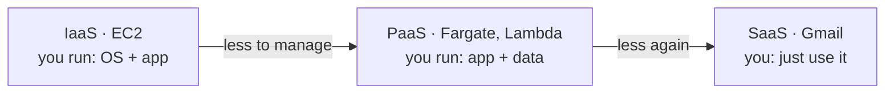
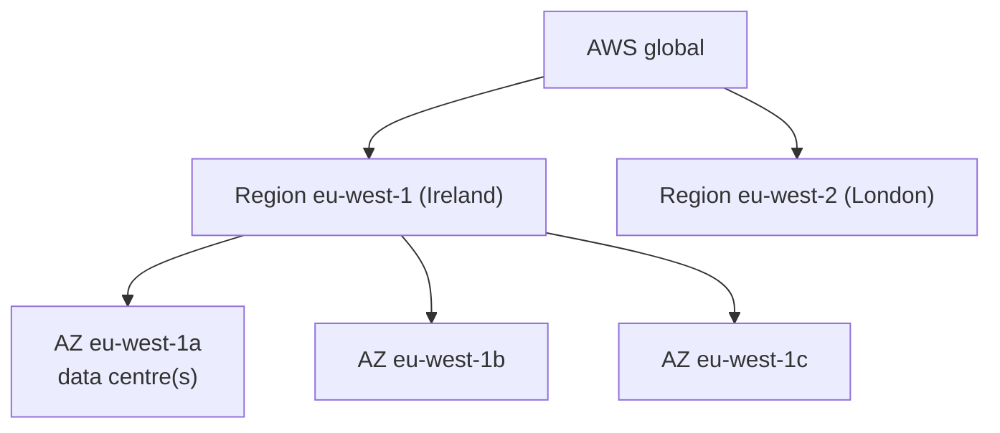
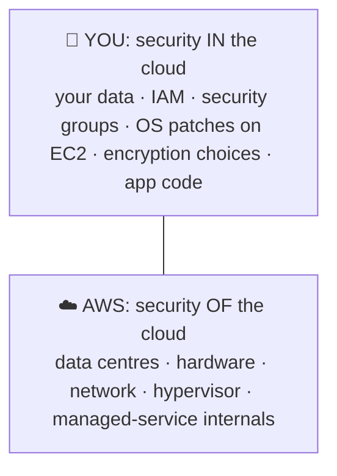
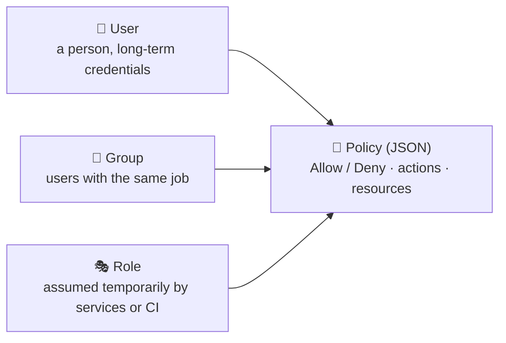
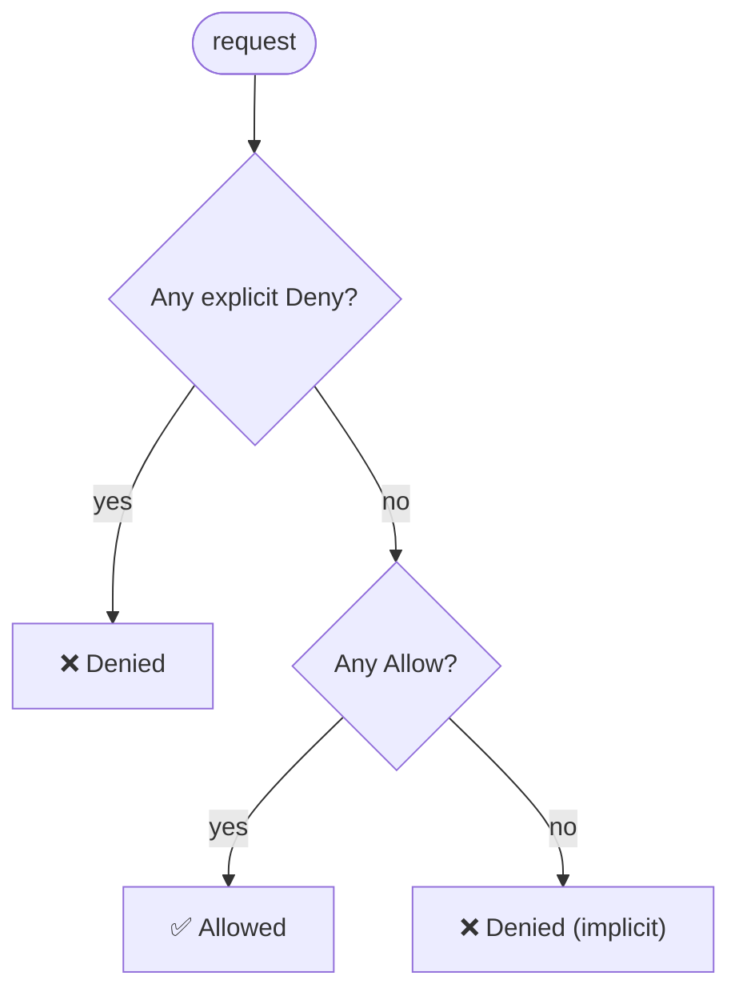

## What the cloud is

### Renting computers by the second
**Cloud computing** means renting computing power, storage and services over the internet, on demand, and paying for what you use. You don't buy hardware, and you can scale up or down in minutes.

### IaaS, PaaS, SaaS

| Model | You manage | AWS example |
|---|---|---|
| IaaS | OS, runtime, app | EC2 |
| PaaS | app and data | Elastic Beanstalk, Fargate |
| SaaS | nothing technical | WorkMail, Gmail |

> 🔧 **In Memos:** Fargate sits close to PaaS. You give it a container, and AWS runs and patches the servers underneath.

### Why companies move to the cloud
- **Elasticity:** scale with demand, rather than buying for the peak.
- **Pay as you go:** an operating cost instead of an upfront capital cost.
- **Speed:** a new environment in minutes.
- **Global reach:** deploy near users anywhere.
- **Managed services:** databases, queues and DNS without running them yourself.

### Check
? On **EC2**, who is responsible for patching the operating system?
- [ ] AWS
- [x] You (the customer)
- [ ] Nobody, because it patches itself
- [ ] The hypervisor
> EC2 is IaaS, so the OS is **yours** to patch. On Fargate, AWS patches the hosts. That's the shared responsibility model.

## Regions, AZs and shared responsibility

### Global infrastructure

- A **Region** is a geographic area, such as eu-west-1 in Ireland. Regions are independent of each other.
- An **Availability Zone (AZ)** is one or more separate data centres inside a Region, with their own power and network. Every Region has **3 or more**, joined by fast private links.
- **Edge locations** cache content close to users (CloudFront).

> 🔧 **In Memos:** everything is in **eu-west-1** across **two AZs** (a and b), so one data centre failing doesn't take down the network.

### Choosing a Region
1. **Compliance:** where data is legally allowed to live.
2. **Latency:** how close it is to your users.
3. **Service availability:** not every service exists in every Region.
4. **Price:** prices differ by Region.

### The shared responsibility model

> ⚠️ AWS won't stop you making an S3 bucket public or opening port 22 to the world. Those are **your** responsibility.

### Check
? A company must keep customer data inside the UK. Which factor decides their Region first?
- [ ] Price
- [ ] Latency
- [x] Compliance (data residency)
- [ ] Number of AZs
> Legal requirements come **before** speed or cost. Here that means eu-west-2 (London).

## A safe AWS account

### The root user
The email you sign up with is the **root user**, which has unlimited power, including closing the account. Use it almost never.

**First four things to do in a new account:**
1. Turn on **MFA** for root.
2. Set a **budget alert** (AWS Budgets) so a mistake doesn't become a huge bill.
3. Create a separate admin identity (**IAM Identity Center**) and use that day to day.
4. **Never** create access keys for root.

### Surprise bills: what costs money even when idle
- **NAT gateways:** charged per hour **plus** per GB.
- **Public IPv4 addresses**, including Elastic IPs.
- **Load balancers**, even with no traffic.
- **EBS volumes** of stopped instances, and snapshots.
- Data transfer **out** to the internet and **between AZs**.

> 🔧 **In Memos:** the two NAT gateways and the ALB are the biggest fixed costs. That's why `destroy.yml` exists, to tear everything down when you're not using it.

### Check
? Which of these keeps costing money even when nobody is using your app?
- [ ] A Lambda function with no invocations
- [ ] An empty S3 bucket
- [x] A NAT gateway
- [ ] An IAM role
> NAT gateways bill **per hour** whether or not traffic flows, and per GB on top. Idle Lambda, empty buckets and IAM cost nothing.

## IAM: who can do what

### The building blocks

- **Users** are people, with passwords and maybe access keys.
- **Groups** are bundles of users: attach policies once.
- **Roles** have **no password**. A trusted principal (an AWS service, GitHub Actions, another account) **assumes** a role and gets **temporary** credentials.
- **Policies** are JSON documents that grant or deny permissions.

### Reading a policy
```json
{
  "Version": "2012-10-17",
  "Statement": [{
    "Effect": "Allow",
    "Action": ["ecr:GetAuthorizationToken", "ecr:BatchGetImage"],
    "Resource": "*"
  }]
}
```
Each statement says **Effect** (Allow or Deny), **Action** (which API calls), **Resource** (which ARNs) and, optionally, **Condition**.

### How AWS decides: the evaluation order

**Everything is denied by default. An Allow grants access. An explicit Deny always wins.**

### Roles and STS
When something assumes a role, **STS** (Security Token Service) hands out **temporary credentials** that expire, typically within an hour. Nothing long-lived can leak.

A role has two policies:
- the **trust policy**: *who* may assume it
- the **permissions policy**: *what* it can do once assumed

> 🔧 **In Memos:** ECS tasks assume `memos-ecs-execution-role` (pull from ECR, write logs). GitHub Actions assumes `github-actions-role` through OIDC. There are no long-lived keys anywhere.

### Least privilege
Grant **only** the permissions needed, on **only** the resources needed, for **only** as long as needed. Start small and add permissions when something is denied, rather than starting with admin.

> 🔧 **Note on the example:** the first version of the Memos CI role uses `AdministratorAccess`. That works, but it isn't least privilege. Tightening it is a great interview talking point.

### Check
? A user is in a group whose policy **allows** `s3:*`, and also has a policy that **denies** `s3:DeleteBucket`. Can they delete a bucket?
- [ ] Yes, because the group Allow covers it
- [x] No, because an explicit Deny always wins
- [ ] Yes, but only buckets they created
- [ ] It depends which policy was attached first
> Explicit **Deny** beats any Allow, every time, whatever the order.

? Why use an IAM **role** instead of an IAM user with access keys for an app or a pipeline?
- [ ] Roles are cheaper
- [x] Roles give temporary credentials that expire, so there are no long-lived keys to leak
- [ ] Users can't call AWS APIs
- [ ] Roles skip permission checks
> Long-lived keys are the most common source of AWS breaches. A role's credentials come from STS and **expire**.

## Using AWS: console, CLI, SDK

### Three ways in, one API
- **Console:** the web UI. Good for exploring and learning. Bad for repeatable work.
- **CLI:** `aws` commands in a terminal or script.
- **SDKs and IaC:** code (Python boto3, Terraform) that calls the same APIs.

```output
$ aws configure sso                       # log in through IAM Identity Center
$ aws sts get-caller-identity             # who am I?
{
  "UserId": "AROA…:you",
  "Account": "123456789012",
  "Arn": "arn:aws:sts::123456789012:assumed-role/AdminAccess/you"
}
```

### ARNs: AWS's universal IDs
Every resource has an **ARN** (Amazon Resource Name):
```output
arn:aws:ecs:eu-west-1:123456789012:service/memos-cluster/memos-service
    │   │   │         │            └ resource
    │   │   │         └ account ID
    │   │   └ region
    │   └ service
    └ partition
```

### Check
? Which command tells you which AWS account and identity your CLI is currently using?
- [ ] `aws whoami`
- [x] `aws sts get-caller-identity`
- [ ] `aws iam list-users`
- [ ] `aws configure list-accounts`
> `sts get-caller-identity` is the first thing to run when "access denied" looks wrong. It's often the wrong account or role.
