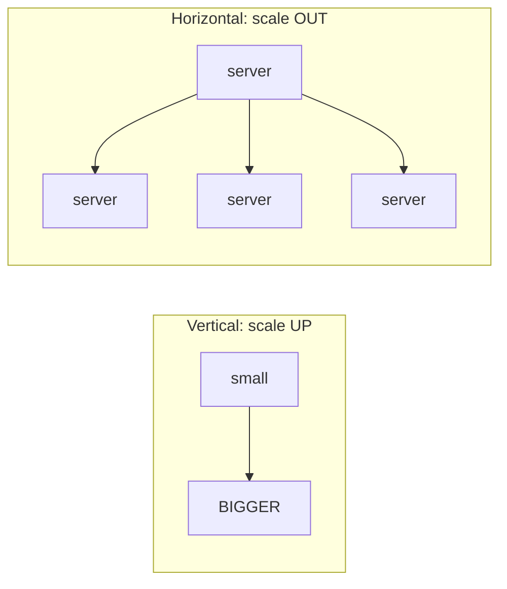
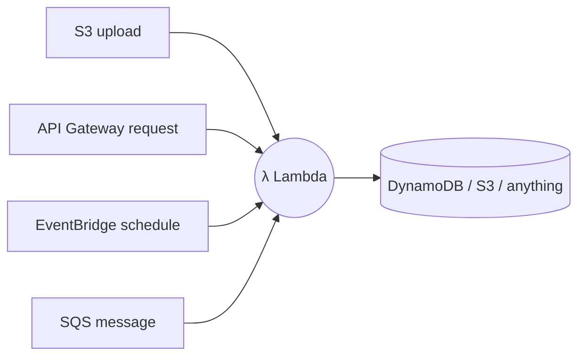
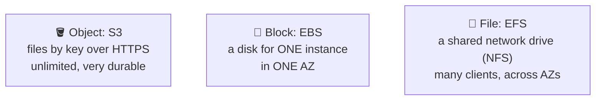
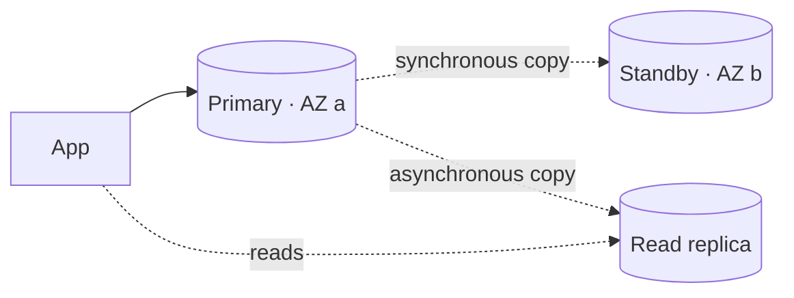
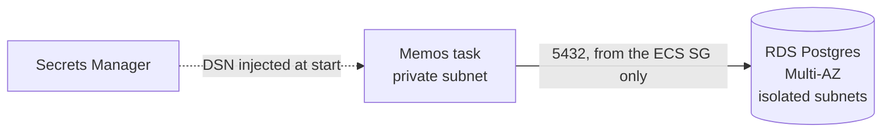

## EC2: virtual servers

### What EC2 is
**EC2** rents you virtual machines (**instances**). You choose:
- an **AMI** (Amazon Machine Image): the OS template to start from
- an **instance type**: CPU and RAM, such as `t3.micro` or `m7g.large`
- a **subnet**, **security groups** and a **key pair** or SSM for access

Instance families: **t** (burstable, cheap), **m** (general), **c** (compute), **r** (memory). A `g` suffix (as in m7**g**) means AWS's ARM Graviton chips, which are often cheaper for the same work.

### Paying for EC2
| Option | Best for | Saving |
|---|---|---|
| On-Demand | short or unpredictable work | none |
| Savings Plans / Reserved | steady 1–3 year use | up to ~72% |
| Spot | interruptible work (batch, CI runners) | up to ~90%, but can be taken back with 2 minutes' notice |

### Reaching an instance safely
Opening SSH (22) to the internet is risky. Better options:
- **SSM Session Manager:** a shell through the AWS API, with no open ports and no keys
- a **bastion** host with SSH restricted to your IP
- immutable servers you **never log in to**: replace them instead of fixing them

### Check
? A nightly batch job can safely be restarted if interrupted. Which pricing option saves the most?
- [ ] On-Demand
- [ ] Reserved Instances
- [x] Spot Instances
- [ ] Dedicated Hosts
> **Spot** uses spare capacity at up to ~90% off. It can be reclaimed, which is fine for work that can restart.

## Scaling: elasticity and Auto Scaling

### Vertical vs horizontal

- **Vertical:** a bigger machine. Simple, but it has limits and is still a single point of failure.
- **Horizontal:** more machines behind a load balancer. This is how cloud apps scale.

### Auto Scaling groups
An **Auto Scaling Group (ASG)** keeps between **min** and **max** instances running, replaces unhealthy ones, and scales using policies:

| Policy | Example |
|---|---|
| Target tracking | keep average CPU at **60%** |
| Step | +2 instances if CPU > 80% |
| Scheduled | 10 instances every weekday 09:00 |
| Predictive | learns daily patterns |

> ⚠️ Don't scale at 100% CPU. New capacity takes minutes to arrive, so aim for **60–70%**.

### Check
? Traffic always peaks Wednesdays and Fridays from 9am to 7pm. What's the simplest way to have capacity ready in advance?
- [ ] Scale when CPU reaches 100%
- [x] A scheduled scaling action before 9am on those days
- [ ] Buy the biggest instance type
- [ ] Manually add servers each morning
> Known, repeating peaks → **scheduled scaling**. You can still add target tracking for anything unexpected.

## Serverless with Lambda

### Functions, not servers
**Lambda** runs your code **in response to events**, scales automatically and bills per request and per millisecond. There are no servers to manage, and it costs nothing when idle.

Limits to know: **15 minutes** maximum runtime per invocation, cold starts on first use, and it's stateless.

### Lambda vs containers vs EC2
| | Lambda | Fargate / ECS | EC2 |
|---|---|---|---|
| Unit | function | container | VM |
| Runs | per event, ≤ 15 min | long-running | long-running |
| Idle cost | £0 | per task | per instance |
| Good for | glue, events, spiky APIs | web apps (Memos) | full control, special needs |

### Check
? Why wouldn't you run the Memos web app on Lambda as it is?
- [ ] Lambda can't run Go
- [x] Memos is a long-running server that keeps local SQLite state, which doesn't fit short, stateless functions
- [ ] Lambda is more expensive at any scale
- [ ] Lambda can't sit behind HTTPS
> Lambda suits short, stateless, event-driven code. Memos is a long-running HTTP server with local state, so containers fit better.

## Storage: S3, EBS, EFS

### Three kinds of storage

| | S3 | EBS | EFS |
|---|---|---|---|
| Access | HTTP API | attached disk | network mount |
| Shared? | yes | one instance (usually) | many, across AZs |
| Use | backups, assets, **Terraform state** | EC2 root disks, databases | shared files, **container volumes** |

### S3 essentials
- **Buckets** hold **objects** (files) addressed by **key**. Bucket names are globally unique.
- **Durability** of 99.999999999% ("eleven nines"), so data is almost never lost. **Availability** (can you reach it right now) is a separate figure, 99.99% for Standard.
- **Block Public Access**, **versioning**, **encryption** and **lifecycle** rules (move old data to cheaper classes such as Glacier).

> 🔧 **In Memos:** the bucket `memos-tfstate-example` holds Terraform state, with versioning, encryption, public access blocked and a policy that denies non-HTTPS access.

### Check
? Memos loses its SQLite data whenever the Fargate task is replaced. Which storage could fix that without changing the database?
- [ ] S3, mounted as a disk
- [ ] EBS, shared across AZs
- [x] EFS, mounted into the task at /var/opt/memos
- [ ] Instance store
> **EFS** is a network file system that ECS tasks can mount and that survives task replacement. (A managed database like RDS is the better long-term fix.)

## Databases

### Managed databases
Running a database yourself means handling backups, patching, failover and storage. **Managed** services do it for you.

| Service | Type | Use |
|---|---|---|
| **RDS** | relational (Postgres, MySQL…) | most apps |
| **Aurora** | AWS's cloud-built relational DB | higher scale and availability |
| **DynamoDB** | key-value / NoSQL, serverless | huge scale, simple access patterns |
| **ElastiCache** | Redis / Memcached | caching, sessions |

### RDS Multi-AZ vs read replicas

- **Multi-AZ** gives **availability**: a standby in another AZ takes over automatically. You can't read from it.
- **Read replicas** give **scale**: extra copies that serve reads, and can be in another Region.

### Where Memos stands
Memos supports **SQLite, MySQL and Postgres**, chosen with `MEMOS_DRIVER` and `MEMOS_DSN`. Today it uses SQLite inside the container.

That's the missing **data tier**. Adding it makes the app stateless, so you can run 2+ tasks.

### Check
? What does RDS **Multi-AZ** give you?
- [ ] Faster reads
- [x] Automatic failover to a standby in another AZ
- [ ] A copy in another Region
- [ ] Lower cost
> Multi-AZ is for **availability**. For faster reads, add **read replicas**.
