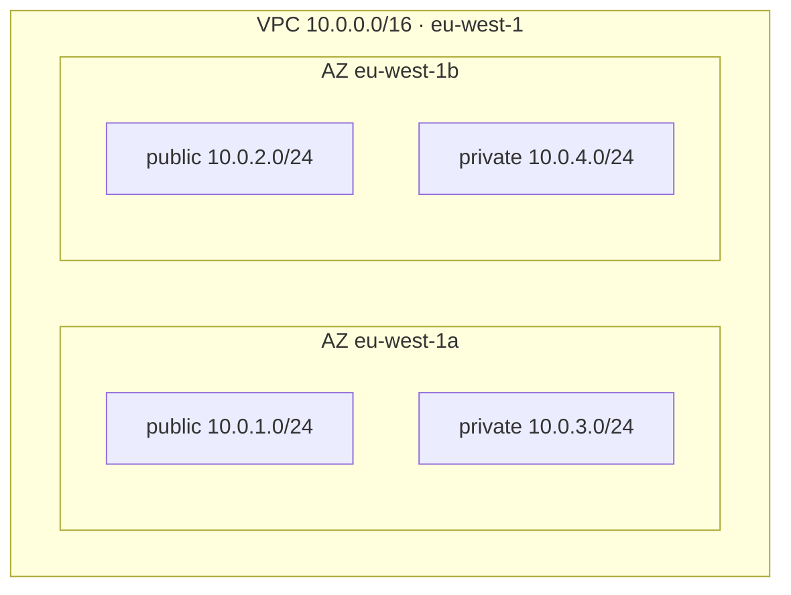
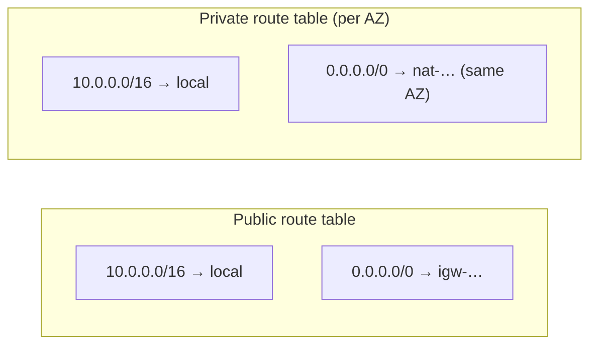
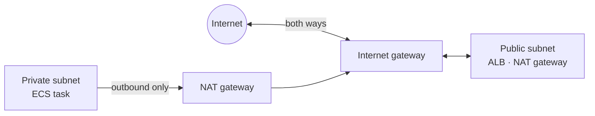
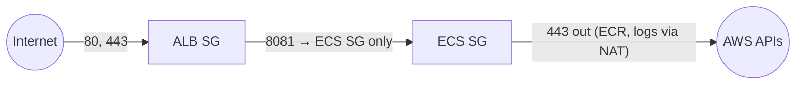
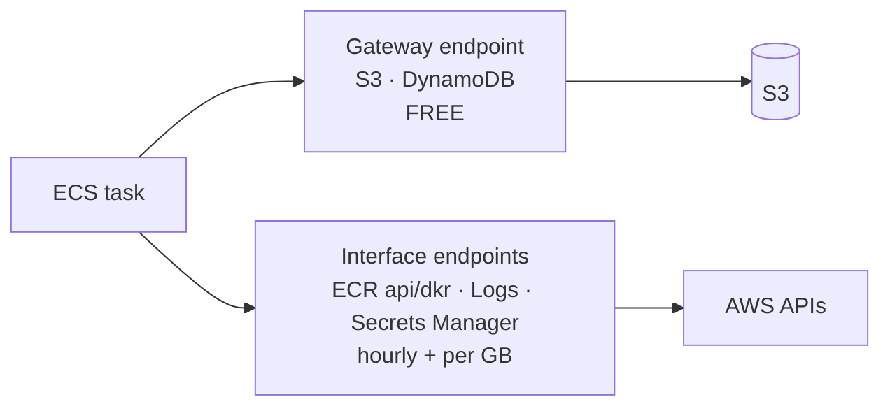

## The VPC

### Your own private network
A **VPC** (Virtual Private Cloud) is an isolated network inside AWS. You choose its IP range (CIDR), then carve it into **subnets**, one per AZ.

> 🔧 **In Memos:** this is the exact layout from `terraform.tfvars`.

### A subnet lives in one AZ
A subnet can't span AZs. For high availability you build **matching subnets in at least two AZs** and spread resources across them.

### Check
? Why does Memos create subnets in **two** Availability Zones?
- [ ] AWS requires at least two subnets
- [x] So the network (and the ALB) keeps working if one AZ fails
- [ ] To get more IP addresses
- [ ] Because NAT gateways need two subnets
> Spreading across AZs is the basis of **high availability**. ALBs also require subnets in at least two AZs.

## Public vs private subnets

### What makes a subnet public
It's **not** a checkbox. A subnet is **public** if its **route table** sends `0.0.0.0/0` to an **internet gateway (IGW)**. Otherwise it's **private**.

The `local` route always exists: everything in the VPC can route to everything else (security groups then decide what's actually allowed).

### Internet gateway vs NAT gateway

- **IGW:** two-way internet access for resources with public IPs.
- **NAT gateway:** lives in a **public** subnet and lets **private** resources reach **out** (to pull images or call APIs). Nothing from outside can start a connection **in**.

### One NAT per AZ, or one total?
| Design | Pros | Cons |
|---|---|---|
| **One NAT per AZ** (Memos) | if an AZ fails, the other AZ still has internet | 2× the cost |
| One shared NAT | cheaper | single point of failure, and cross-AZ data charges |

### Check
? A private subnet's route table sends `0.0.0.0/0` to a NAT gateway. What can its instances do?
- [ ] Receive connections from the internet
- [x] Start outbound connections to the internet, but not accept inbound ones
- [ ] Nothing: private subnets are fully offline
- [ ] Only talk to S3
> NAT lets traffic **out** and the replies come back. New inbound connections from the internet aren't possible.

## Firewalls: security groups and NACLs

### Security groups: stateful, per resource
A **security group (SG)** is a firewall attached to a resource (an ENI). It's:
- **Stateful:** if traffic is allowed in, the reply is allowed out automatically.
- **Allow-only:** there are no deny rules. Anything not allowed is blocked.
- Able to reference **other security groups** instead of IP ranges.

### Memos' security groups

- **ALB SG:** in 80/443 from anywhere. Out **only** to the ECS SG on 8081.
- **ECS SG:** in 8081 **only from the ALB SG**. Out 443.

Referencing the **SG** rather than an IP range means any ALB node is allowed, and nothing else is.

### NACLs: stateless, per subnet
A **network ACL** guards a whole **subnet**:
- **Stateless:** you must allow the return traffic too (on ephemeral ports 1024–65535).
- Has **allow and deny** rules, checked **in number order**.
- The default NACL allows everything, and most teams leave it that way and rely on SGs.

| | Security group | NACL |
|---|---|---|
| Attached to | resource (ENI) | subnet |
| State | stateful | stateless |
| Rules | allow only | allow + deny, numbered |

### Check
? Why does the Memos ECS security group allow port 8081 **from the ALB's security group** rather than from `10.0.0.0/16`?
- [ ] It's required by ECS
- [x] It allows only the load balancer, not every other resource in the VPC
- [ ] Security groups can't use CIDR ranges
- [ ] It's faster
> SG-to-SG rules are the tightest option: only traffic from resources in the ALB SG can reach the task.

? You need to **block one specific IP address** from reaching a subnet. What should you use?
- [ ] A security group deny rule
- [x] A network ACL deny rule
- [ ] A route table entry
- [ ] An IAM policy
> Security groups **can't deny**. NACLs have deny rules (WAF is another option for HTTP traffic).

## Private access to AWS services

### VPC endpoints
Private resources normally reach AWS APIs (ECR, S3, CloudWatch) **through the NAT gateway**, which costs per GB. **VPC endpoints** give a private path instead:

> 🔧 **Memos improvement:** an S3 gateway endpoint (free) would carry ECR's image layers, which are stored in S3, past the NAT.

### Peering, Transit Gateway, VPN
- **VPC peering:** connect two VPCs directly. Their CIDRs **must not overlap**, and it isn't transitive.
- **Transit Gateway:** a hub joining many VPCs and on-premises networks.
- **Site-to-Site VPN / Direct Connect:** link your office or data centre to AWS.

> ⚠️ Plan CIDRs so they never overlap (Memos 10.0.0.0/16, the next environment 10.1.0.0/16 …). Fixing an overlap later is painful.

### Flow logs
**VPC Flow Logs** record accepted and rejected connections (IPs, ports, action). They're great for "why is this blocked?" questions and for security investigations.

> 🔧 **In Memos:** flow logs are deliberately **off** to save cost, documented with a `tfsec:ignore` comment. That's a known, accepted trade-off.

### Check
? Which VPC endpoint type is **free** and covers S3?
- [x] Gateway endpoint
- [ ] Interface endpoint
- [ ] NAT endpoint
- [ ] Transit endpoint
> Gateway endpoints (S3 and DynamoDB only) are free route-table entries. Interface endpoints are network interfaces billed per hour.
