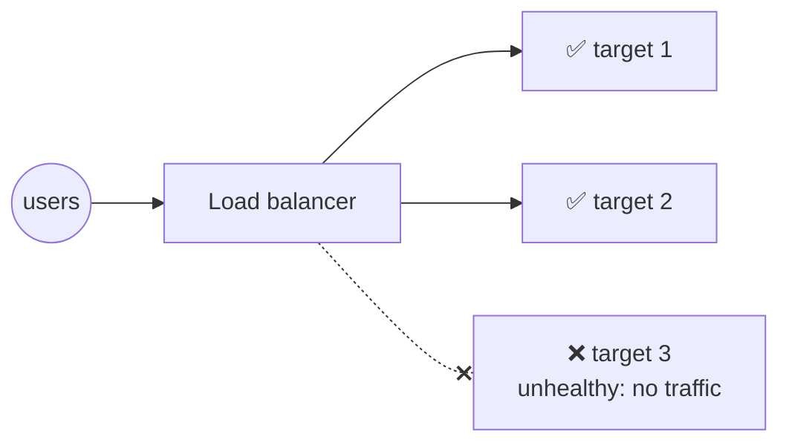
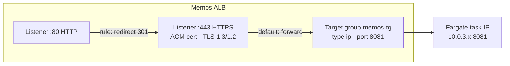
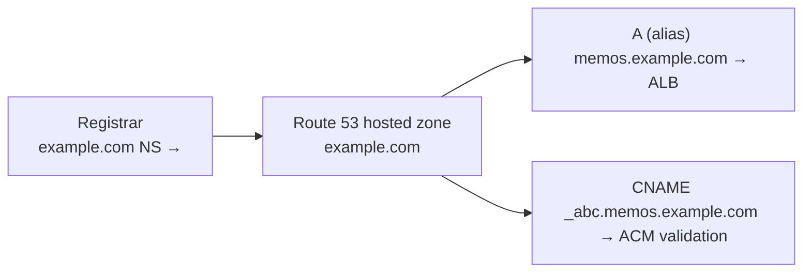
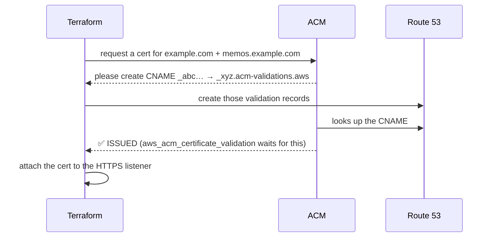

## Load balancers

### What a load balancer does
A **load balancer** is the single front door for your app. It spreads requests across healthy backends, ends TLS, and sends traffic only to targets that pass **health checks**.



### Types of AWS load balancer
| Type | Layer | Strengths |
|---|---|---|
| **ALB** (Application) | 7 | HTTP routing by path, host or header; redirects; WebSockets; authentication |
| **NLB** (Network) | 4 | very fast, static IPs, any TCP/UDP |
| **GWLB** (Gateway) | 3 | puts firewall appliances inline |
| Classic | 4/7 | old: avoid |

> 🔧 **In Memos:** an **internet-facing ALB** in the two public subnets.

### Check
? A game server needs fixed IP addresses and plain TCP on a custom port. Which load balancer fits?
- [ ] ALB
- [x] NLB
- [ ] Classic Load Balancer
- [ ] CloudFront
> The **NLB** works at layer 4 and offers static IPs per AZ. The ALB is for HTTP(S).

## Inside an ALB

### Listeners, rules and target groups

1. A **listener** accepts a port and protocol.
2. **Rules** (checked by priority) forward, redirect or return a fixed response.
3. A **target group** is the set of backends plus its health-check settings.

> Fargate tasks register as **`target_type = "ip"`**, because each task has its own private IP (awsvpc networking mode).

### Health checks
The ALB keeps requesting a **path** on every target:

| Memos setting | Value |
|---|---|
| path | `/` |
| port | 8081 |
| matcher | 200–399 counts as healthy |
| interval | 30 s |
| healthy / unhealthy threshold | 2 / 2 |

> 🔧 **Improvement:** Memos has a real `/healthz` endpoint, and the pipeline already checks it. Pointing the target group at `/healthz` too would make the ALB and CI agree on what "healthy" means.

### 502, 503, 504 from an ALB
| Code | Meaning | First thing to check |
|---|---|---|
| **502** Bad Gateway | the target gave a bad reply or reset the connection | app crashing? wrong protocol or port? |
| **503** Service Unavailable | **no registered targets** in the group | is the ECS task running at all? |
| **504** Gateway Timeout | the target didn't reply in time | slow app, or a security group blocking the ALB → task path |

> ⚠️ If **every** target is unhealthy, the ALB "fails open" and sends traffic to all of them anyway, so you usually see 502s, not 503s.

### Check
? Right after a deploy the ALB returns **503**. What's the most likely situation?
- [ ] The certificate expired
- [x] There are no registered targets: the new task isn't running or never registered
- [ ] DNS is pointing to the wrong place
- [ ] The app is slow
> 503 from an ALB means there's nothing in the target group to send to. Check the ECS service events and the task's stopped reason.

## Route 53 and DNS on AWS

### Hosted zones and records
**Route 53** is AWS's DNS service. A **hosted zone** holds the records for a domain (`example.com`). The domain's registrar must point its **NS records** at the zone's four Route 53 name servers.



### Alias records
An **alias** record is Route 53's special A/AAAA record that points at an AWS resource (ALB, CloudFront, S3 website…):
- it follows the resource's **changing IPs** automatically
- it works at the **zone apex** (`example.com`), where a CNAME isn't allowed
- queries to AWS targets are **free**

```hcl file=infra/main.tf
resource "aws_route53_record" "app" {
  zone_id = data.aws_route53_zone.main.zone_id
  name    = "memos.${var.domain_name}"
  type    = "A"
  alias {
    name                   = module.alb.dns_name
    zone_id                = module.alb.alb_zone_id
    evaluate_target_health = true
  }
}
```

### Routing policies
| Policy | Use |
|---|---|
| Simple | one answer |
| Weighted | e.g. 90/10 for a canary release |
| Latency | send users to the fastest Region |
| Failover | primary, with a backup if its health check fails |
| Geolocation | answer by the user's country, for data residency |

### Check
? Why can't you use a CNAME record for `example.com` itself (the zone apex)?
- [ ] CNAMEs only work with IP addresses
- [x] DNS rules forbid a CNAME at the apex, where NS and SOA records must exist. Route 53 alias records solve this.
- [ ] Route 53 doesn't support CNAMEs
- [ ] CNAMEs can't point to AWS resources
> The apex must hold NS and SOA records, and a CNAME can't coexist with other records. **Alias** gets around it.

## Certificates with ACM

### ACM in one card
**AWS Certificate Manager** issues public TLS certificates **for free** and **renews them automatically**, for use on ALBs, CloudFront and API Gateway. The private key never leaves AWS.

> ⚠️ Certificates are **regional** for ALBs (they must be in the ALB's Region). CloudFront needs them in **us-east-1**.

### DNS validation, automated with Terraform
ACM must check that you control the domain. With **DNS validation**, you create a special CNAME it gives you, and as long as that record exists, renewals happen automatically.


> 🔧 **In Memos:** the `acm` module uses a `for_each` over `domain_validation_options` to create every validation record, then `aws_acm_certificate_validation` blocks until the certificate is issued.

### CloudFront in one card
**CloudFront** is AWS's CDN: it caches content at edge locations near users. It speeds up static files, absorbs traffic spikes and works with **WAF** and **Shield** for protection. Memos doesn't use it yet, but putting CloudFront in front of the ALB is a common next step.

### Check
? Why does Memos use **DNS** validation for its ACM certificate instead of email validation?
- [ ] Email validation costs money
- [x] It can be fully automated in Terraform, and it lets ACM renew the certificate automatically
- [ ] Email validation doesn't work for subdomains
- [ ] DNS validation is faster to type
> As long as the validation CNAME stays in Route 53, ACM renews automatically, with no humans and no expiry surprises.
