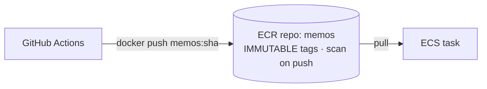
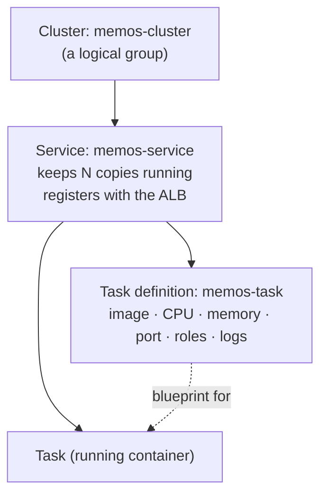
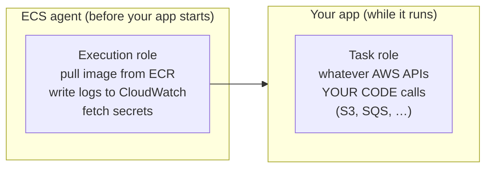
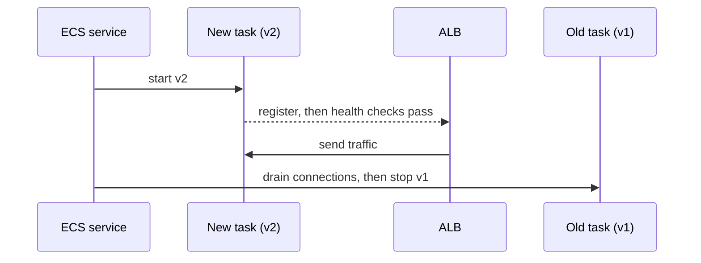

## ECR: the image registry

### What ECR is
**Amazon ECR** is a private Docker registry in your account. Images are pushed by CI and pulled by ECS.



### Tags: why the Git SHA, and why immutable
- Tag every image with the **commit SHA** (`memos:3f9c2e…`): unique, and traceable to the exact code.
- **IMMUTABLE** tags mean a tag can never be overwritten, so `memos:<sha>` always means the same bytes. That's what makes **rollback** safe.
- Avoid deploying `latest`: you can't tell what's running.

> 🔧 **In Memos:** immutability broke pipeline re-runs at first (pushing the same tag twice is refused). The fix: `build.yml` checks ECR first and **reuses** the image if it already exists.

### Scanning and lifecycle
- **Scan on push** checks images for known CVEs.
- **Lifecycle policies** delete old images automatically (e.g. keep the last 30) to control cost.

### Check
? Why tag images with the Git commit SHA instead of `latest`?
- [ ] SHAs are shorter
- [x] Each SHA is unique and maps to exact code, so you always know what's running and can roll back
- [ ] ECR requires SHA tags
- [ ] `latest` is slower to pull
> `latest` changes meaning every push. A SHA tag is a permanent, traceable version.

## ECS building blocks

### The four pieces

- **Task definition:** the blueprint (like a docker-compose file). Each change creates a new **revision**.
- **Task:** a running instance of a task definition.
- **Service:** keeps the desired count of tasks running, replaces failures and does rolling deployments.
- **Cluster:** groups services and tasks.

### Fargate vs EC2 launch type
| | Fargate (Memos) | EC2 launch type |
|---|---|---|
| Servers | none to manage | you run the instances |
| Billing | per task vCPU/GB per second | per instance |
| Control | less | more (GPUs, daemons, special kernels) |

Fargate CPU and memory come in fixed pairs: e.g. **256 CPU (0.25 vCPU) with 512 MB to 2 GB**. Memos uses 256 / 512.

### awsvpc networking
On Fargate every task gets **its own network interface and private IP** in your subnet, with **its own security group**. That's why the target group uses `target_type = "ip"`.

### Check
? What does an ECS **service** do that a single task doesn't?
- [ ] Builds the Docker image
- [x] Keeps the desired number of tasks running, replaces failed ones and registers them with the load balancer
- [ ] Stores the image
- [ ] Defines CPU and memory
> The **service** is the controller. The **task definition** is the blueprint, and a **task** is one running copy.

## Two roles, two jobs

### Execution role vs task role
This is one of the most common ECS interview questions.


| | Execution role | Task role |
|---|---|---|
| Used by | ECS itself | your application code |
| Memos policy | `AmazonECSTaskExecutionRolePolicy` | **none**: Memos doesn't call AWS |

> 🔧 **Rule of thumb:** "can't pull the image or read the secret" → **execution role**. "My app gets AccessDenied from S3" → **task role**.

### Injecting secrets
Never put secrets in the image or in plain environment variables:
```hcl
secrets = [{
  name      = "MEMOS_DSN"
  valueFrom = aws_secretsmanager_secret.dsn.arn
}]
```
ECS fetches the value **at start-up** using the **execution role** (which needs `secretsmanager:GetSecretValue`) and injects it as an environment variable.

### Check
? A new task fails with **CannotPullContainerError**, and you suspect permissions. Which role do you check?
- [x] The execution role
- [ ] The task role
- [ ] The GitHub Actions OIDC role
- [ ] The ALB's role
> Pulling images, writing logs and fetching secrets all happen **before** your code runs, so they're done by ECS using the **execution role**.

## Deployments and rollbacks

### Rolling deployment
When the task definition changes (for example, a new image tag), the service replaces old tasks with new ones:


`minimum_healthy_percent` and `maximum_percent` control how many tasks can be down or extra during the swap.

### Deployment circuit breaker
If new tasks keep failing to become healthy, the **circuit breaker** stops the deployment, and with `rollback = true` it returns to the last working version automatically.

```hcl
deployment_circuit_breaker {
  enable   = true
  rollback = true
}
```
> 🔧 **Memos improvement:** not enabled yet. Today, rollback is manual: rerun `deploy.yml` with the previous SHA.

### Blue/green and canary
- **Blue/green:** run the new version alongside the old one, then switch all traffic at once (CodeDeploy can do this for ECS). Rollback is instant.
- **Canary:** send a small percentage (say 10%) to the new version first, watch the metrics, then increase.

### Check
? What does enabling the ECS deployment circuit breaker with `rollback = true` give you?
- [ ] Faster image pulls
- [x] Automatic return to the last working deployment if new tasks can't become healthy
- [ ] Blue/green deployments
- [ ] Automatic scaling
> It detects a failing rollout and **reverts by itself**, with no human needed at 3 am.

## Scaling and the bigger picture

### ECS service auto scaling
Services scale **out and in** on metrics:
- target tracking on **CPU** or **memory** (e.g. 60%)
- target tracking on **ALB requests per target**
- scheduled scaling

Tasks spread across the subnets you give the service, so **2+ tasks across 2 AZs** gives you availability.

> ⚠️ Memos can't scale out yet: two tasks would each have their **own** SQLite file. Fix the data tier first.

### ECS vs EKS
| | ECS | EKS (Kubernetes) |
|---|---|---|
| Learning curve | gentle | steep |
| Portability | AWS only | runs anywhere |
| Ecosystem | AWS integrations | huge (Helm, operators, service meshes) |
| Control plane cost | free | about $0.10 per hour per cluster |

Pick **ECS** for simplicity on AWS. Pick **EKS** for portability, very large platforms, or if your team already knows Kubernetes.

### Logs: awslogs
Containers write to stdout and stderr. The `awslogs` driver ships those lines to **CloudWatch Logs**:
```hcl
logConfiguration = {
  logDriver = "awslogs"
  options = {
    "awslogs-group"         = "/ecs/memos"
    "awslogs-region"        = "eu-west-1"
    "awslogs-stream-prefix" = "ecs"
  }
}
```

### Check
? Why can't you just set `desired_count = 3` on Memos today to make it highly available?
- [ ] Fargate only allows one task per service
- [x] Each task would have its own separate SQLite database, so users would see different data
- [ ] The ALB can only route to one task
- [ ] It would exceed the VPC's IP addresses
> State lives **inside** each task. Move the data to RDS or EFS first, then scale out.
