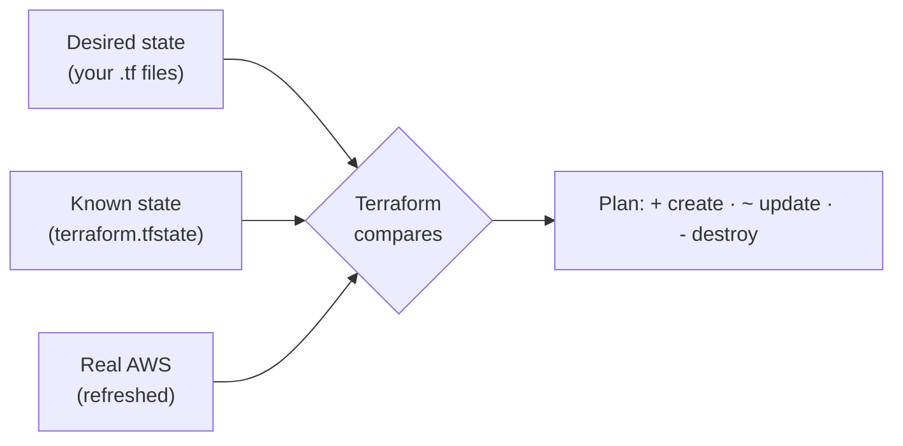
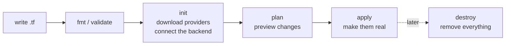
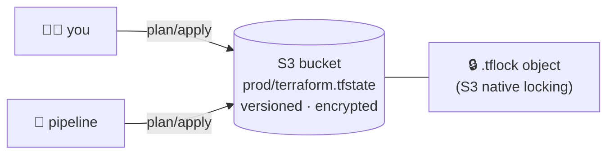
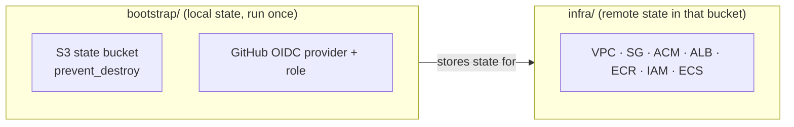
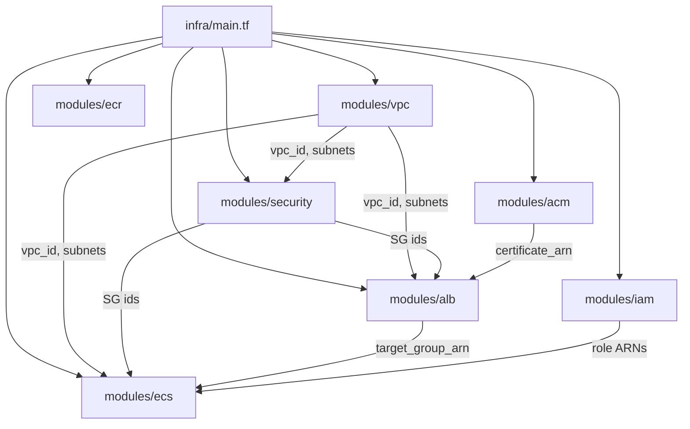

## Infrastructure as code

### Why IaC?
Clicking in the console is slow, error-prone and leaves no record. **Infrastructure as code (IaC)** describes infrastructure in **files**, so it is:
- **repeatable:** build identical dev, staging and prod environments
- **reviewable:** changes go through pull requests
- **versioned:** Git history of every change
- **automatable:** pipelines apply it

### Declarative: describe the result
Terraform is **declarative**: you describe **what** should exist, and Terraform works out **how** to get there.



### Terraform vs the rest
| Tool | Type | Notes |
|---|---|---|
| **Terraform / OpenTofu** | declarative IaC, any cloud | huge provider ecosystem |
| CloudFormation | declarative IaC, AWS only | no state file to manage |
| CDK / Pulumi | IaC in real programming languages | |
| Ansible | configuration management | configures servers; mostly procedural |

### Check
? What does it mean that Terraform is **declarative**?
- [ ] You list every API call in order
- [x] You describe the end state and Terraform works out the steps
- [ ] It only works on AWS
- [ ] It runs on a schedule
> You declare "a VPC with this CIDR should exist", and Terraform decides whether to create, update or leave it alone.

## HCL and the workflow

### The building blocks
```hcl
terraform {                          # settings + required providers + backend
  required_providers { aws = { source = "hashicorp/aws", version = "~> 5.0" } }
}
provider "aws" { region = var.aws_region }        # how to talk to AWS

variable "vpc_cidr" { type = string }             # input
resource "aws_vpc" "main" {                        # something to create
  cidr_block = var.vpc_cidr
}
data "aws_route53_zone" "main" { name = "example.com" }   # look up something that already exists
output "vpc_id" { value = aws_vpc.main.id }       # value to expose
```
A reference such as `aws_vpc.main.id` creates a **dependency**, so Terraform builds things in the right order.

### init → plan → apply

| Command | Does |
|---|---|
| `terraform fmt` | format the code (`-check` in CI) |
| `terraform validate` | check syntax and references |
| `terraform init` | providers, modules, backend |
| `terraform plan -out=tfplan` | show **and save** the changes |
| `terraform apply tfplan` | apply exactly that plan |

### Reading a plan
```output
  # aws_ecs_service.this will be updated in-place
  ~ resource "aws_ecs_service" "this" {
      ~ task_definition = "memos-task:41" -> (known after apply)
    }
  # aws_lb.this must be replaced
-/+ resource "aws_lb" "this" { … }

Plan: 1 to add, 1 to change, 1 to destroy.
```
`+` create · `~` update in place · `-` destroy · `-/+` **replace** (destroy then create).

> ⚠️ Always read `-/+` lines carefully. Replacing an ALB or a database is an outage.

### Check
? Why does Memos' pipeline run `terraform plan -out=tfplan` and then `terraform apply tfplan`?
- [ ] It's faster than a plain apply
- [x] So exactly the reviewed plan is applied, with no surprise changes in between
- [ ] `apply` can't run without a file
- [ ] To skip the refresh
> A saved plan guarantees what you saw is what gets applied, even if something changed in the meantime.

## State and locking

### What state is
`terraform.tfstate` maps your code to **real resource IDs**, such as "`aws_vpc.main` is `vpc-0abc…`". Without it, Terraform can't tell what it already manages.

> ⚠️ State can contain **secrets** (database passwords, for example). Never commit it to Git.

### Remote state + locking

- **Remote** state in S3 is shared by everyone and by CI, with **versioning** for recovery.
- **Locking** stops two applies running at once. Terraform 1.10+ supports `use_lockfile = true` on S3, so you no longer need a DynamoDB table.

```hcl file=infra/provider.tf
backend "s3" {
  bucket       = "memos-tfstate-example"
  key          = "prod/terraform.tfstate"
  region       = "eu-west-1"
  encrypt      = true
  use_lockfile = true
}
```

### The bootstrap pattern
There's a chicken-and-egg problem: the state bucket can't store its own state before it exists. So Memos uses **two stacks**:


Long-lived things (state, CI identity) live separately from things you destroy and rebuild.

### Drift and refresh
**Drift** means reality no longer matches the code, for example when someone changes a security group in the console.
- `terraform plan -refresh-only` shows drift **without** changing anything.
- The next normal `apply` puts reality back to match the code.
- `terraform refresh` is deprecated. Use `plan/apply -refresh-only`.

### Check
? Two engineers run `terraform apply` at the same moment against the Memos backend. What happens?
- [ ] Both succeed and the state merges
- [x] The second one fails to get the state lock and changes nothing
- [ ] The state file is corrupted
- [ ] The newest apply wins
> `use_lockfile = true` creates a lock object. The second run gets "Error acquiring the state lock".

## Modules, variables and loops

### Modules: reusable building blocks
A **module** is a folder of `.tf` files with inputs (variables) and outputs. The root module calls child modules and wires them together:



```hcl file=infra/main.tf
module "alb" {
  source          = "./modules/alb"
  vpc_id          = module.vpc.vpc_id
  public_subnets  = module.vpc.public_subnets
  security_group  = module.security.alb_security_group_id
  certificate_arn = module.acm.certificate_arn
}
```

### Variables, tfvars and outputs
```hcl
variable "environment" {
  type    = string
  default = "prod"
  validation {
    condition     = contains(["dev", "prod"], var.environment)
    error_message = "environment must be dev or prod."
  }
}
```
Values come from `terraform.tfvars`, `-var` flags or `TF_VAR_name` environment variables. Mark secrets `sensitive = true`.

### count vs for_each
```hcl
resource "aws_subnet" "public" {          # count: a list, indexed 0,1,2…
  count      = length(var.public_subnet_cidrs)
  cidr_block = var.public_subnet_cidrs[count.index]
}
resource "aws_route53_record" "validation" {   # for_each: a map, keyed by name
  for_each = { for o in aws_acm_certificate.this.domain_validation_options : o.domain_name => o }
  name     = each.value.resource_record_name
}
```
> ⚠️ With `count`, removing a middle item **shifts the indexes** and can recreate resources. `for_each` keys are stable, so prefer it for anything you might remove.

### Lifecycle rules
| Rule | Use |
|---|---|
| `prevent_destroy = true` | refuse to destroy (Memos' state bucket) |
| `create_before_destroy = true` | build the replacement first (Memos' ACM cert) |
| `ignore_changes = [desired_count]` | let autoscaling change it without Terraform reverting it |

### Check
? You manage subnets with `count` from a list of three CIDRs and delete the **middle** one. What could happen?
- [ ] Only the middle subnet is destroyed
- [x] The third subnet's index shifts, so Terraform may destroy and recreate it
- [ ] Nothing, because count is stable
- [ ] Terraform refuses to plan
> `count` identifies resources by **position**. Use `for_each` with stable keys to avoid it.

## Working safely

### Importing existing resources
Things created by hand can be brought under Terraform with an **import block** (Terraform 1.5+):
```hcl
import {
  to = aws_route53_record.validation["example.com"]
  id = "Z123…_abc.example.com_CNAME"
}
```
> 🔧 **In Memos:** moving ACM into code hit "record already exists". Import blocks adopted the existing records, and were removed after one apply.

### Security scanning: tfsec
**tfsec** (now part of Trivy) scans Terraform for risky settings: public buckets, open security groups, missing encryption. Memos runs it on **every** pipeline run.

If you accept a finding, document **why**:
```hcl
# Flow Logs are omitted to avoid extra logging costs.
# tfsec:ignore:aws-ec2-require-vpc-flow-logs-for-all-vpcs
resource "aws_vpc" "main" { … }
```

### Environments and workspaces
Keep environments **isolated**: separate state per environment (different backend keys, or separate folders or accounts) and separate tfvars. One bad apply should never touch two environments.

### Check
? A security group rule was added by hand in the console. How do you see this drift **without** changing anything?
- [ ] `terraform apply`
- [ ] `terraform destroy`
- [x] `terraform plan -refresh-only`
- [ ] `terraform fmt`
> `-refresh-only` compares state with reality and reports differences without proposing changes to your resources.
