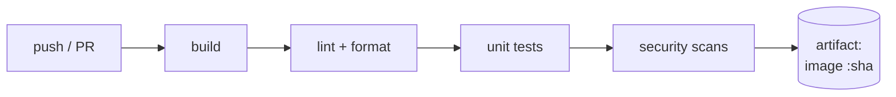
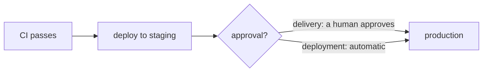
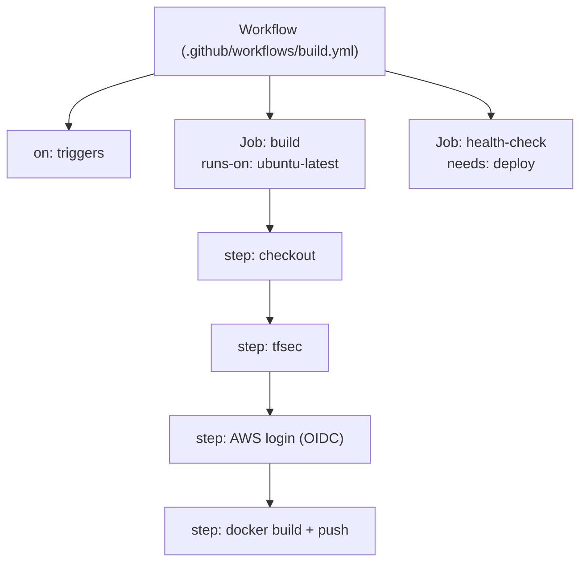
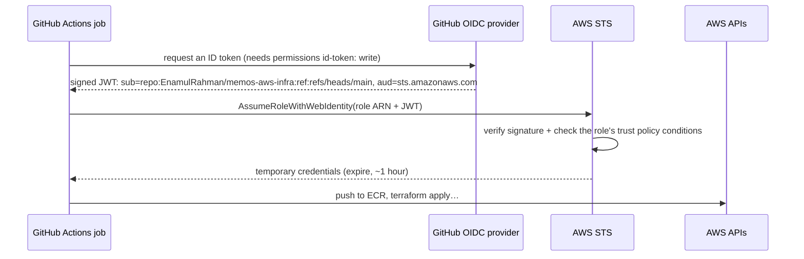
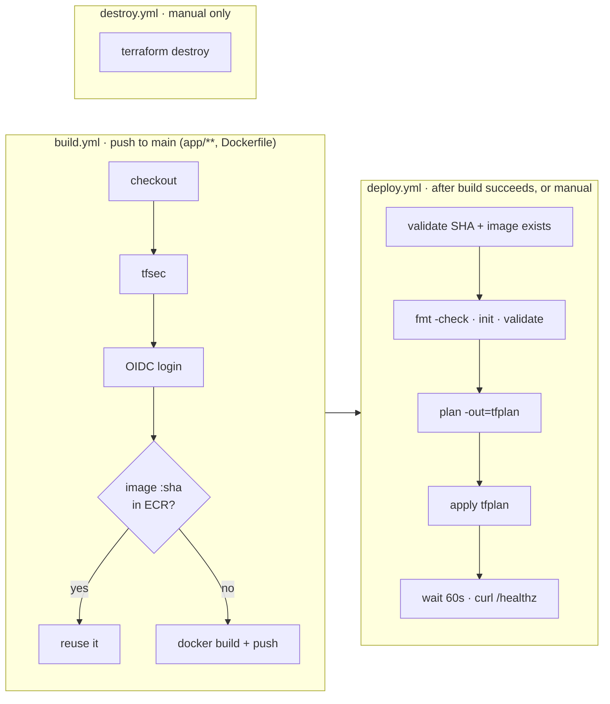
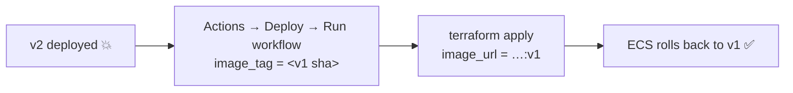

## CI and CD

### Continuous integration
**CI** means everyone merges small changes to `main` often, and every push is **automatically built and tested**. Bugs show up in minutes, not at release time.



### Continuous delivery vs deployment
- **Continuous delivery:** every change that passes is **ready** to release. A human presses the button.
- **Continuous deployment:** every change that passes **goes to production automatically**.


> 🔧 **In Memos:** continuous **deployment**. A merge to `main` that changes the app goes all the way to production.

### Build once, promote everywhere
Build the artefact (the image) **once**, give it an immutable tag, and deploy **that same artefact** to every environment. Rebuilding per environment risks shipping something you never tested.

### Check
? What's the difference between continuous delivery and continuous deployment?
- [ ] Delivery is for apps; deployment is for infrastructure
- [x] Delivery keeps every change releasable but needs a human to release; deployment releases automatically
- [ ] There is no difference
- [ ] Deployment skips testing
> Both automate build and test. The difference is whether production needs a **manual approval**.

## GitHub Actions anatomy

### Workflows, jobs, steps

- **Workflow:** a YAML file. **Triggers** (`on:`) start it.
- **Jobs** run on fresh **runners** (VMs), in parallel unless they declare `needs:`.
- **Steps** run in order: a shell command (`run:`) or a reusable **action** (`uses:`).

### Triggers
```yaml
on:
  push:
    branches: [main]
    paths: ['app/**', 'Dockerfile', '.dockerignore']   # only when the app changes
  pull_request:
  workflow_dispatch:          # a manual "Run workflow" button, with inputs
  workflow_run:               # after another workflow finishes
    workflows: ["Build and Push"]
    types: [completed]
  schedule:
    - cron: "0 3 * * 1"       # Mondays 03:00 UTC
```

### Secrets and variables
- `${{ secrets.NAME }}` for sensitive values. They're **masked** in logs, and not given to workflows triggered by pull requests from forks.
- `${{ vars.NAME }}` for plain settings.
- **Environments** (e.g. `production`) can hold their own secrets and **require reviewers** before a job runs.

> ⚠️ Third-party actions run code with your permissions. Pin them to a **full commit SHA**, not just a tag, because tags can be moved.

### Check
? In GitHub Actions, how do you make a job wait for another job to finish?
- [ ] Put them in the same step
- [x] Use `needs: <job-id>`
- [ ] Use `on: workflow_run`
- [ ] Jobs always run in order
> Jobs run **in parallel** by default. `needs:` creates the dependency (`health-check` needs `deploy` in Memos).

## Keyless AWS login with OIDC

### The problem with access keys
Storing `AWS_ACCESS_KEY_ID`/`AWS_SECRET_ACCESS_KEY` in GitHub means long-lived credentials that can leak, need rotating and work from anywhere.

### How OIDC works

No secret is stored. The only GitHub secret is the **role ARN**, which isn't a credential.

### The trust policy is everything
```hcl file=bootstrap/oidc.tf
Condition = {
  StringEquals = { "token.actions.githubusercontent.com:aud" = "sts.amazonaws.com" }
  StringLike   = { "token.actions.githubusercontent.com:sub" = "repo:EnamulRahman/memos-aws-infra:*" }
}
```
- `aud` must be `sts.amazonaws.com`.
- `sub` decides **which repo, branch or environment** may assume the role.

> 🔧 **Real Memos story:** OIDC kept failing because the `sub` didn't match after the repo was renamed. The fix was rebuilding the provider and role with a correct trust policy, then moving it into `bootstrap/`.

> ⚠️ **Tighten it:** `:*` allows any branch. `repo:…:ref:refs/heads/main` or `repo:…:environment:production` is safer. The role also has AdministratorAccess today, which is too broad.

### Check
? The OIDC step fails with "Not authorized to perform sts:AssumeRoleWithWebIdentity". What do you check first?
- [ ] The Docker image tag
- [x] The role's trust policy: do the `sub` and `aud` conditions match the token GitHub sent?
- [ ] The ECS service events
- [ ] The S3 bucket policy
> Almost every OIDC failure is a **trust-policy mismatch** (wrong repo name, branch, environment or audience), or a missing `permissions: id-token: write`.

## The Memos pipeline

### Three workflows


### Rolling back
Every image stays in ECR under its SHA. To roll back, run **Deploy** manually with the previous good SHA:


> 🔧 **Improve:** add the ECS circuit breaker for automatic rollback, and a `terraform plan` on every pull request, posted as a comment for review.

### Gotcha: path filters
`build.yml` only triggers on `app/**`, `Dockerfile` and `.dockerignore`. A change **only to `infra/**`** doesn't trigger a build, so the deploy never runs. You'd run **Deploy** manually, or add an infra-specific trigger.

### Deployment strategies
| Strategy | How | Rollback |
|---|---|---|
| Recreate | stop old, start new | slow, with downtime |
| **Rolling** (Memos) | replace tasks gradually | redeploy the old version |
| Blue/green | full new copy, then switch traffic | flip back instantly |
| Canary | small % first, then more | stop the canary |

### Check
? You change only `infra/modules/alb/main.tf` and merge to main. Why doesn't anything deploy?
- [ ] tfsec blocked it
- [x] build.yml's path filter only matches app/**, Dockerfile and .dockerignore, so the build (and the deploy that follows it) never starts
- [ ] Terraform changes need a pull request
- [ ] The OIDC role can't change ALBs
> `deploy.yml` runs **after** `build.yml`. No build means no deploy, so trigger it manually or add an `infra/**` trigger.
