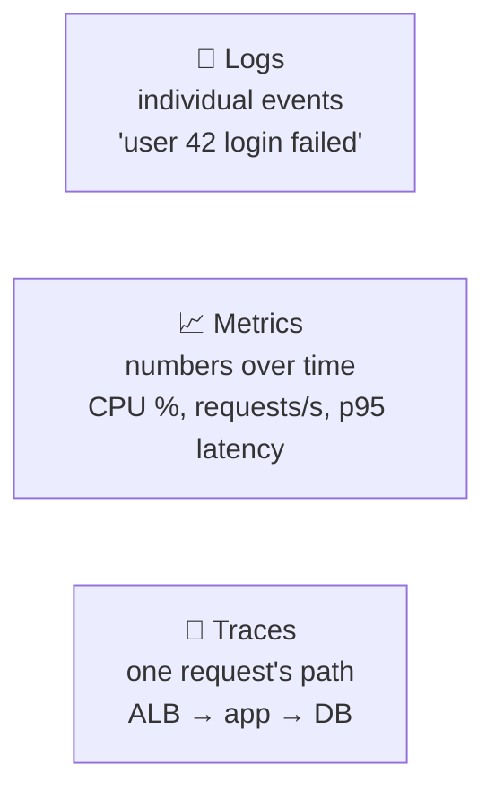
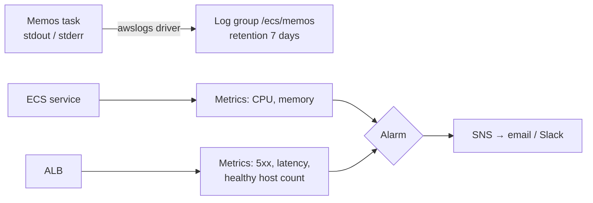
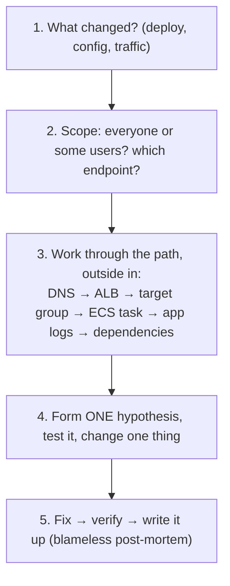
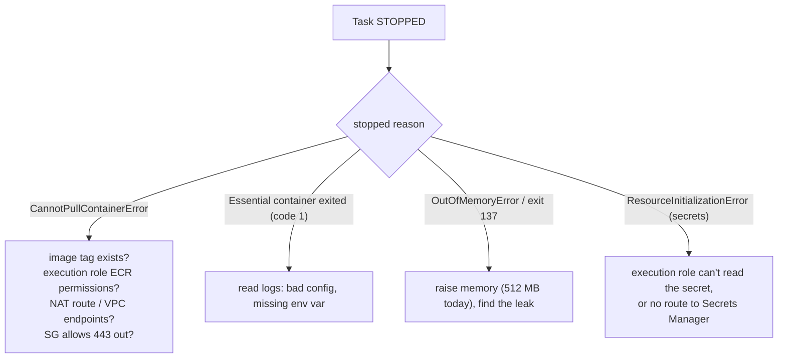

## Observability basics

### Monitoring vs observability
- **Monitoring** tells you **that** something is wrong: a metric crossed a line, an alarm fired.
- **Observability** lets you work out **why**, including problems you never predicted, by asking new questions of the data.

### The three pillars

| Pillar | Answers | AWS tool |
|---|---|---|
| Logs | what exactly happened? | CloudWatch Logs |
| Metrics | how much and how fast? | CloudWatch Metrics |
| Traces | where is the time going? | X-Ray / OpenTelemetry |

### The golden signals
For any service, watch the **four golden signals**:
1. **Latency:** how long requests take (watch p95/p99, not just the average)
2. **Traffic:** how many requests
3. **Errors:** the rate of failures (5xx)
4. **Saturation:** how full it is (CPU, memory, connections)

### Check
? Which pillar of observability shows the path of a **single request** through several services?
- [ ] Logs
- [ ] Metrics
- [x] Traces
- [ ] Alarms
> A **trace** follows one request across hops, with timings for each, and shows where it's slow.

## CloudWatch and alarms

### CloudWatch in Memos

> 🔧 **Memos trade-offs:** 7-day log retention and **Container Insights off** (both to save cost). There are no alarms yet. Adding one on ALB 5xx and `UnHealthyHostCount` is a quick win.

### Logs Insights
Query logs like a database:
```output
fields @timestamp, @message
| filter @message like /error/
| sort @timestamp desc
| limit 20
```

### SLIs, SLOs and error budgets
- **SLI** (indicator): what you measure, such as "% of requests that succeed in under 500 ms".
- **SLO** (objective): the target, such as "99.9% over 30 days".
- **Error budget:** what's left over (0.1% ≈ **43 minutes** a month). Plenty left means ship faster. Used up means slow down and fix reliability.
- **SLA:** a contract with customers, usually looser than your SLO.

### Check
? An SLO is 99.9% availability over 30 days. Roughly how much downtime does the error budget allow?
- [ ] 4 minutes
- [x] 43 minutes
- [ ] 7 hours
- [ ] 3 days
> 30 days × 24 × 60 = 43,200 minutes, and 0.1% of that ≈ **43 minutes**.

## A method for troubleshooting

### Layer by layer, one change at a time

> ⚠️ **Errors right after a release? Roll back first** and investigate after. Recovery beats root cause during an incident.

### Where to look, in order
| Layer | Check |
|---|---|
| DNS | `dig memos.example.com`: right ALB? |
| ALB | listener and certificate OK? status code: 502/503/504? |
| Target group | healthy targets? health-check failure reason? |
| ECS | service **events**, task **stopped reason**, exit code |
| App | CloudWatch Logs `/ecs/memos` |
| Network | security group chain ALB SG → ECS SG on 8081, NAT route for pulls |

### Blameless post-mortems
After an incident write: **timeline · impact · root cause · what went well · action items**. Blameless means you fix **systems**, not people. People hide mistakes when they fear blame.

### Check
? Users report errors two minutes after a new deploy. What's the best **first** action?
- [ ] Read through the code changes line by line
- [x] Roll back to the previous version, then investigate
- [ ] Restart the database
- [ ] Wait to see if it fixes itself
> Restore service first. With immutable SHA tags, rolling back is fast and safe. Debug afterwards.

## Memos playbooks

### 502 / 503 / unreachable
1. **Target group:** any healthy targets? (503 means none registered)
2. **ECS:** is the task running, or stopping in a loop? Read the stopped reason.
3. **Port:** 8081 **everywhere**: `MEMOS_PORT`, the task definition, the target group, both SG rules.
4. **Health check:** does `/` (or `/healthz`) return 200–399?
5. **Security groups:** ECS SG allows 8081 **from the ALB SG**, and the ALB SG has **egress** to it.
6. **Logs:** `/ecs/memos`: crashing on start?

> 🔧 **Classic cause:** port drift between 5230 (Memos' default) and 8081 makes targets unhealthy. The lesson: define the port **once** as a variable.

### The task won't start


### A timeout or hang
A **timeout** means traffic is being **dropped**: check security groups, NACLs and route tables. **Connection refused** is different: the host was reached, but nothing is listening.

### Check
? A task stops with `CannotPullContainerError`. It runs in a private subnet. Which is **not** a likely cause?
- [ ] The private route table has no route to a NAT gateway
- [ ] The execution role lacks ECR permissions
- [ ] The image tag doesn't exist in ECR
- [x] The ALB's health check path is wrong
> Pulling happens **before** the app starts, so health checks don't matter yet. Routing, IAM and the tag itself do.
