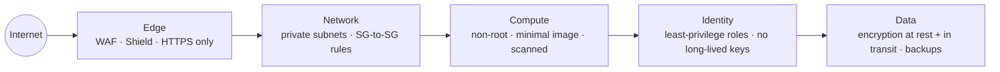
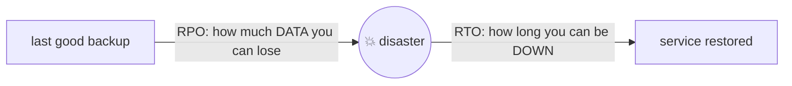
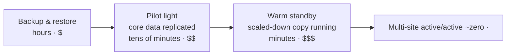
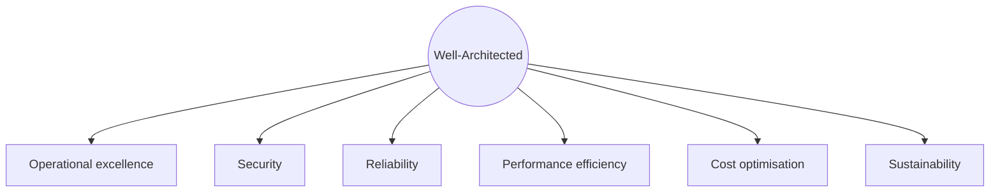

## Security in layers

### Defence in depth
No single control is perfect, so you stack them. An attacker has to beat **every** layer.

### Memos' security, honestly
| ✅ Already good | ⚠️ To improve |
|---|---|
| Tasks in private subnets | OIDC role has AdministratorAccess |
| SG-to-SG rule on 8081 only | trust policy `sub` is `repo:…:*` (any branch) |
| HTTPS only (301 redirect, TLS 1.2+) | actions pinned by tag, not SHA |
| OIDC: no stored keys | no WAF |
| Non-root container, scan on push | no flow logs (accepted cost trade-off) |
| State bucket: versioned, encrypted, HTTPS-only | |

### Secrets management
| Option | Good for |
|---|---|
| **Secrets Manager** | database passwords and API keys, with **automatic rotation**; small monthly fee per secret |
| **SSM Parameter Store** (SecureString) | config and secrets; the standard tier is free |
| **KMS** | the encryption keys behind both, plus EBS, S3 and RDS encryption |

Never put secrets in Git, Docker images, Terraform variables in plain text, or logs.

### Check
? Which AWS service can **automatically rotate** a database password?
- [ ] KMS
- [x] Secrets Manager
- [ ] IAM
- [ ] S3
> Secrets Manager has built-in rotation (for RDS and others). Parameter Store stores secrets but doesn't rotate them for you.

## Detect and audit

### Who did what: CloudTrail
**CloudTrail** records **API calls** in the account: who, what, when and from where. It's the first place to look for "who deleted the security group?"

| Service | Job |
|---|---|
| **CloudTrail** | audit log of API activity |
| **GuardDuty** | threat detection from logs (crypto-mining, odd logins) |
| **Security Hub** | central findings and best-practice checks |
| **Inspector** | vulnerability scanning for EC2, ECR and Lambda |
| **Config** | history of resource configuration and compliance rules |
| **WAF / Shield** | block bad HTTP traffic / DDoS protection |

### Supply-chain security
Your pipeline runs other people's code: actions, base images, packages.
- Pin actions to **commit SHAs**. Pin base image versions.
- **Scan** images and dependencies (Trivy, ECR scanning, Dependabot).
- Give CI only the permissions it needs (`permissions:` in workflows, least-privilege roles).

### Check
? Someone deleted a security group last night. Which service tells you who did it?
- [ ] CloudWatch Metrics
- [x] CloudTrail
- [ ] GuardDuty
- [ ] Inspector
> CloudTrail logs every API call, including `DeleteSecurityGroup`, with the identity that made it.

## Reliability

### High availability vs fault tolerance vs DR
- **High availability (HA):** keeps working with at most a short blip (multi-AZ, several tasks, health checks).
- **Fault tolerance:** **no** interruption at all (fully redundant, more expensive).
- **Disaster recovery (DR):** how you recover from losing a whole Region or a whole system.

### RPO and RTO

- **RPO** (Recovery Point Objective): the most data loss you can accept, measured in time.
- **RTO** (Recovery Time Objective): the most downtime you can accept.

### DR strategies, cheapest to most expensive

The lower the RPO and RTO, the higher the cost. Match the strategy to what the business actually needs.

### Check
? Memos keeps its SQLite data inside the container with no backups. What are its RPO and RTO for data if a task is replaced?
- [ ] RPO zero, RTO zero
- [x] The data is simply lost: there's no recovery point at all
- [ ] RPO 24 hours, RTO 1 hour
- [ ] RPO 7 days, because of log retention
> With no backup and ephemeral storage, there's nothing to restore. That's why moving to RDS (with backups) or EFS is the top improvement.

## Well-Architected and cost

### The six pillars
The **AWS Well-Architected Framework** reviews a design against six pillars:

### Where cloud money goes
| Driver | Memos example | Ways to save |
|---|---|---|
| Always-on networking | **2 NAT gateways**, ALB, public IPv4 | one NAT in non-prod, VPC endpoints, destroy when idle |
| Compute | Fargate 0.25 vCPU / 512 MB | right-size, Fargate Spot for non-prod, Savings Plans |
| Data transfer | traffic through the NAT | S3 gateway endpoint (free) |
| Storage and logs | 7-day log retention | lifecycle rules, shorter retention |

> 🔧 **Habit:** tag everything (`Project = "Memos"`, `ManagedBy = "Terraform"` via `default_tags`), turn on **Cost Explorer** and set **AWS Budgets** alerts.

### Check
? Which is a **free** way to stop Memos' ECR image layer downloads going through the NAT gateway?
- [ ] An interface endpoint for ECR
- [x] An S3 gateway endpoint (image layers are stored in S3)
- [ ] A second NAT gateway
- [ ] CloudFront
> Gateway endpoints for S3 cost nothing. You still need the ECR API endpoints (paid) or the NAT for the small API calls.
