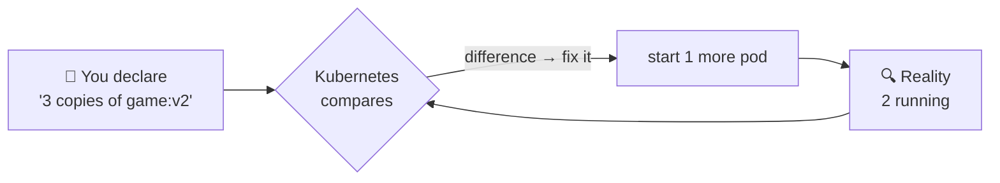
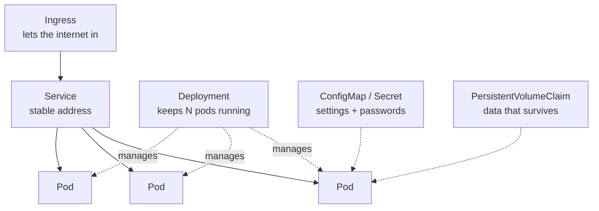
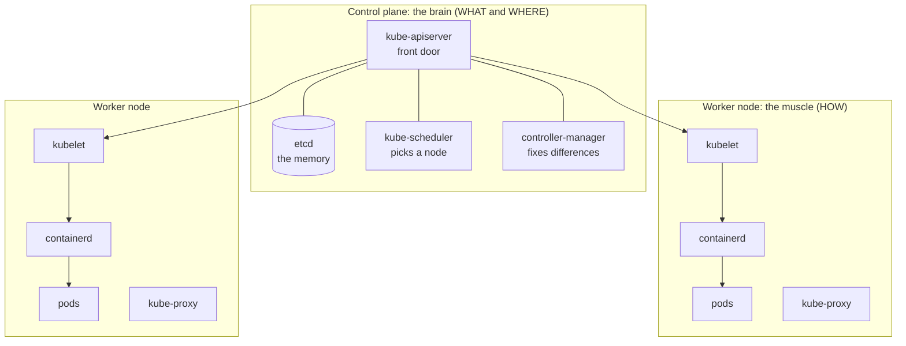
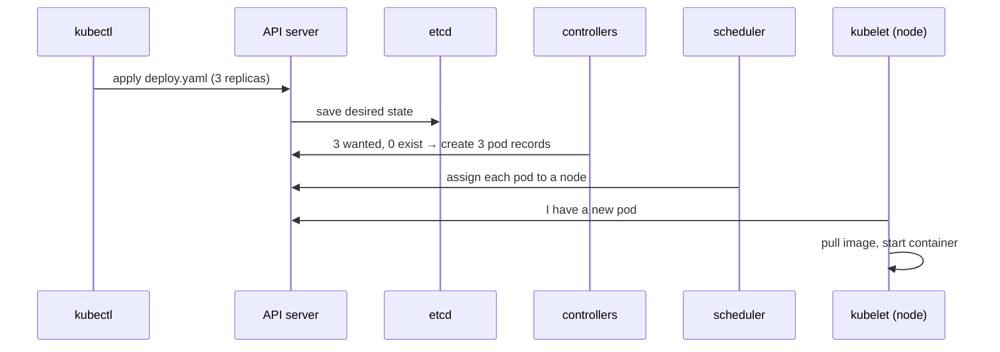
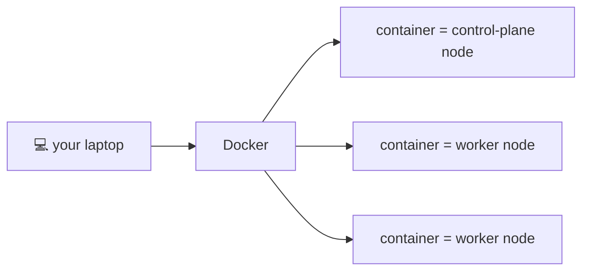
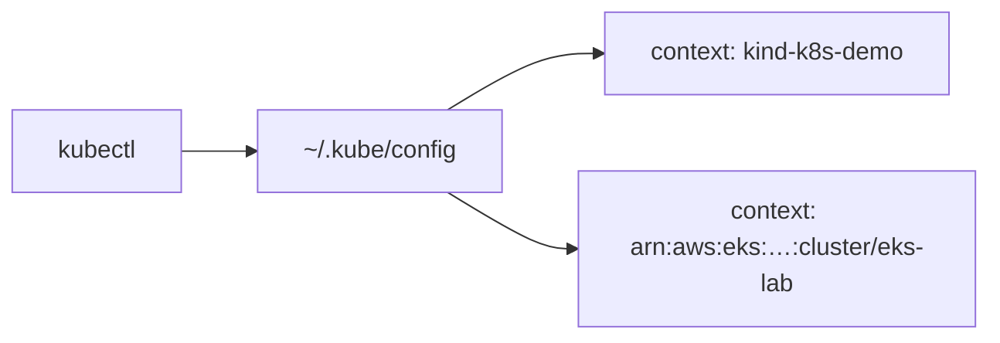
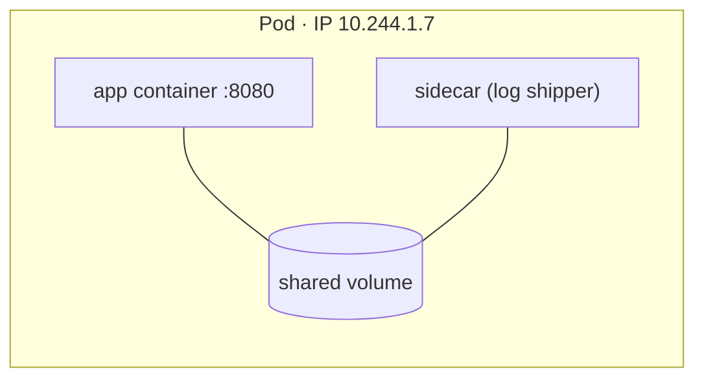
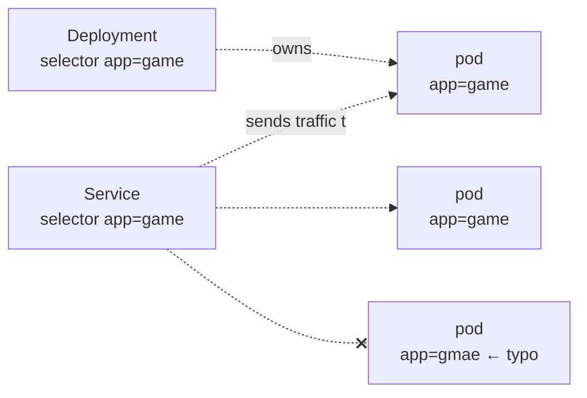

## Why Kubernetes

### The problem it solves
One container is easy to run. Hundreds, across many machines, all needing to be **started, watched, restarted, updated, scaled and connected**, is not.

A **container orchestrator** does that boring work for you:
- **Scheduling:** which machine runs what
- **Scaling:** more or fewer copies
- **Self-healing:** restart what crashes, move work off dead machines
- **Rolling updates:** new versions with no downtime
- **Load balancing**, **storage** and **secrets**

**Kubernetes** (K8s: K, 8 letters, s) is the industry-standard orchestrator. Google built it, and the CNCF looks after it now.

### The single most important idea: desired state
You don't tell Kubernetes **how**. You tell it **what you want**, and it keeps making that true, forever.


If a container crashes, a node dies or someone deletes a pod, reality no longer matches what you asked for, so Kubernetes fixes it.

> 🧠 Kubernetes is Linux, networking and containers, scaled up across a fleet of machines and managed from one control centre. If you know those three, you're halfway there.

### The building blocks

Everything is described in **YAML**, and objects find each other with **labels**.

### Kubernetes vs the ECS example
If you did the ECS Lab, most ideas map straight across:

| Job | ECS (the Memos example) | Kubernetes |
|---|---|---|
| Group of machines | ECS cluster | Cluster (EKS on AWS) |
| Recipe for the app | Task definition | Pod spec in a Deployment |
| One running copy | Task | Pod |
| Keep N copies, roll out updates | ECS service (`desired_count`) | Deployment (`replicas`) |
| Stable address | ALB target group | Service |
| HTTPS + routing by host | ALB listener | Ingress + ingress controller |
| Certificate | ACM | cert-manager + Let's Encrypt |
| DNS record | Route 53 via Terraform | ExternalDNS (automatic) |
| Settings / passwords | env vars / Secrets Manager | ConfigMap / Secret |
| Firewall between parts | Security groups | NetworkPolicy |
| App's AWS permissions | Task role | Service account + IRSA |

> 🔧 **Interview answer, "ECS or Kubernetes?":** ECS is simpler and AWS-only. Kubernetes is the open-source standard: it runs on any cloud and has a huge ecosystem (Helm, Argo CD, cert-manager), but there's more to learn and operate.

### Check
? What does "desired state" mean in Kubernetes?
- [ ] The state you hope the app reaches after testing
- [x] What you declare should be running; Kubernetes keeps working to make reality match it
- [ ] The last state saved in a backup
- [ ] The state of the control plane only
> Declare it once, and control loops keep fixing any difference: that's self-healing.

## Cluster architecture

### Control plane and worker nodes


### The restaurant analogy
- **API server:** the order desk. Every order goes through it, and nobody walks into the kitchen.
- **etcd:** the order book, the official record of everything.
- **Scheduler:** decides which chef gets each new order.
- **Controller-manager:** keeps checking "did every table get what it ordered?"
- **Worker nodes:** kitchen stations. The **kubelet** is the station chef, and **kube-proxy** is the waiter who knows which station serves which table.

> 🧠 You only ever talk to the **API server**. It saves your desired state in etcd, and the other components make it happen.

### What each part does
| Component | Where | Job |
|---|---|---|
| kube-apiserver | control plane | every request goes through it; validates and stores |
| etcd | control plane | key-value store holding all cluster state (back it up!) |
| kube-scheduler | control plane | chooses a node for each new pod (free CPU and memory, rules) |
| controller-manager | control plane | reconcile loops: actual → desired |
| cloud-controller-manager | control plane (cloud only) | creates cloud load balancers and disks |
| kubelet | every node | starts and watches that node's containers |
| kube-proxy | every node | network rules so Services reach the right pods |
| container runtime | every node | actually runs containers (containerd, CRI-O) |

### What happens when you apply something


### On EKS, who runs what?
On **EKS**, AWS runs and scales the **whole control plane** across three AZs. You manage the **worker nodes** (node groups) and what runs on them. ECS hides all of this from you.

### Check
? Which component do `kubectl` commands actually talk to?
- [ ] etcd
- [ ] The kubelet on each node
- [x] The kube-apiserver
- [ ] The scheduler
> Everything goes through the API server, which stores the desired state in etcd.

? Which component decides **which node** a new pod runs on?
- [ ] kubelet
- [x] kube-scheduler
- [ ] kube-proxy
- [ ] etcd
> The scheduler matches pods to nodes with enough free resources. The kubelet on that node then starts the containers.

## A free practice cluster with kind

### kind: Kubernetes in Docker
Cloud clusters cost money. **kind** runs each "node" as a Docker container, so you get a **real multi-node cluster on your laptop, for free**. (Alternatives: minikube, k3d, Docker Desktop's built-in Kubernetes.)

```yaml file=kind-config.yaml
kind: Cluster
apiVersion: kind.x-k8s.io/v1alpha4
nodes:
  - role: control-plane
  - role: worker
  - role: worker
```



### Create it and look around
```output
$ kind create cluster --config kind-config.yaml --name k8s-demo
$ kubectl get nodes
NAME                     STATUS   ROLES           AGE
k8s-demo-control-plane   Ready    control-plane   60s
k8s-demo-worker          Ready    <none>          40s
k8s-demo-worker2         Ready    <none>          40s
```
- `kubectl config get-contexts` lists every cluster you can talk to. kind names its context `kind-<name>`.
- `kubectl config use-context <name>` switches cluster.
- `kind delete cluster --name k8s-demo` removes it.

### kubeconfig and contexts
`kubectl` reads **`~/.kube/config`** to know which clusters exist and how to log in. Each **context** is one cluster plus one user.


> ⚠️ Always check the context before destructive commands: `kubectl config current-context`.

### Check
? What do you need installed to run a kind cluster?
- [ ] An AWS account
- [x] Docker (running) and kubectl
- [ ] A VirtualBox VM per node
- [ ] Helm
> kind's nodes **are** Docker containers. kubectl is how you talk to the cluster.

## YAML manifests and pods

### What a pod is
A **pod** is the smallest thing Kubernetes runs: a wrapper around one container (sometimes a main container plus a small **sidecar**).

Containers in the same pod:
- always land on the **same node**
- share **one IP address**, so they talk over `localhost`
- can share **volumes** (each container must mount them)



### Anatomy of a manifest
Every manifest has the same four top-level fields:

```yaml file=nginx-pod.yaml
apiVersion: v1            # which API version this kind lives in
kind: Pod                 # what type of object
metadata:                 # facts ABOUT the object
  name: nginx-pod
  labels:
    app: nginx            # name tags you choose
spec:                     # the desired state
  containers:             # a list: each item starts with "-"
    - name: nginx
      image: nginx:1.27   # pin a tag; no tag means :latest
      ports:
        - containerPort: 80
```
> 🧠 Not sure what goes under a field? Ask the cluster: `kubectl explain pod.spec.containers`.

### Try it
```output
$ kubectl apply -f nginx-pod.yaml
pod/nginx-pod created
$ kubectl get pods -o wide
NAME        READY   STATUS    IP            NODE
nginx-pod   1/1     Running   10.244.1.7    k8s-demo-worker
$ kubectl logs nginx-pod
$ kubectl exec -it nginx-pod -- sh
$ kubectl delete pod nginx-pod
```
`READY 1/1` means one of one containers is ready.

### YAML gotchas
- **Spaces only, never tabs.** Indentation shows what belongs to what. "error converting YAML to JSON" is usually one wrong indent.
- A pod normally has **one main container**. To run more copies, add more **pods**, not more containers.
- A **bare pod is not self-healing**: delete it and it's gone. Real work uses Deployments.

### Check
? Which four fields appear at the top of every Kubernetes manifest?
- [ ] name, image, ports, replicas
- [x] apiVersion, kind, metadata, spec
- [ ] version, type, labels, containers
- [ ] api, object, data, status
> `status` is filled in by Kubernetes. You write the other four.

? Two containers in the same pod need to talk. How?
- [ ] Through a Service
- [x] Over `localhost`: they share one network namespace (one IP)
- [ ] Through the Ingress
- [ ] They can't
> Same pod = same IP and port space. They just use different ports.

## Labels, selectors and namespaces

### Labels and selectors
**Labels** are `key: value` name tags on objects. A **selector** is a search: "everything labelled `app: game`".


Deployments, Services and NetworkPolicies all find pods **by label**. Nothing is linked by name, so a **typo means nothing connects**.

```output
$ kubectl get pods --show-labels
$ kubectl get pods -l app=game
```

### Namespaces
**Namespaces** are folders inside one cluster, keeping groups of objects apart.

| Namespace | Holds |
|---|---|
| `default` | your things, unless you say otherwise |
| `kube-system` | Kubernetes' own pods (CoreDNS, kube-proxy…) |
| your own (`game`, `monitoring`, `cert-manager`…) | one app or add-on each |

Use `-n <namespace>` for one, `-A` for all.

### Imperative vs declarative
| | Imperative | Declarative |
|---|---|---|
| How | a command says do this **now** | a file says what you **want** |
| Example | `kubectl run`, `kubectl create deployment` | `kubectl apply -f deploy.yaml` |
| Use for | quick tests, exams, debugging | **real work**: files in Git, reviewed and repeatable |

The best of both: generate a clean starting file with a command, then keep the file.
```output
$ kubectl create deploy game --image=nginx --dry-run=client -o yaml > deploy.yaml
```
`--dry-run=client -o yaml` prints the YAML and **creates nothing**.

> ⚠️ `kubectl create pod` doesn't exist. Use `kubectl run nginx --image=nginx` for a quick pod.

### Check
? A Service sends traffic nowhere. Its selector is `app: game`. What's the most common cause?
- [ ] The Service type is ClusterIP
- [x] The pods' labels don't match the selector (e.g. a typo)
- [ ] The namespace is called default
- [ ] etcd is down
> Selectors match labels exactly. A typo means no Endpoints, so there's nowhere to send traffic.

? Why is declarative (`kubectl apply -f`) the right choice for real work?
- [ ] It's faster to type
- [x] The files live in Git, so changes are reviewed, repeatable and auditable
- [ ] Imperative commands are deprecated
- [ ] Declarative skips validation
> The same reason infrastructure moved to Terraform: Git becomes the record of the truth.
