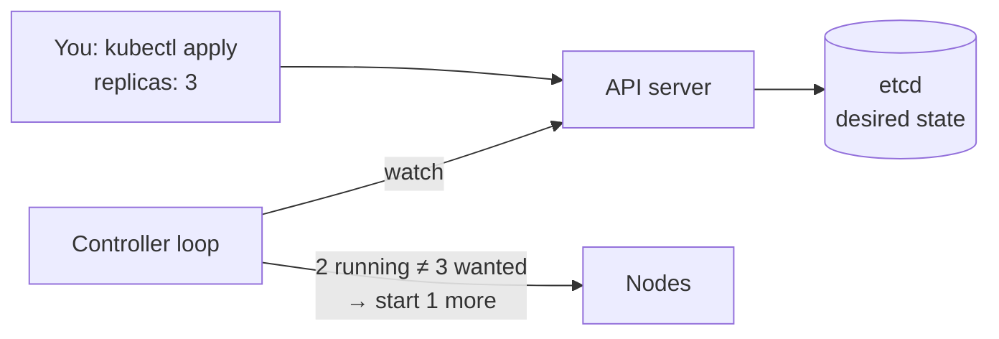
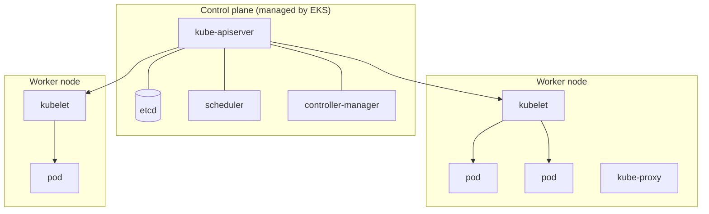
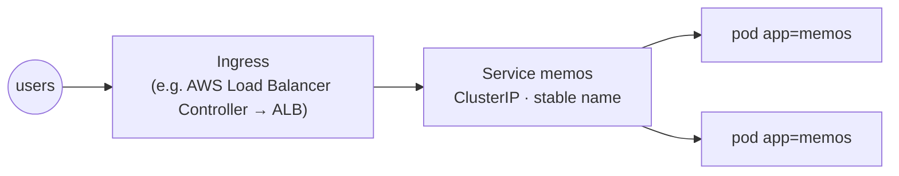

## Why Kubernetes

### Orchestration
Running one container is easy. Running hundreds across many machines, with restarts, scaling, networking, rolling updates and secrets, needs an **orchestrator**. **Kubernetes (K8s)** is the industry standard. ECS is AWS's simpler alternative.

### Desired state, reconciled
You declare what you want in YAML. **Controllers** keep comparing that with reality and fix any difference, forever.



### Check
? What is the core idea behind how Kubernetes keeps applications running?
- [ ] It restarts the whole cluster every hour
- [x] Controllers continuously reconcile the actual state with the declared desired state
- [ ] It runs every container twice
- [ ] Developers restart pods by hand
> Declare the state you want, and control loops make reality match it. That's how self-healing works.

## Cluster architecture

### Control plane and nodes

| Component | Job |
|---|---|
| **API server** | the front door: every command goes through it |
| **etcd** | key-value store holding the cluster's state |
| **scheduler** | picks which node a new pod runs on |
| **controller-manager** | runs the reconcile loops |
| **kubelet** | agent on each node that starts pods |
| **kube-proxy** | node networking for Services |

### Check
? Which component decides **which node** a new pod is placed on?
- [ ] kubelet
- [ ] etcd
- [x] kube-scheduler
- [ ] kube-proxy
> The **scheduler** looks at resources, taints and affinity rules and picks a node. The kubelet on that node then runs the pod.

## Core objects

### Pod → ReplicaSet → Deployment
- **Pod:** the smallest unit. One or more containers that share an IP and storage.
- **ReplicaSet:** keeps N identical pods running.
- **Deployment:** manages ReplicaSets to do **rolling updates and rollbacks**. This is what you normally create.

```yaml
apiVersion: apps/v1
kind: Deployment
metadata: { name: memos }
spec:
  replicas: 2
  selector: { matchLabels: { app: memos } }
  template:
    metadata: { labels: { app: memos } }
    spec:
      containers:
        - name: memos
          image: 123456789012.dkr.ecr.eu-west-1.amazonaws.com/memos:3f9c2e1
          ports: [{ containerPort: 8081 }]
          readinessProbe: { httpGet: { path: /healthz, port: 8081 } }
          resources: { requests: { cpu: 250m, memory: 256Mi }, limits: { memory: 512Mi } }
```

### Services and Ingress
Pods come and go and their IPs change. A **Service** gives a stable name and IP that load-balances across matching pods (selected by **labels**).


| Service type | Reachable from |
|---|---|
| ClusterIP | inside the cluster only (the default) |
| NodePort | a port on every node |
| LoadBalancer | a cloud load balancer |

### Probes, config and namespaces
- **Readiness probe:** "can this pod take traffic?" If not, it's removed from the Service.
- **Liveness probe:** "is it stuck?" If it fails, the container is restarted.
- **ConfigMap** holds plain config and **Secret** holds sensitive config (base64-encoded, **not encrypted** by default: turn on encryption at rest).
- **Namespaces** are virtual clusters for separating teams or environments.

### Check
? A pod is running but still warming its cache, so it shouldn't get traffic yet. Which probe handles this?
- [ ] Liveness probe
- [x] Readiness probe
- [ ] Startup quota
- [ ] Node affinity
> Readiness controls **traffic**. Liveness controls **restarts**. Mixing them up causes restart loops.

## Daily K8s

### kubectl survival kit
| Command | Does |
|---|---|
| `kubectl get pods -n memos` | list pods |
| `kubectl describe pod <name>` | events: why it's pending or crashing |
| `kubectl logs -f <pod>` | logs (`--previous` for the last crash) |
| `kubectl apply -f k8s/` | create or update from YAML |
| `kubectl rollout status / undo deploy/memos` | watch or roll back a deployment |
| `kubectl exec -it <pod> -- sh` | shell inside |

### Common pod problems
| Status | Usually means |
|---|---|
| `Pending` | no node has enough CPU or memory, or there's a taint without a toleration |
| `ImagePullBackOff` | wrong image name or tag, or no permission to pull |
| `CrashLoopBackOff` | app keeps exiting: read `logs --previous` |
| `OOMKilled` | over its memory limit (exit 137) |

### Helm, GitOps and when to choose EKS
- **Helm:** a package manager for K8s ("charts" with templated YAML).
- **GitOps (Argo CD / Flux):** the cluster pulls its desired state from Git, and Git is the single source of truth.
- **Taints and tolerations:** keep pods off certain nodes unless they tolerate the taint.

For Memos, **ECS is the right call**: one small service and no need for Kubernetes' extra moving parts. Choose EKS when you have many services, need portability, or your team already runs Kubernetes.

### Check
? A pod shows `CrashLoopBackOff`. What's the most useful first command?
- [ ] `kubectl delete node`
- [x] `kubectl logs <pod> --previous`
- [ ] `kubectl get svc`
- [ ] `kubectl scale --replicas=0`
> The container keeps crashing, so read the **previous** container's logs to see why it exited.
