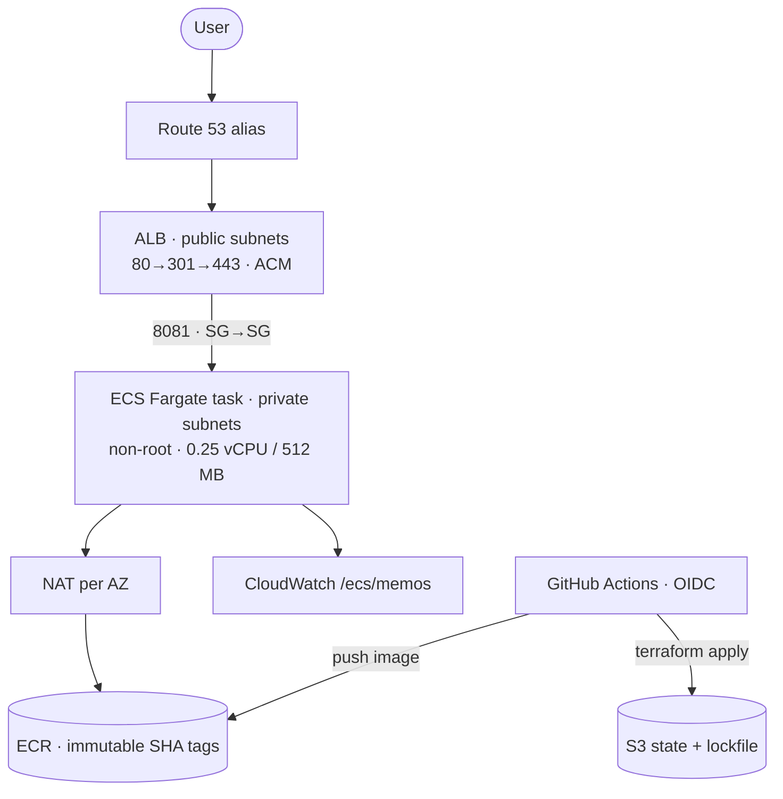
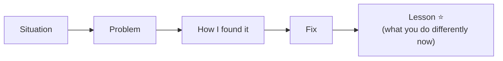
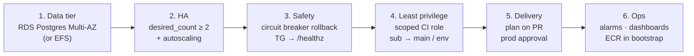

## The pitch

### Your project is now an interview asset
Once you've finished the **Build Lab**, you have a real, working platform to talk about. Interviewers love a project you can explain end to end, because it shows you can do the job, not just define the words.

### The 60-second version
Adapt this template to what you actually built, then say it out loud until it's natural:

> “I deployed the open-source **Memos** app to AWS at **memos.example.com**. It runs on **ECS Fargate in private subnets** across **two AZs**, behind a public **ALB** that redirects HTTP to HTTPS using an **ACM** certificate validated automatically through **Route 53**. The image is a **three-stage Docker build**, 2.79 GB down to 75.8 MB, and runs as a non-root user. Everything is **Terraform**: a bootstrap stack for state and OIDC, then seven modules, with **S3 remote state and native locking**. **GitHub Actions** builds and deploys with **OIDC**, so there are no stored AWS keys. tfsec scans every run, a post-deploy check hits **/healthz**, and I can **roll back** by redeploying any previous commit SHA.”

### The diagram you should be able to draw

> 🔧 **Tip:** practise drawing it on paper in under two minutes. Whiteboard rounds often start with "draw me your project".

### Know your known limits
Say these **before** the interviewer finds them. It shows maturity:
1. SQLite data lives **inside** the container, so it's lost when the task is replaced.
2. **One task**: not truly highly available.
3. The OIDC role is **admin**, and the trust allows any branch.
4. The target group checks `/`, not `/healthz`.
5. No alarms, flow logs or WAF yet (cost trade-offs, documented).

## Telling stories

### The story structure
Use **Situation → Problem → How I found it → Fix → Lesson**. Keep each to about 90 seconds.

The **lesson** is what interviewers remember. It shows you learn.

### Eight problems you'll probably hit
| # | Story | Lesson |
|---|---|---|
| 1 | OIDC wouldn't authenticate | the trust policy `sub` must match exactly |
| 2 | `.gitignore` hid `cmd/memos/main.go` | anchor patterns: `/memos` |
| 3 | Go 1.23 image vs newer `go.mod` | match toolchain versions |
| 4 | Port drift 5230 ↔ 8081 | define the port once |
| 5 | CGO needed C libraries | `CGO_ENABLED=0` → static binary |
| 6 | 2.79 GB image | multi-stage → 75.8 MB |
| 7 | Immutable tags broke re-runs | check ECR first, reuse the image |
| 8 | ACM records already existed | `import` blocks |

People building this project commonly hit these. If **you** hit one while building, that's your story: tell it with the real details. Have two or three ready.

### Example answer: the OIDC story
- **Situation:** the first pipeline run deploying the app with GitHub Actions.
- **Problem:** the AWS login step failed. The role couldn't be assumed.
- **Found it:** I checked the token's claims against the role's trust policy and saw the `sub` didn't match my repo name.
- **Fix:** I corrected the trust policy (`aud = sts.amazonaws.com`, `sub` like `repo:your-username/memos-aws-infra:ref:refs/heads/main`), moved it into the bootstrap stack, and kept everything keyless, with no static keys as a workaround.
- **Lesson:** OIDC failures are almost always the trust policy, so check `sub`/`aud` first.

### Check
? In a project story, which part do interviewers value most?
- [ ] How long it took
- [ ] Which tools you used
- [x] What you learned and now do differently
- [ ] Who caused the problem
> The **lesson** shows judgement and growth, and stops the story being just a list of facts.

## The roadmap: what you'd improve

### Ordered by impact

### How to answer "what would you improve?"
Pick **one**, explain **why first**, and say **how**:
> “First I'd move the data out of the container. Memos supports Postgres, so I'd add RDS in Multi-AZ, pass the DSN from Secrets Manager through the task definition, and allow 5432 only from the ECS security group. That makes the tasks stateless, which unlocks running two or more across both AZs.”

## Handling hard questions

### When you don't know
Don't bluff. Bridge from what you **do** know:
> “I haven't used Datadog hands-on yet, but I understand it's an observability platform for metrics, logs, traces and APM. I've used CloudWatch Logs and metrics for Memos, so the troubleshooting principles carry over, and I'd expect to pick it up quickly.”

### Think out loud
For scenario questions:
1. **Clarify:** "Is this production? Did anything change recently?"
2. **Structure:** "I'd work outside in: DNS, load balancer, targets, the task, then the logs."
3. **Prioritise:** "If users are affected, I'd roll back first."
4. **Close:** "Then I'd add an alarm so we catch it sooner next time."

### Questions to ask them
- "What does the deployment pipeline look like today, and what would you most like to improve?"
- "How do you handle on-call and post-mortems?"
- "What would success look like in my first six months?"
- "Which skills are essential from day one, and which would I be supported to grow?"

### Check
? An interviewer asks about a tool you've never used. What's the best approach?
- [ ] Pretend you've used it
- [ ] Say "I don't know" and stop
- [x] Be honest, explain what you understand it does, and link it to similar tools you have used
- [ ] Change the subject to Memos
> Honesty plus a bridge to related experience shows you can learn, which is what they're really testing.
