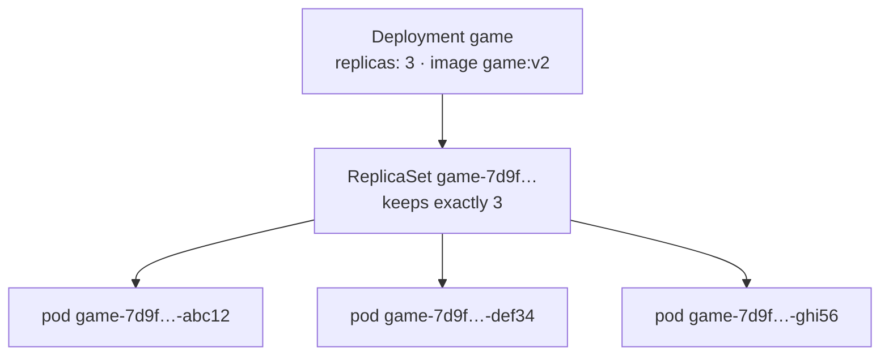
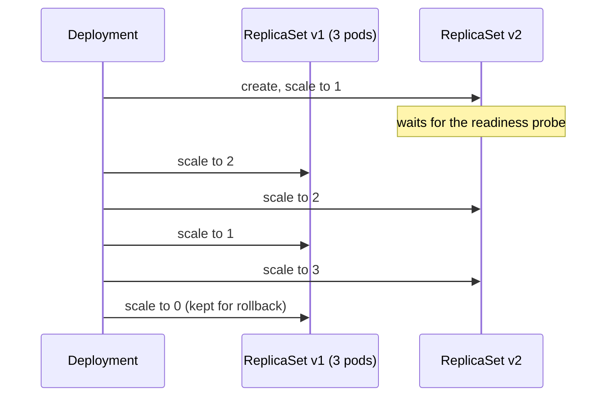
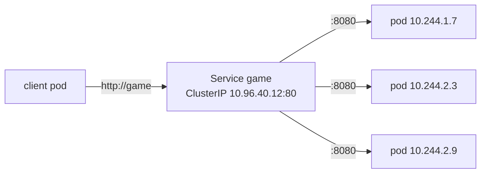
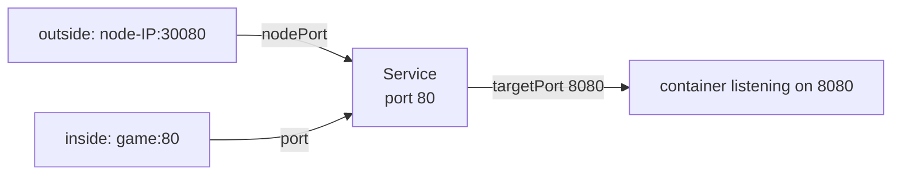
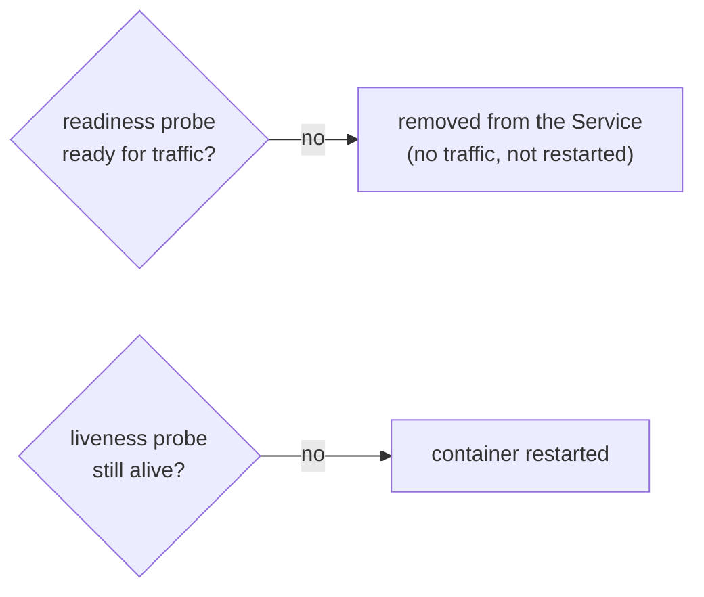
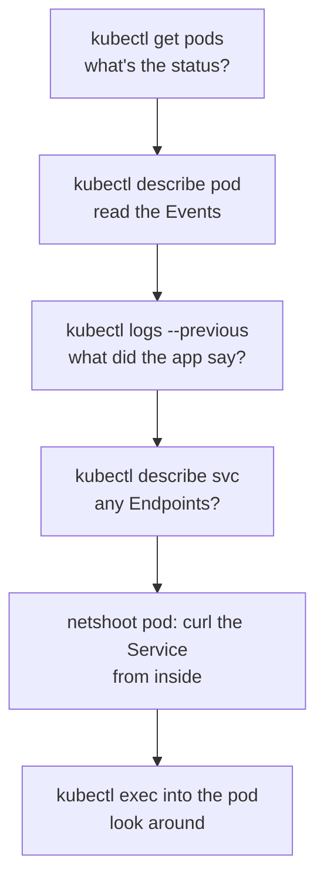

## Deployments and ReplicaSets

### Why not just pods?
A bare pod that crashes **stays dead**. You also want several copies, and a way to change version without taking the site down. That's the **Deployment**'s job.


You talk to the **Deployment**. It manages a **ReplicaSet**, and the ReplicaSet keeps the right number of **pods**. Pod names are deployment + ReplicaSet hash + a random suffix.

### A Deployment manifest
```yaml file=k8s/deployment.yaml
apiVersion: apps/v1           # ⚠️ apps/v1, not v1
kind: Deployment
metadata:
  name: game
  namespace: game
spec:
  replicas: 3                 # how many pods to keep running
  selector:
    matchLabels:
      app: game               # "the pods I own have this label"…
  template:                   # the blueprint for each pod
    metadata:
      labels:
        app: game             # …so this MUST match the selector
    spec:
      containers:
        - name: game
          image: 123456789012.dkr.ecr.eu-west-2.amazonaws.com/game-2048:3f9c2e1
          ports:
            - containerPort: 8080
```
> ⚠️ "selector does not match template labels" means the two `app:` labels differ. The selector is also **immutable**: to change it, delete and recreate the Deployment.

### Self-healing, scaling, updating
```output
$ kubectl delete pod game-7d9f-abc12     # a new one appears within seconds
$ kubectl scale deploy game --replicas=5 -n game
$ kubectl set image deploy/game game=…/game-2048:4a1b2c3 -n game
$ kubectl rollout status deploy/game -n game
$ kubectl rollout history deploy/game -n game
$ kubectl rollout undo deploy/game -n game
```
> ⚠️ `set image` is fine for practice. In real work, change the YAML (or the Helm values) and apply it, so Git stays the truth.

### What a rolling update really does

The old ReplicaSet stays at **0 pods**, which is why `rollout undo` is instant: it just scales the old one back up. `maxSurge` and `maxUnavailable` control how many pods change at a time.

### Check
? You delete one of a Deployment's 3 pods. What happens?
- [ ] It's gone; you now have 2
- [x] A replacement starts within seconds, because the ReplicaSet insists on 3
- [ ] The whole Deployment restarts
- [ ] The node is drained
> That's self-healing. To really remove the pods, delete the **Deployment**.

? Why is `kubectl rollout undo` so fast?
- [ ] It rebuilds the old image
- [x] The old ReplicaSet is kept at 0 replicas, so undo just scales it back up
- [ ] It restores etcd from a backup
- [ ] It skips health checks
> Rolling back is a scale operation, not a rebuild.

## Services: stable addresses

### The problem with pod IPs
Pods come and go, and each new pod gets a **new IP**. A **Service** gives a group of pods (selected by label) **one stable name and IP**, and spreads traffic across them.


The current list of pod IPs behind a Service is its **Endpoints**. kube-proxy writes the rules on every node that make this work.

### Service types
| Type | Reachable from | Use for |
|---|---|---|
| **ClusterIP** (default) | inside the cluster only | pod-to-pod, and anything behind an Ingress |
| **NodePort** | `<any-node-IP>:30000–32767` | local testing, small setups |
| **LoadBalancer** | the internet, via a real cloud load balancer (an NLB/ELB on AWS) | exposing one service directly, or an ingress controller |

> ⚠️ Services work at **layer 4** (IPs and ports). Routing by hostname or path (layer 7) is the **Ingress**'s job.

### The three ports

```yaml file=k8s/service.yaml
apiVersion: v1
kind: Service
metadata:
  name: game
  namespace: game
spec:
  type: ClusterIP
  selector:
    app: game           # = the pods' label
  ports:
    - port: 80          # the Service's port
      targetPort: 8080  # the container's port
```

### Testing a Service
```output
# 1) tunnel it to your laptop (testing only)
$ kubectl port-forward svc/game 8080:80 -n game      # → http://localhost:8080

# 2) from inside the cluster, with a throwaway pod full of network tools
$ kubectl run tmp-shell --rm -it --image=nicolaka/netshoot -- bash
bash-5.2# curl http://game.game
```
> 🧠 Service returns nothing? `kubectl describe svc game -n game` and check **Endpoints**. Empty = the selector matches no pods.

### Check
? A Service has `port: 80` and `targetPort: 8080`. What listens on 8080?
- [ ] The Service
- [x] The container inside the pod
- [ ] Every node
- [ ] The ingress controller
> `port` is what clients call. `targetPort` is where the container actually listens.

? Which Service type is reachable **only inside** the cluster?
- [x] ClusterIP
- [ ] NodePort
- [ ] LoadBalancer
- [ ] ExternalName
> It's the default and the safest: put an Ingress in front for internet traffic.

## Resources and health probes

### Requests and limits
- A **request** is what the scheduler **reserves** for the pod. It places the pod only where that much is free.
- A **limit** is the **most** it may use.

```yaml
resources:
  requests:
    cpu: 50m          # 50 millicores = 0.05 of a CPU core
    memory: 64Mi
  limits:
    memory: 128Mi     # over this → the container is killed (OOMKilled)
```
| Over the limit | Result |
|---|---|
| **memory** | container **killed** (`OOMKilled`, exit 137) |
| **CPU** | only **slowed down** (throttled) |

Many teams set a memory limit but no CPU limit. A pod stuck `Pending` with "Insufficient cpu" means the requests don't fit on any node.

### Readiness vs liveness

```yaml
readinessProbe:
  httpGet: { path: /, port: 8080 }
  initialDelaySeconds: 3
  periodSeconds: 5
livenessProbe:
  httpGet: { path: /, port: 8080 }
  initialDelaySeconds: 10
  periodSeconds: 10
```
Rolling updates **wait for readiness**, so a broken version never receives traffic.

> ⚠️ Pointing liveness at something slow or dependent (like a database) can cause restart loops. Keep it simple.

### Check
? A container keeps showing `OOMKilled`. What happened?
- [ ] It used too much CPU
- [x] It went over its memory limit and was killed
- [ ] Its readiness probe failed
- [ ] The image couldn't be pulled
> Raise the memory limit (and request), or fix the memory growth. CPU over the limit only throttles.

? A pod is still warming up and shouldn't get traffic yet. Which probe handles this?
- [x] Readiness
- [ ] Liveness
- [ ] Startup quota
- [ ] PodDisruptionBudget
> Readiness controls **traffic**. Liveness controls **restarts**.

## Debugging with kubectl

### The toolkit
| Command | Does |
|---|---|
| `kubectl get pods\|deploy\|svc\|all -n ns` | list (`-o wide`, `-o yaml`, `-w` to watch) |
| `kubectl describe <type> <name>` | full details + **Events**: your first stop |
| `kubectl logs <pod> [-f] [--previous]` | what the container printed (and the last crash) |
| `kubectl exec -it <pod> -- sh` | shell inside (`--` ends kubectl's own flags) |
| `kubectl get events -n ns --sort-by=.lastTimestamp` | what's been happening |
| `kubectl explain <field>` | built-in docs |

Short names: `po`, `deploy`, `rs`, `svc`, `cm`, `ns`, `ing`. Many people `alias k=kubectl`.

### Pod statuses decoded
| Status | Usually means | Look at |
|---|---|---|
| `Pending` | no node has room (requests) or it's waiting for storage | `describe pod` → Events |
| `ImagePullBackOff` | wrong image name or tag, or no permission to pull | `describe pod` → Events |
| `CrashLoopBackOff` | starts, crashes, repeat (with growing waits) | `logs --previous` |
| `OOMKilled` | over the memory limit | `describe pod` → Last State |
| `Running` but not `READY` | readiness probe failing | `describe pod` → probe errors |

### A debugging routine


### Check
? A pod is `CrashLoopBackOff`. Which command shows why the **last** run crashed?
- [ ] `kubectl get pods -w`
- [x] `kubectl logs <pod> --previous`
- [ ] `kubectl describe node`
- [ ] `kubectl rollout status`
> The current container may have only just started. `--previous` shows the one that died.

? A pod is stuck in `ImagePullBackOff`. What's the most likely cause?
- [ ] Not enough memory
- [x] A wrong image name or tag, or no permission to pull from the registry
- [ ] A failing liveness probe
- [ ] A NetworkPolicy
> On EKS, the node role needs ECR read access (the EKS module adds it) and the tag must exist.
