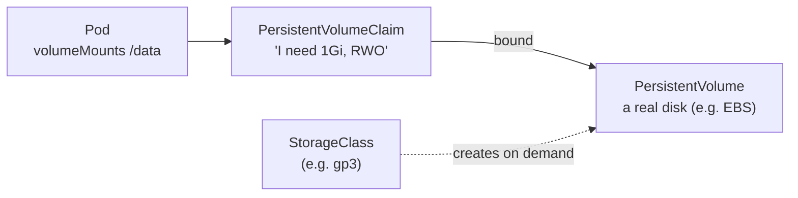
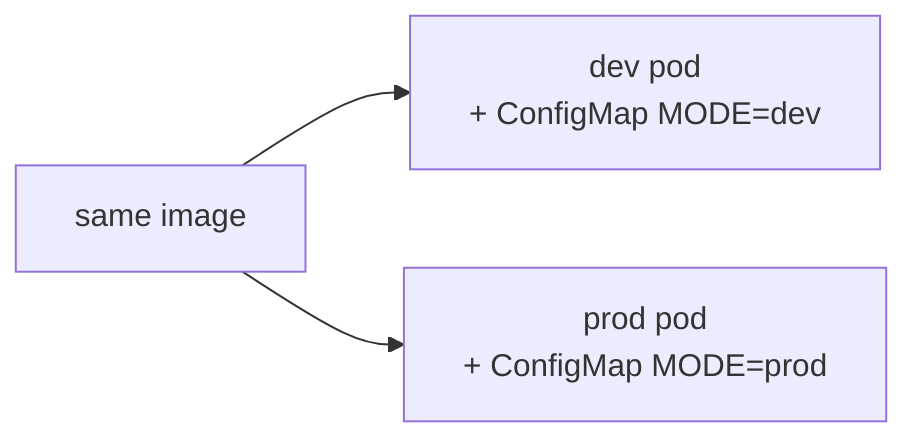
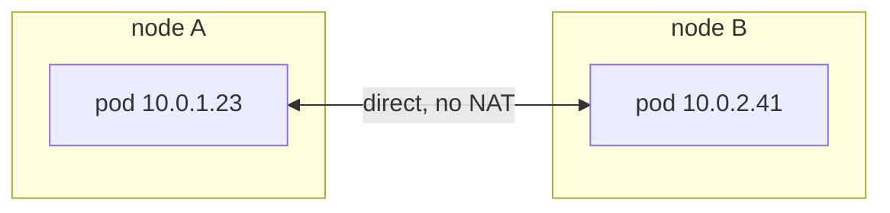
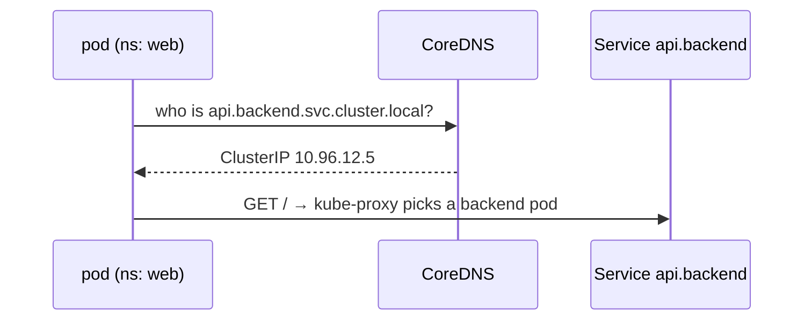
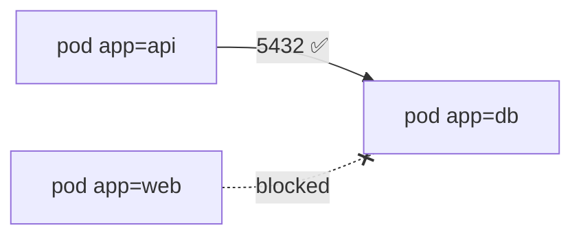
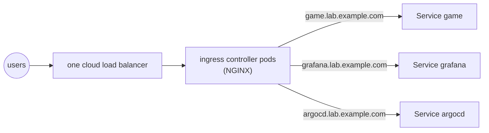

## Persistent storage

### Pods are ephemeral
Anything a container writes to its own file system **vanishes with the pod**. Databases, uploads and queues need storage that outlives pods.

> 🔧 **Same lesson as the ECS example:** Memos keeps SQLite inside the container, so every redeploy loses it. On Kubernetes the fix is a PVC; on ECS it's EFS or RDS.

### PV, PVC and StorageClass

- **PV:** a piece of storage in the cluster (EBS, EFS, NFS…).
- **PVC:** an app's **request** for storage. Kubernetes binds it to a matching PV.
- **StorageClass:** a recipe that creates PVs **automatically** when a PVC asks (dynamic provisioning).

Think of a library: the PV is a locker, the PVC is your request form, and the StorageClass is a locker factory.

### Access modes
| Mode | Meaning | Typical AWS storage |
|---|---|---|
| ReadWriteOnce (RWO) | read-write by **one node** | EBS |
| ReadOnlyMany (ROX) | read-only by many nodes | |
| ReadWriteMany (RWX) | read-write by many nodes | EFS |

> ⚠️ RWO means one **node**, not one pod.

### Using a claim
```yaml
apiVersion: v1
kind: PersistentVolumeClaim
metadata: { name: data, namespace: app }
spec:
  accessModes: [ReadWriteOnce]
  storageClassName: gp3
  resources: { requests: { storage: 1Gi } }
---
# in the pod spec
containers:
  - name: app
    volumeMounts:
      - name: data
        mountPath: /data
volumes:
  - name: data
    persistentVolumeClaim:
      claimName: data
```
On EKS, PVCs need the **EBS CSI driver** add-on (with its IAM role) and a StorageClass. Without them, PVCs stay `Pending`.

### Check
? A PVC is stuck in `Pending`. Which is the most likely cause?
- [ ] The pod's image is wrong
- [x] No PV matches (size, access mode, class) and nothing can create one, e.g. the EBS CSI driver isn't installed on EKS
- [ ] The Service has no Endpoints
- [ ] The namespace is wrong for CoreDNS
> Dynamic provisioning needs a StorageClass **and** a working CSI driver.

## ConfigMaps and Secrets

### ConfigMaps: settings outside the image
A **ConfigMap** holds non-secret config, so **one image works in every environment**.


A pod can use it in three ways:
1. one key as an env var (`configMapKeyRef`)
2. all keys as env vars (`envFrom`)
3. as files in a folder (a volume), where each key becomes a file

> 🧠 Env vars are read **once, at start-up**: restart the pod to see changes. **Mounted files update** when the ConfigMap changes.

### Secrets: base64 is not encryption
A **Secret** is used like a ConfigMap, but kept separate so access can be restricted.

```output
$ kubectl create secret generic db --from-literal=password=s3cret
$ kubectl get secret db -o jsonpath='{.data.password}'
czNjcmV0
$ echo czNjcmV0 | base64 -d
s3cret          ← anyone who can read the Secret can decode it
```
Protect Secrets with:
- **RBAC** (who may read them)
- **etcd encryption at rest** (EKS can use KMS for this)
- **never committing them to Git**
- often an external store: AWS Secrets Manager or Vault (e.g. via the External Secrets Operator)

### Check
? A teammate says "our Secrets are safe, they're encrypted". What's the correction?
- [ ] They're right: Secrets are AES-encrypted by default
- [x] Secret values are only base64-encoded; protect them with RBAC, encryption at rest and an external store, and never commit them
- [ ] Secrets can't be read by anyone
- [ ] Only ConfigMaps are encoded
> `base64 -d` decodes them in one command.

? You changed a ConfigMap, but the app still shows the old value it reads from an **environment variable**. Why?
- [ ] ConfigMaps are cached for 24 hours
- [x] Env vars are only read when the container starts, so restart the pod
- [ ] The ConfigMap is in the wrong namespace
- [ ] ConfigMaps can't be changed
> Mounted files would update, but environment variables don't.

## The pod network and DNS

### The network model
1. Every pod gets **its own IP**.
2. Any pod can reach any other pod **directly**, with no NAT, even on another node.
3. Everything is **open** until you add NetworkPolicies.

A **CNI plugin** builds this network: Calico, Cilium, Flannel, or the **AWS VPC CNI** on EKS (which gives pods real VPC IP addresses).



### CoreDNS: the cluster's phone book
Every Service gets DNS names from **CoreDNS** (it shows up as `kube-dns` in `kube-system`):

| Name | Works from |
|---|---|
| `game` | pods in the **same** namespace |
| `game.game` (`<svc>.<ns>`) | any namespace |
| `game.game.svc.cluster.local` | anywhere (the FQDN) |

Short names work because of the **search list** in each pod's `/etc/resolv.conf`.



### Check
? A pod in namespace `web` wants the Service `api` in namespace `backend`. Which name works?
- [ ] `api`
- [x] `api.backend` (or the full `api.backend.svc.cluster.local`)
- [ ] `backend.api`
- [ ] `api.web`
> The short name `api` would only resolve inside the `backend` namespace.

## NetworkPolicies

### Firewalls for pods
A **NetworkPolicy** picks pods by label and controls traffic **in** (ingress) and/or **out** (egress).

```yaml
apiVersion: networking.k8s.io/v1
kind: NetworkPolicy
metadata: { name: db-allow-api, namespace: shop }
spec:
  podSelector:
    matchLabels: { app: db }          # WHICH pods this protects
  policyTypes: [Ingress]
  ingress:
    - from:
        - podSelector:
            matchLabels: { app: api } # WHO may call them
      ports:
        - { protocol: TCP, port: 5432 }
```


### Two rules to remember
> 🧠 Once **any** policy selects a pod, everything **not explicitly allowed** is denied (for that direction).

> ⚠️ Policies only work if the CNI **enforces** them (Calico, Cilium, or the AWS VPC CNI with network policy enabled). Otherwise they're **silently ignored**: no error, and no protection.

> 🔧 It's the Kubernetes version of "the ECS task accepts 8081 only from the ALB's security group".

### Check
? You apply a NetworkPolicy and nothing gets blocked. What's the likely reason?
- [ ] Policies take 24 hours to apply
- [x] The CNI plugin doesn't enforce NetworkPolicies, so they're silently ignored
- [ ] You need a LoadBalancer Service
- [ ] NetworkPolicies only work on ports below 1024
> Check that your CNI supports and has policy enforcement turned on.

## Ingress and ingress controllers

### One door, many apps
A `LoadBalancer` Service per app means one paid cloud load balancer per app, and none of them can route by hostname or path. An **Ingress** is a set of **layer-7 rules** (host/path → Service) served through **one** entry point.



### Rules vs the controller
- The **Ingress resource** is just the list of delivery rules.
- The **ingress controller** is the program (pods) that reads the rules and routes the traffic.
- **No controller = the Ingress does nothing.**

```yaml file=k8s/ingress.yaml
apiVersion: networking.k8s.io/v1
kind: Ingress
metadata:
  name: game
  namespace: game
spec:
  ingressClassName: nginx        # which controller follows these rules
  rules:
    - host: game.lab.example.com
      http:
        paths:
          - path: /
            pathType: Prefix
            backend:
              service:
                name: game
                port:
                  number: 80
```

### Which NGINX controller?
Two different products share almost the same name:

| | Community `ingress-nginx` | F5 NGINX Ingress Controller |
|---|---|---|
| Made by | Kubernetes community | F5 / NGINX |
| Status | **retired** (best-effort maintenance ended in March 2026) | maintained, open source |
| Annotations | `nginx.ingress.kubernetes.io/…` | `nginx.org/…` (different!) |

The Kubernetes project also recommends the **Gateway API**, Ingress's more expressive successor, for new work.

> ⚠️ Annotations copied from old ingress-nginx tutorials do **nothing** on F5's controller.

### Check
? You create an Ingress and nothing happens. Why?
- [ ] Ingresses take an hour to propagate
- [x] No ingress controller is installed, or `ingressClassName` names one that doesn't exist
- [ ] The Service must be type LoadBalancer
- [ ] Ingress only supports HTTP/1.0
> An Ingress is only rules. Something has to follow them.

? Why put many apps behind one Ingress instead of one LoadBalancer Service each?
- [ ] Ingress is more secure by default
- [x] One load balancer serves them all (cheaper), and it can route by hostname and path (layer 7)
- [ ] LoadBalancer Services don't work on AWS
- [ ] Ingress removes the need for Services
> Ingress still sends traffic to **Services**. It just shares one front door.
