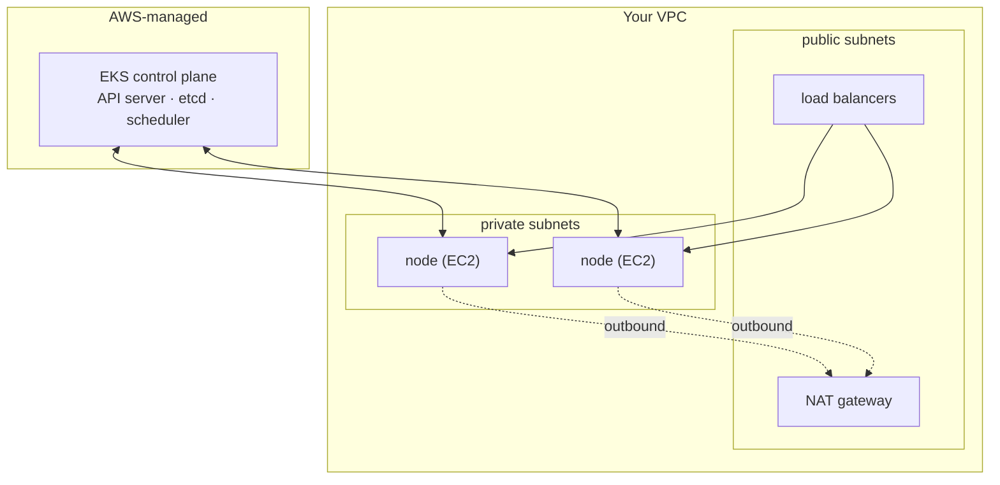
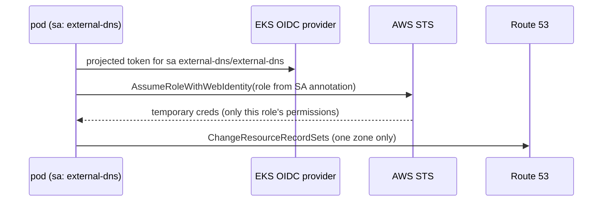
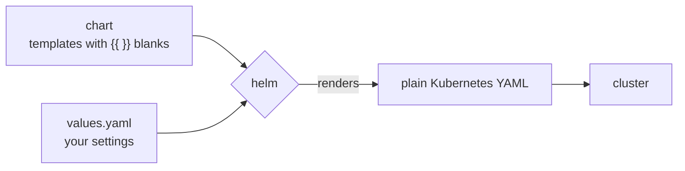
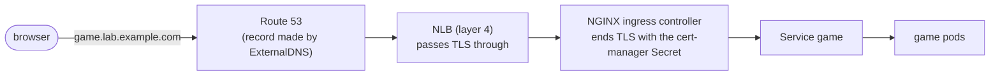
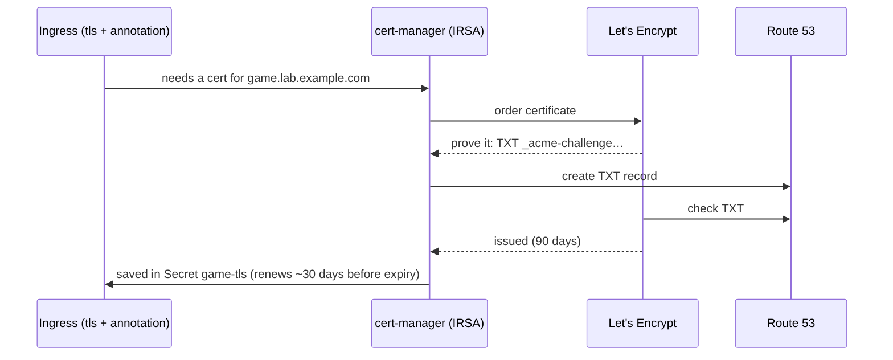
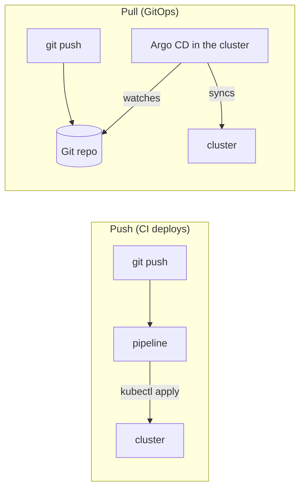
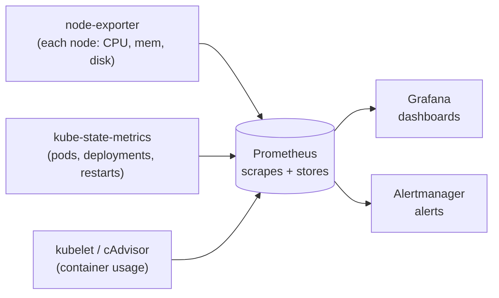
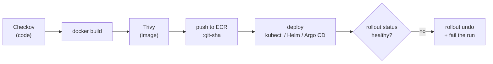
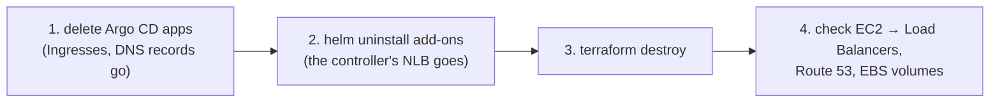

## EKS with Terraform

### What EKS gives you
**Amazon EKS** is managed Kubernetes. AWS runs the **control plane** (API server, etcd, scheduler) across three AZs. You run **worker nodes**, usually in a **managed node group** (EC2 instances EKS creates and updates for you).



> ⚠️ **EKS isn't free.** The control plane alone is about $0.10/hour (~$73/month). Nodes, a NAT gateway and a load balancer come on top. Set a **budget alert** and `terraform destroy` after each practice session.

### VPC and EKS as modules
Community modules build dozens of resources per block. Wrapping them in **your own** module (your inputs, sensible defaults) still counts as a reusable module.

```hcl file=terraform/modules/vpc/main.tf
module "vpc" {
  source  = "terraform-aws-modules/vpc/aws"
  version = "~> 6.0"

  name            = var.name
  cidr            = var.cidr                      # e.g. 10.0.0.0/16
  azs             = var.azs                       # 3 AZs
  private_subnets = var.private_subnets           # worker nodes
  public_subnets  = var.public_subnets            # load balancers

  enable_nat_gateway = true
  single_nat_gateway = var.single_nat_gateway     # true = cheap, lab only

  public_subnet_tags  = { "kubernetes.io/role/elb" = 1 }           # public LBs land here
  private_subnet_tags = { "kubernetes.io/role/internal-elb" = 1 }
}
```

### The cluster
```hcl file=terraform/modules/eks/main.tf
module "eks" {
  source  = "terraform-aws-modules/eks/aws"
  version = "~> 21.0"

  name               = var.name
  kubernetes_version = var.kubernetes_version   # pick a version in standard support
  vpc_id             = var.vpc_id
  subnet_ids         = var.private_subnet_ids   # nodes in private subnets

  endpoint_public_access                   = true   # lab only: lock down in production
  enable_cluster_creator_admin_permissions = true   # whoever applies gets admin
  enable_irsa                              = true   # pods can get their own IAM roles

  eks_managed_node_groups = {
    default = {
      instance_types = ["t3.large"]
      min_size       = 1
      max_size       = 3
      desired_size   = 2
    }
  }
}
```
> ⚠️ Module major versions rename inputs (v21 uses `name` and `kubernetes_version`, not `cluster_name`/`cluster_version`). Always read the module's upgrade notes.

### Getting kubectl in: access entries
```output
$ aws eks update-kubeconfig --region eu-west-2 --name eks-lab
$ kubectl get nodes
error: You must be logged in to the server (Unauthorized)
```
Being able to call **AWS** doesn't mean **Kubernetes** lets you in. Every IAM identity needs an **access entry** with an access policy:

```hcl
access_entries = {
  github_actions = {
    principal_arn = var.github_actions_role_arn
    policy_associations = {
      admin = {
        policy_arn   = "arn:aws:eks::aws:cluster-access-policy/AmazonEKSClusterAdminPolicy"
        access_scope = { type = "cluster" }
      }
    }
  }
}
```
> 🔧 Admin is fine for a lab. In production, use something narrower, like `AmazonEKSEditPolicy` scoped to one namespace.

### IRSA: AWS permissions for one app's pods
Without it, every pod on a node shares the **node's** IAM role. **IRSA** (IAM Roles for Service Accounts) ties an IAM role to **one Kubernetes service account**:


The service account carries the annotation `eks.amazonaws.com/role-arn: <role ARN>`. The role's trust policy only accepts `system:serviceaccount:<namespace>:<sa-name>`, so **the wrong namespace means no AWS access**. **EKS Pod Identity** is a newer, simpler alternative.

> 🔧 It's the same idea as the ECS **task role**, and the same OIDC trust pattern as GitHub Actions.

### Check
? `aws sts get-caller-identity` works, but `kubectl get nodes` says "You must be logged in to the server". What's missing?
- [ ] The kubeconfig file
- [x] An EKS access entry (with an access policy) for your IAM identity
- [ ] A NAT gateway
- [ ] The node group's IAM role
> AWS authentication ≠ Kubernetes authorisation. Add an access entry, or set `enable_cluster_creator_admin_permissions`.

? What does IRSA give you over putting permissions on the node role?
- [ ] Faster pods
- [x] Each app's pods get only their own role's permissions, instead of every pod on the node sharing them
- [ ] Free IAM
- [ ] It replaces RBAC
> Least privilege per workload, scoped to a namespace and service account.

## Helm: the package manager

### Charts, values and releases
Real add-ons are dozens of Kubernetes objects. **Helm** installs them as one **chart**, customised by a **values file**. Each installed copy is a **release**.



### The commands you'll use
| Command | Does |
|---|---|
| `helm repo add <name> <url>` / `helm repo update` | add / refresh a chart repository |
| `helm show values <repo>/<chart>` | see every setting |
| `helm upgrade --install <rel> <chart> -n <ns> --create-namespace -f values.yaml` | install **or** upgrade (what pipelines use) |
| `helm list -A` / `helm history <rel>` | what's installed / its revisions |
| `helm rollback <rel> <rev>` | go back a revision |
| `helm template` / `helm lint` | render YAML / check a chart **without** installing |

### Your own chart
```output
$ helm create game-2048
game-2048/
├── Chart.yaml        # name and version
├── values.yaml       # default values for the blanks
└── templates/
    ├── deployment.yaml
    ├── service.yaml
    └── ingress.yaml
```
```yaml file=game-2048/templates/deployment.yaml
spec:
  replicas: {{ .Values.replicaCount }}
  template:
    spec:
      containers:
        - name: game
          image: "{{ .Values.image.repository }}:{{ .Values.image.tag }}"
```
The pipeline then runs `helm upgrade --install game ./game-2048 --set image.tag=$GITHUB_SHA`.

### Installing charts from Terraform
```hcl
resource "helm_release" "cert_manager" {
  name             = "cert-manager"
  repository       = "https://charts.jetstack.io"
  chart            = "cert-manager"
  namespace        = "cert-manager"
  create_namespace = true
  # version = "…"   ← pin the chart version you tested
  set = [{ name = "crds.enabled", value = "true" }]   # Helm provider v3 list syntax
}
```
> ⚠️ The Helm and Kubernetes providers need a cluster that **already exists**. Many teams put add-ons in a **second Terraform stack** applied after the cluster.

### Check
? Which Helm command installs a chart if it's missing and upgrades it if it's there?
- [ ] `helm install --force`
- [x] `helm upgrade --install`
- [ ] `helm apply`
- [ ] `helm sync`
> That's why pipelines use it: the same command works on the first run and every run after.

## Automatic HTTPS and DNS

### The full request path


### Delegating a subdomain
You can keep the domain at its registrar and hand **one subdomain** to Route 53:
1. Route 53 → create a public hosted zone `lab.example.com` (AWS gives it 4 NS records).
2. At the registrar, add those 4 **NS** records for `lab`.
3. Check: `dig NS lab.example.com +short` shows the AWS name servers.

ExternalDNS and cert-manager are then only allowed to edit **that zone**.

### cert-manager: free, self-renewing certificates
cert-manager asks **Let's Encrypt** for certificates and proves you own the domain with a **DNS-01 challenge**: a TXT record in Route 53.


```yaml
apiVersion: cert-manager.io/v1
kind: ClusterIssuer
metadata: { name: letsencrypt }
spec:
  acme:
    server: https://acme-staging-v02.api.letsencrypt.org/directory   # staging first!
    email: you@example.com
    privateKeySecretRef: { name: letsencrypt }
    solvers:
      - dns01:
          route53: { region: eu-west-2 }
        selector:
          dnsZones: [lab.example.com]
```
> ⚠️ Test with Let's Encrypt **staging** (production has strict rate limits), then switch the server URL.

### ExternalDNS: records from Ingresses
**ExternalDNS** watches Ingresses (and Services) and creates the matching Route 53 records, plus TXT "ownership" records so it only ever changes records **it** made.

```yaml file=helm-values/external-dns.yaml
provider:
  name: aws
domainFilters: [lab.example.com]   # only ever touch this zone
policy: sync                       # also delete records for removed Ingresses
txtOwnerId: eks-lab
serviceAccount:
  annotations:
    eks.amazonaws.com/role-arn: arn:aws:iam::123456789012:role/external-dns
```
An Ingress then only needs `cert-manager.io/cluster-issuer: letsencrypt` and a `tls:` block. The certificate **and** the DNS record appear automatically.

### Check
? How does cert-manager prove you own the domain in this setup?
- [ ] By emailing the domain owner
- [x] A DNS-01 challenge: it creates a `_acme-challenge` TXT record in Route 53, which Let's Encrypt checks
- [ ] By uploading a file to S3
- [ ] Route 53 trusts EKS automatically
> It writes to Route 53 using its own IRSA role, limited to one hosted zone.

? The ingress controller sits behind an NLB. Where does TLS end?
- [ ] At the NLB
- [x] At the ingress controller, using the certificate cert-manager stored in a Secret
- [ ] Inside each game pod
- [ ] At Route 53
> The NLB works at layer 4 and passes encrypted traffic straight through. The controller does the layer-7 work.

## GitOps with Argo CD

### Push vs pull deployment

With **GitOps**, Git is the single source of truth, and a tool **inside the cluster** keeps it matching Git. The pipeline no longer needs cluster credentials, which is safer.

### An Application
```yaml
apiVersion: argoproj.io/v1alpha1
kind: Application
metadata:
  name: game
  namespace: argocd              # must be Argo CD's own namespace
spec:
  project: default
  source:
    repoURL: https://github.com/your-username/eks-assignment
    targetRevision: main
    path: k8s                    # or a Helm chart folder
  destination:
    server: https://kubernetes.default.svc
    namespace: game
  syncPolicy:
    automated:
      prune: true                # delete what was removed from Git
      selfHeal: true             # undo manual changes
    syncOptions: [CreateNamespace=true]
```
- **Sync** = apply Git's changes. **Prune** = delete what was removed from Git. **Self-heal** = undo manual edits.
- First admin password: `kubectl -n argocd get secret argocd-initial-admin-secret -o jsonpath="{.data.password}" | base64 -d`
- Private repo errors ("authentication required")? Add the repo's credentials in Argo CD.

### Check
? What do `prune` and `selfHeal` do in Argo CD?
- [ ] Shrink images and restart pods
- [x] Prune deletes resources removed from Git; selfHeal reverts changes made directly in the cluster
- [ ] They schedule backups
- [ ] They're only for Helm charts
> Together they keep the cluster exactly matching the repo.

## Monitoring with Prometheus and Grafana

### How it fits together

- **Prometheus** pulls (**scrapes**) metrics from **exporters** and stores them over time.
- **Grafana** draws dashboards from them.
- **Alertmanager** sends alerts when a rule fires.

The **kube-prometheus-stack** Helm chart installs all of it, with ready-made dashboards.

### Getting in
```output
$ kubectl get pods -n monitoring
$ kubectl get secret -n monitoring monitoring-grafana -o jsonpath="{.data.admin-password}" | base64 -d
$ kubectl port-forward -n monitoring svc/monitoring-grafana 3000:80    # http://localhost:3000
```
Built-in dashboards include **Kubernetes / Compute Resources / Cluster** (CPU and memory by namespace) and **Node Exporter / Nodes**.

### PromQL for your own panels
| Panel | Query |
|---|---|
| Running pods per namespace | `sum by (namespace) (kube_pod_status_phase{phase="Running"})` |
| Number of nodes | `count(kube_node_info)` |
| CPU by namespace | `sum by (namespace) (rate(container_cpu_usage_seconds_total{container!=""}[5m]))` |
| Memory by namespace | `sum by (namespace) (container_memory_working_set_bytes{container!=""})` |

> ⚠️ Without the EBS CSI driver and a StorageClass, Prometheus keeps data inside the pod (lost on restart). The stack is also heavy: on small nodes pods sit `Pending` with "Insufficient memory".

### Check
? Which component **draws the dashboards**?
- [ ] Prometheus
- [x] Grafana
- [ ] Alertmanager
- [ ] kube-state-metrics
> Prometheus collects and stores, Grafana visualises, Alertmanager notifies.

## Secure pipelines for Kubernetes

### Checkov vs Trivy
| | Checkov | Trivy |
|---|---|---|
| Scans | **code and config**: Terraform, Kubernetes YAML, Dockerfiles | the **built image** (and file systems) |
| Finds | insecure designs: root containers, no limits, no probes, `latest` tags, unencrypted buckets | known vulnerabilities (CVEs) in packages |
| When | before building | after building, **before pushing** |

### The secure delivery order

A vulnerable image **never reaches the registry**, and a broken release rolls itself back.

### Hardening a container
Checkov commonly flags missing **requests/limits**, missing **probes**, running as **root**, the **`latest`** tag and no **securityContext**:
```yaml
securityContext:
  runAsNonRoot: true
  allowPrivilegeEscalation: false
  readOnlyRootFilesystem: true      # mount an emptyDir at /tmp if the app needs to write
  capabilities:
    drop: ["ALL"]
```
To accept a finding deliberately: `# checkov:skip=CKV_K8S_xx: reason`. Always write the reason.

### Clean-up: inside out
Kubernetes itself creates some AWS resources (the **NLB**, **DNS records**, **EBS volumes**). Terraform doesn't know about them, so destroying the cluster first leaves **orphans** that keep billing and can block the VPC from being deleted.



### Check
? You ran `terraform destroy` first and it hung deleting the VPC. Why?
- [ ] Terraform can't delete VPCs
- [x] Kubernetes created resources Terraform doesn't track (e.g. the ingress controller's NLB), which still use the VPC
- [ ] The state file was locked
- [ ] The NAT gateway was in use by Grafana
> Clean up from the inside out: apps → Helm releases → Terraform → check the console.

? Why scan with Trivy **before** pushing to ECR?
- [ ] Trivy can't scan images in ECR
- [x] So a vulnerable image never reaches the registry or the cluster
- [ ] It's faster
- [ ] ECR requires it
> Fail early and cheaply. Scan-on-push in ECR is a second layer, not a replacement.
