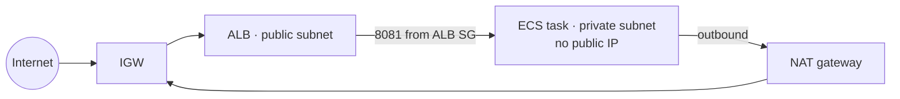

? Name two AWS services where you can store secrets.
- [ ] S3 and EBS
- [x] Secrets Manager and SSM Parameter Store
- [ ] IAM and CloudTrail
- [ ] ECR and ECS
> Secrets Manager adds automatic rotation (paid). Parameter Store SecureString is free on the standard tier.

? How do Regions and Availability Zones relate?
- [ ] An AZ contains several Regions
- [x] A Region is a geographic area containing 3+ isolated AZs (separate data centres) linked by fast private networking
- [ ] They're the same thing
- [ ] AZs are only for backups
> Spread across **2+ AZs** for high availability. Memos uses eu-west-1a and 1b.

? What is auto scaling?
- [ ] Manually resizing servers
- [x] Automatically adding capacity when load rises and removing it when load falls, while replacing unhealthy instances
- [ ] Moving apps between Regions
- [ ] Making disks bigger
> Policies: target tracking, step, scheduled and predictive.

? Which services help protect against a **DDoS** attack?
- [ ] IAM and Organizations
- [x] AWS Shield, WAF, CloudFront and Route 53 (plus ALB and auto scaling to absorb load)
- [ ] S3 and Glacier
- [ ] CloudTrail only
> Shield Standard is free and automatic. Shield Advanced adds DDoS response support and cost protection.

? What is an AMI?
- [ ] An IAM policy type
- [x] An Amazon Machine Image: the template (OS and software) an EC2 instance launches from
- [ ] A monitoring agent
- [ ] A load balancer type
> Golden AMIs can be built with **Packer**.

? Which network object lets a server in a VPC **receive** traffic from the internet?
- [ ] NAT gateway
- [x] Internet gateway (with a public IP and a route to it)
- [ ] VPC endpoint
- [ ] Transit Gateway
> NAT is **outbound-only**. Inbound needs an IGW route, a public IP (or a public load balancer) and security group rules.

? In a VPC with public and private subnets, where should database servers go?
- [ ] Public subnets, for easy access
- [x] Private subnets, reachable only from the app tier's security group
- [ ] Any subnet, as long as the password is strong
- [ ] In the default VPC
> Databases should never be directly reachable from the internet.

? Which is an EC2 security best practice?
- [ ] Open port 22 to 0.0.0.0/0 for convenience
- [x] Use least-privilege IAM roles, tight security groups, SSM Session Manager instead of open SSH, and keep the OS patched
- [ ] Share one key pair with the whole team
- [ ] Put access keys in user data
> Instance **roles** give temporary credentials, so you never need keys on the box.

@ level: Intermediate
? Traffic peaks every Wednesday and Friday, 9 AM to 7 PM. What's the best scaling approach?
- [ ] Scale on 100% CPU
- [x] Scheduled scaling to add capacity before 9 AM on those days, with target tracking for anything unexpected
- [ ] Buy the biggest instance permanently
- [ ] Disable auto scaling
> Predictable patterns → schedule them, and react to the rest.

@ level: Intermediate
? You want to reduce load on an EC2 instance **as soon as** CPU hits 100%. What's the better answer?
- [ ] Add a CloudWatch alarm at 100% that adds instances
- [x] Scale at a lower target (60–70%) so new capacity is ready before you hit 100%
- [ ] Reboot the instance at 100%
- [ ] Switch to a smaller instance
> By the time CPU is at 100%, users are already suffering, and new instances take minutes to arrive.

? Name managed Lambda runtimes.
- [x] Node.js, Python, Java, .NET and Ruby (Go and Rust run on the OS-only `provided.al2023` runtime)
- [ ] Only Python
- [ ] PHP and Perl only
- [ ] Lambda only runs containers
> You can also package Lambda as a container image.

@ source: Revision notes
? What makes a subnet **public**?
- [ ] A checkbox in the console
- [x] Its route table sends 0.0.0.0/0 to an internet gateway
- [ ] Having more than 256 IPs
- [ ] Being in AZ a
> Private subnets route 0.0.0.0/0 to a NAT gateway, or have no default route at all.

@ source: Revision notes · level: Intermediate
? Look at the diagram. What will happen to traffic from the internet trying to reach the ECS task directly?

- [ ] It reaches the task through the NAT gateway
- [x] It can't: the task has no public IP, and NAT only allows outbound-started connections
- [ ] It reaches the task on port 8081
- [ ] It's redirected to HTTPS
> The only way in is through the ALB, and the ECS security group only accepts 8081 from the ALB's security group.

@ source: Revision notes
? What do **RPO** and **RTO** mean?
- [ ] Region Placement Option / Route Table Owner
- [x] RPO = the most data you can afford to lose (in time); RTO = the most downtime you can afford
- [ ] Both are measured in GB
- [ ] RPO is for networks, RTO for storage
> Lower RPO/RTO usually costs more: backup & restore → pilot light → warm standby → active/active.

@ source: Revision notes
? Under the shared responsibility model, who patches the OS of an EC2 instance, and of a Fargate task's host?
- [ ] AWS for both
- [ ] You for both
- [x] You patch EC2; AWS patches Fargate's hosts
- [ ] Nobody, because patching is automatic
> The more managed the service, the more AWS takes on. You still own your container image's contents.

@ source: Revision notes
? Which is the AWS **audit log** of API calls: who did what, and when?
- [ ] CloudWatch Metrics
- [x] CloudTrail
- [ ] AWS Config
- [ ] X-Ray
> Config records **resource configuration history**. CloudTrail records **API calls**.

@ source: Revision notes · level: Intermediate
? S3 durability vs availability?
- [ ] They're the same
- [x] Durability = how unlikely data is to be lost (eleven nines); availability = how often you can reach it (99.99% for Standard)
- [ ] Durability is about speed
- [ ] Availability is about encryption
> Data is almost never lost, but there can still be brief moments when you can't reach it.

? What is a VPC?
- [ ] A virtual private computer
- [x] Your own isolated network in AWS where you choose the IP range, subnets, routing and firewalls
- [ ] A VPN to your office
- [ ] A type of EC2 instance
> Every Region also has a "default VPC" for convenience, but real workloads should use their own.

@ level: Intermediate
? Describe a three-tier architecture on AWS.
- [ ] Three EC2 instances in one public subnet
- [x] Web tier (ALB in public subnets) → app tier (EC2/ECS in private subnets, allowed only from the ALB) → data tier (RDS Multi-AZ in isolated subnets, allowed only from the app tier)
- [ ] Three Regions with one server each
- [ ] Lambda, S3 and CloudFront only
> Memos has the first two tiers. Its data tier is missing because SQLite lives inside the task.

@ source: Revision notes
? Which load balancer types does AWS offer?
- [ ] Only ALB
- [x] ALB (L7 HTTP), NLB (L4 TCP/UDP, static IPs), Gateway LB (L3 appliances) and the legacy Classic
- [ ] ALB and CloudFront
- [ ] Route 53 and NLB
> Memos uses an ALB.
