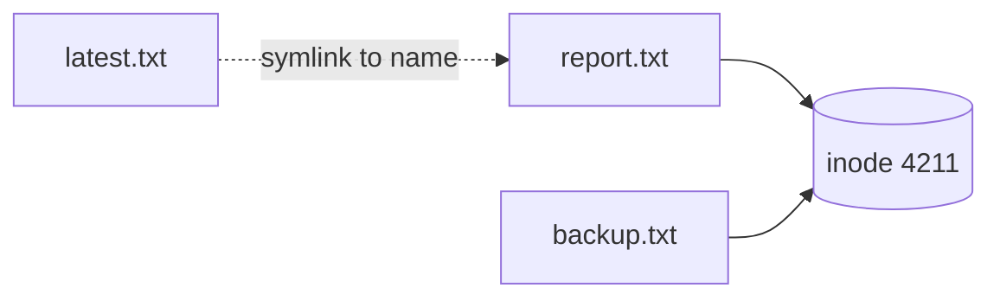

? What is the main difference between Linux and UNIX?
- [ ] Linux has no command line
- [x] Linux is a free, open-source, UNIX-like system developed by a community; most UNIX versions are commercial and tied to vendor hardware
- [ ] UNIX is newer than Linux
- [ ] Linux can only run on servers
> Linux (1991, Linus Torvalds) works like UNIX but is free and runs on almost anything. UNIX (Bell Labs, late 1960s) mostly lives on as commercial systems such as AIX and Solaris.

? What is the Linux **kernel**?
- [ ] The desktop environment
- [ ] The package manager
- [x] The core of the OS that manages CPU, memory, devices and processes, sitting between programs and hardware
- [ ] The first user that logs in
> Programs ask the kernel for resources through **system calls**. Everything else (shell, tools, desktop) runs on top.

? Which information is **not** stored in a file's inode?
- [ ] Permissions
- [ ] Owner
- [x] The file name
- [ ] Location of the data blocks
> Names live in **directory entries** that point to inode numbers. That's how one inode can have several hard-link names.

@ level: Intermediate
? What is a **zombie** process?
- [ ] A process using 100% CPU
- [x] A finished process whose parent hasn't yet collected its exit status
- [ ] A process running as root
- [ ] A process with no terminal
> It holds only a process-table entry (a PID). Fix or restart the **parent**. You can't kill a zombie because it's already dead.

? Look at the diagram. Which file still works if `report.txt` is deleted?

- [x] `backup.txt` (a hard link to the same inode)
- [ ] `latest.txt` (the symlink)
- [ ] Both
- [ ] Neither
> The data survives while **any hard link** points to the inode. The symlink points to the *name* `report.txt`, so it breaks.

@ level: Intermediate
? In Linux, what do **namespaces** and **cgroups** provide?
- [ ] Encryption and compression
- [x] Namespaces isolate what a process can see; cgroups limit how much CPU and memory it can use
- [ ] User accounts and passwords
- [ ] Networking and DNS
> These two kernel features are what make a container: an isolated view plus resource limits.

? What does `chmod +x deploy.sh` do?
- [ ] Deletes the file
- [ ] Makes it readable by everyone
- [x] Adds execute permission so it can be run as a program
- [ ] Changes the owner to root
> After this you can run it with `./deploy.sh`.

? What does `chmod 755 script.sh` set?
- [x] rwx for the owner; r-x for group and others
- [ ] rwx for everyone
- [ ] rw- for the owner; r-- for everyone else
- [ ] Owner only, nothing for anyone else
> 7 = rwx, 5 = r-x. It's the standard setting for scripts and directories.

? What do `chown` and `chgrp` change?
- [ ] Permissions and passwords
- [x] The owning user, and the owning group
- [ ] The file's name and folder
- [ ] File size limits
> `chown user:group file` changes both at once. `chmod` changes permissions.

? Which command shows used and free **memory** in human-readable units?
- [ ] `df -h`
- [x] `free -h`
- [ ] `du -sh`
- [ ] `top -m`
> `df` is disk. `free` is memory. Note that Linux uses spare RAM for cache, so look at the **available** column.

? What is **swap** space?
- [ ] Extra CPU cores
- [x] Disk space the kernel uses as overflow when RAM is full
- [ ] A backup of /etc
- [ ] A network share
> Swap prevents out-of-memory crashes, but it's much slower than RAM. Heavy swapping means you need more memory.

? How should you stop a misbehaving process **first**?
- [ ] `kill -9 PID`
- [x] `kill PID` (SIGTERM), and only use `-9` if it won't stop
- [ ] Reboot the server
- [ ] Delete its binary
> SIGTERM lets the program clean up. SIGKILL (-9) can't be caught and may leave corrupt or half-written files.

? Which command shows listening TCP ports and the processes that own them?
- [ ] `ping -a`
- [x] `ss -tlnp`
- [ ] `ls /ports`
- [ ] `ps -ports`
> `ss` replaced `netstat`. `-tlnp` means TCP, listening, numeric, with the process.

? You need the PID of the running `nginx` process. Which command is quickest?
- [ ] `whoami nginx`
- [x] `pgrep nginx`
- [ ] `kill -0 nginx`
- [ ] `ls /proc/nginx`
> `pgrep` searches by name. `ps aux | grep nginx` also works.

? What does this crontab line do?
```output
*/15 * * * * /usr/local/bin/backup.sh
```
- [ ] Runs at 15:00 every day
- [x] Runs every 15 minutes
- [ ] Runs on the 15th of every month
- [ ] Runs 15 times then stops
> `*/15` in the **minute** field means every 15 minutes. The other fields `* * * *` mean every hour, day, month and weekday.

@ level: Intermediate
? What is inside `/proc`?
- [ ] Installed programs
- [x] A virtual file system the kernel creates, with live information about processes and the system
- [ ] User passwords
- [ ] Log files
> e.g. `/proc/cpuinfo`, `/proc/meminfo` and `/proc/<PID>/` for each process. Nothing there is stored on disk.

@ level: Intermediate
? What are **system calls** (syscalls)?
- [ ] Phone calls to the help desk
- [x] The interface programs use to ask the kernel to do privileged work, such as open a file or create a process
- [ ] Commands typed in the shell
- [ ] Cron jobs
> `open()`, `read()`, `fork()` and `execve()` are syscalls. `strace` shows a program's syscalls live.

? Which command copies a file to another server over SSH?
- [ ] `cp file user@host:/tmp/`
- [x] `scp file user@host:/tmp/`
- [ ] `mv file host`
- [ ] `ssh-copy file host`
> `scp` (or the more efficient `rsync -avz`, which also handles directories and resumes).

@ level: Intermediate
? Someone ran `chmod 644 /bin/chmod`. Now `chmod` can't run. How can you fix it?
- [ ] Reboot
- [x] Run it through the dynamic loader or another tool, e.g. `/lib64/ld-linux-x86-64.so.2 /bin/chmod +x /bin/chmod` (or use `install`, `setfacl`, or Python's `os.chmod`)
- [ ] Delete `/bin/chmod`
- [ ] `sudo chmod +x /bin/chmod`
> The binary lost its execute bit, so you need **another program** that can set permissions, such as the dynamic loader running chmod directly. `sudo` doesn't help because chmod itself can't run.

? A colleague says "ping fails, so the server is down". Why might that be wrong?
- [ ] Ping always works
- [x] Ping (ICMP) is often blocked by firewalls or security groups even when the service works, so test the real port with `nc` or `curl`
- [ ] Ping only works on Windows
- [ ] Ping uses port 80
> A good habit from the guide: test the actual service (`nc -zv host 443`, `curl -v`), not just ICMP.

? Which command finds all `.yaml` files under the current folder and shows their permissions?
- [ ] `ls *.yaml -R`
- [x] `find . -type f -name "*.yaml" -exec ls -l {} \;`
- [ ] `grep -r yaml .`
- [ ] `cat *.yaml`
> `find` walks the tree. `-exec … {} \;` runs `ls -l` on each match.

@ source: Revision notes
? What exit code means "command not found"?
- [ ] 0
- [ ] 1
- [x] 127
- [ ] 137
> 0 = success · 1 = general error · **127 = not found** · 137 = killed (SIGKILL, often OOM) · 143 = SIGTERM.
